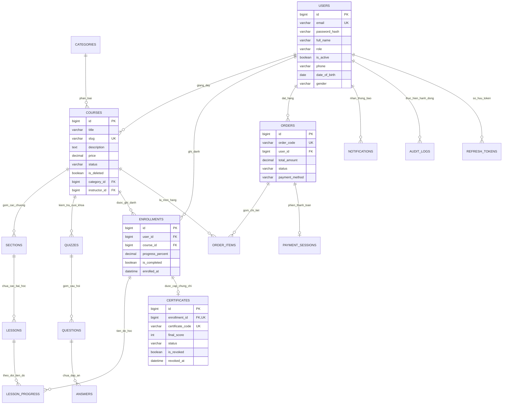

# DANH MỤC VÀ KIỂM KÊ TẬP TIN TOÀN BỘ HỆ THỐNG (FILE INVENTORY)
**Hệ thống Quản lý Học tập Trực tuyến - MOOC-lms**  
*Thời điểm thống kê: 06/11/2026*  
*Quy chuẩn đếm dòng: `git ls-files` - CHỈ tính mã nguồn tự viết, loại trừ thư mục `node_modules`, `target`, `dist`, `.mvn`, wrapper scripts, lock files, logs, và assets ảnh/video/pdf*

---

## 1. BẢNG TỔNG QUAN HỆ THỐNG (CHỈ TÍNH MÃ NGUỒN TỰ VIẾT)

Phạm vi kiểm đếm được thực hiện bằng cách phân tích trực tiếp danh sách tập tin theo dõi bởi Git (`git ls-files`) và các tập tin tính năng mới trong cây làm việc:

| Nhóm Thành Phần | Số File (Tracked) | Số Dòng (Tracked) | Số File (Đầy đủ cả Feature mới) | Tổng Dòng (Đầy đủ) | Vai Trò & Chức Năng Chính |
| :--- | :---: | :---: | :---: | :---: | :--- |
| **Backend Main (Java)** | **147** | **7,575** | **168** | **8,439** | Tầng Controller, Service, Repository, Entity, DTO, Security |
| **Backend Test (Java)** | **24** | **3,989** | **28** | **4,987** | JUnit 5, Mockito, Integration Tests kiểm thử bảo mật & nghiệp vụ |
| **Frontend Src (JS/JSX/CSS)** | **81** | **18,137** | **87** | **20,185** | Giao diện ReactJS, Components, Hooks, Context, Pages đa vai trò |
| **Frontend Test (JS/JSX)** | **36** | **4,559** | **39** | **4,921** | Vitest, React Testing Library, MSW Handlers giả lập API |
| **SQL (Flyway Migrations)** | **14** | **2,267** | **16** | **2,306** | 16 bản migration DDL schema & DML seed dữ liệu (`V1` - `V16`) |
| **Cấu hình Hệ thống (Config)**| **14** | **1,677** | **14** | **1,677** | `pom.xml`, `package.json`, Dockerfile, docker-compose, Nginx, .env |
| **TỔNG CỘNG MÃ NGUỒN VIẾT**| **316** | **38,204** | **352** | **42,515** | Toàn bộ mã nguồn do nhóm phát triển tự xây dựng |

> [!NOTE]
> - Cột **Tracked**: Các tập tin đã được commit hoặc đưa vào staging của Git.
> - Cột **Đầy đủ**: Bao gồm cả các tập tin thuộc các tính năng mới vừa hoàn thiện gần đây (Admin Quản lý Chứng chỉ, Admin Chi tiết Người dùng, Nhật ký Kiểm toán Audit Logs, Migrations V15 và V16) đang có mặt trong thư mục làm việc.

---

## 2. TOP 10 TẬP TIN NGUỒN LỚN NHẤT MỖI NHÓM

### Top 10 Backend Main Java
1. [`CourseService.java`](file:///d:/University/E-Learning/MOOC-lms/lms-backend/src/main/java/com/lms/lms_backend/service/CourseService.java) - **510 dòng**: Nghiệp vụ quản lý vòng đời khóa học (CRUD, duyệt khóa, slug, lọc phân trang).
2. [`AdminService.java`](file:///d:/University/E-Learning/MOOC-lms/lms-backend/src/main/java/com/lms/lms_backend/service/AdminService.java) - **347 dòng**: Quản trị tài khoản, kiểm duyệt khóa học, giải mã dữ liệu nhạy cảm, đặt lại mật khẩu.
3. [`CertificateService.java`](file:///d:/University/E-Learning/MOOC-lms/lms-backend/src/main/java/com/lms/lms_backend/service/CertificateService.java) - **322 dòng**: Tự động sinh chứng chỉ UUID, tính điểm, thu hồi và khôi phục hiệu lực.
4. [`DataInitializer.java`](file:///d:/University/E-Learning/MOOC-lms/lms-backend/src/main/java/com/lms/lms_backend/config/DataInitializer.java) - **263 dòng**: Bộ seed dữ liệu khởi tạo tài khoản quản trị và dữ liệu mẫu kiểm thử.
5. [`AuthService.java`](file:///d:/University/E-Learning/MOOC-lms/lms-backend/src/main/java/com/lms/lms_backend/service/AuthService.java) - **240 dòng**: Đăng ký, đăng nhập BCrypt, cấu hình HttpOnly Cookie, phát hiện tái sử dụng Token.
6. [`AuditLogService.java`](file:///d:/University/E-Learning/MOOC-lms/lms-backend/src/main/java/com/lms/lms_backend/service/AuditLogService.java) - **194 dòng**: Ghi nhận và truy vấn lịch sử hoạt động, kiểm toán quyền truy cập nhạy cảm.
7. [`LocalFileStorageService.java`](file:///d:/University/E-Learning/MOOC-lms/lms-backend/src/main/java/com/lms/lms_backend/service/LocalFileStorageService.java) - **193 dòng**: Lưu trữ tệp tin cục bộ, kiểm tra phần mở rộng, chống Path Traversal.
8. [`QuizService.java`](file:///d:/University/E-Learning/MOOC-lms/lms-backend/src/main/java/com/lms/lms_backend/service/QuizService.java) - **191 dòng**: Soạn thảo trắc nghiệm, chấm điểm tự động, che giấu đáp án `isCorrect`.
9. [`EnrollmentService.java`](file:///d:/University/E-Learning/MOOC-lms/lms-backend/src/main/java/com/lms/lms_backend/service/EnrollmentService.java) - **170 dòng**: Quản lý ghi danh, cập nhật tiến độ học và xác thực quyền vào lớp.
10. [`AdminRevenueService.java`](file:///d:/University/E-Learning/MOOC-lms/lms-backend/src/main/java/com/lms/lms_backend/service/AdminRevenueService.java) - **170 dòng**: Thống kê doanh thu toàn sàn, hoa hồng nền tảng.

### Top 10 Frontend Source Files
1. [`CourseEditorPage.jsx`](file:///d:/University/E-Learning/MOOC-lms/lms-frontend/src/pages/instructor/CourseEditorPage.jsx) - **983 dòng**: Màn hình soạn thảo khóa học đa cấp (thông tin, chương học, bài học, tải video).
2. [`AdminRevenuePage.jsx`](file:///d:/University/E-Learning/MOOC-lms/lms-frontend/src/pages/admin/AdminRevenuePage.jsx) - **963 dòng**: Báo cáo tài chính Admin, biểu đồ doanh thu theo thời gian, lọc nâng cao.
3. [`LoginPage.jsx`](file:///d:/University/E-Learning/MOOC-lms/lms-frontend/src/pages/auth/LoginPage.jsx) - **895 dòng**: Trang đăng nhập hiện đại với chế độ chuyển đổi nhanh tài khoản mẫu (Demo Switcher).
4. [`AdminUserDetailPage.jsx`](file:///d:/University/E-Learning/MOOC-lms/lms-frontend/src/pages/admin/AdminUserDetailPage.jsx) - **790 dòng**: Chi tiết tài khoản, giải mã thông tin nhạy cảm, cấp mật khẩu tạm.
5. [`CourseListingPage.jsx`](file:///d:/University/E-Learning/MOOC-lms/lms-frontend/src/pages/student/CourseListingPage.jsx) - **746 dòng**: Danh mục khóa học cho học viên, lọc đa chiều, tìm kiếm, phân trang.
6. [`AdminCertificatesPage.jsx`](file:///d:/University/E-Learning/MOOC-lms/lms-frontend/src/pages/admin/AdminCertificatesPage.jsx) - **745 dòng**: Quản trị chứng chỉ, tra cứu mã UUID, xem trước chứng chỉ, thu hồi và hoàn tác.
7. [`CourseDetailPage.jsx`](file:///d:/University/E-Learning/MOOC-lms/lms-frontend/src/pages/student/CourseDetailPage.jsx) - **727 dòng**: Trang chi tiết khóa học, đề cương bài giảng, thông tin giảng viên, thêm vào giỏ.
8. [`InstructorRevenuePage.jsx`](file:///d:/University/E-Learning/MOOC-lms/lms-frontend/src/pages/instructor/InstructorRevenuePage.jsx) - **654 dòng**: Báo cáo thu nhập của Giảng viên sau khi trừ tỷ lệ hoa hồng nền tảng.
9. [`CourseApprovalPage.jsx`](file:///d:/University/E-Learning/MOOC-lms/lms-frontend/src/pages/admin/CourseApprovalPage.jsx) - **654 dòng**: Kiểm duyệt nội dung khóa học gửi lên từ giảng viên.
10. [`CoursePlayerPage.jsx`](file:///d:/University/E-Learning/MOOC-lms/lms-frontend/src/pages/student/CoursePlayerPage.jsx) - **512 dòng**: Giao diện học tập, phát video bài giảng, đánh dấu hoàn thành và chuyển bài.

---

## 3. CƠ SỞ DỮ LIỆU & QUAN HỆ THỰC THỂ (DATABASE & ERD)

### 3.1. Sơ đồ Quan hệ Thực thể Toàn diện (Mermaid ER Diagram)

### 3.2. Danh mục 16 Bản Migration Flyway
1. **`V1__init_schema.sql`** (119 dòng): Khởi tạo các bảng `users`, `categories`, `courses`, `sections`, `lessons`, `quizzes`, `questions`, `answers`, `enrollments`, `lesson_progress`, `certificates`. [Cốt lõi - Hay bị hỏi]
2. **`V2__seed_data.sql`** (93 dòng): Chèn dữ liệu ban đầu cho người dùng mẫu, danh mục công nghệ và 1 khóa học demo. [Hỗ trợ]
3. **`V3__add_user_profile_fields.sql`** (17 dòng): Bổ sung các cột thông tin cá nhân mở rộng `phone`, `date_of_birth`, `gender`, `title`, `bio`, `teaching_field`. [Cốt lõi]
4. **`V4__add_course_price.sql`** (5 dòng): Thêm cột `price` vào bảng `courses`. [Cốt lõi]
5. **`V5__create_cart_items.sql`** (18 dòng): Tạo bảng `cart_items` quản lý giỏ hàng tạm thời của học viên. [Cốt lõi]
6. **`V6__create_orders.sql`** (38 dòng): Tạo bảng `orders` và `order_items` lưu giao dịch thanh toán khóa học. [Cốt lõi - Hay bị hỏi]
7. **`V7__create_payment_sessions.sql`** (15 dòng): Tạo bảng `payment_sessions` phục vụ xác nhận QR 2 thiết bị. [Hỗ trợ]
8. **`V8__add_certificate_fields.sql`** (8 dòng): Bổ sung cột `final_score` và `total_duration_minutes` vào `certificates`. [Cốt lõi]
9. **`V9__add_course_status_and_soft_delete.sql`** (16 dòng): Thêm cột `status` (`DRAFT`, `PENDING`, `PUBLISHED`, `REJECTED`) và `is_deleted` vào `courses`. [Cốt lõi - Hay bị hỏi]
10. **`V10__expand_seed_data.sql`** (288 dòng): Seed mở rộng thêm nhiều khóa học, bài giảng và bài trắc nghiệm phong phú. [Hỗ trợ]
11. **`V11__create_refresh_tokens.sql`** (20 dòng): Tạo bảng `refresh_tokens` lưu chuỗi token băm, ngày hết hạn và trạng thái thu hồi. [Cốt lõi - Hay bị hỏi]
12. **`V12__expand_courses_per_category.sql`** (749 dòng): Dữ liệu bài học chi tiết cho từng chuyên ngành CNTT. [Hỗ trợ]
13. **`V13__expand_revenue_seed_data.sql`** (887 dòng): Dữ liệu phân bổ doanh thu lịch sử và đồng bộ bù toàn bộ enrollments cho các đơn hàng hoàn tất. [Cốt lõi]
14. **`V14__create_notifications.sql`** (28 dòng): Tạo bảng `notifications` với Index tối ưu theo `(recipient_id, is_read, created_at)`. [Cốt lõi]
15. **`V15__create_audit_logs.sql`** (26 dòng): Tạo bảng `audit_logs` lưu vết hành động bảo mật của giảng viên và admin. [Cốt lõi - Hay bị hỏi]
16. **`V16__add_certificate_revocation_fields.sql`** (10 dòng): Bổ sung các cột thu hồi `status`, `is_revoked`, `revoked_at`, `revoked_by`, `revocation_reason`. [Cốt lõi - Hay bị hỏi]

---

## 4. DANH MỤC BACKEND (SPRING BOOT)

### 4.1. Tầng Controller (20 Files)
- [`AdminCertificateController.java`](file:///d:/University/E-Learning/MOOC-lms/lms-backend/src/main/java/com/lms/lms_backend/controller/AdminCertificateController.java) (92 dòng): API quản lý, tra cứu, thu hồi và khôi phục chứng chỉ cho Admin. [Cốt lõi - Hay bị hỏi]
- [`AdminController.java`](file:///d:/University/E-Learning/MOOC-lms/lms-backend/src/main/java/com/lms/lms_backend/controller/AdminController.java) (285 dòng): Quản lý người dùng, duyệt khóa học, xem chi tiết nhạy cảm (reveal) và reset mật khẩu an toàn. [Cốt lõi - Hay bị hỏi]
- [`AdminRevenueController.java`](file:///d:/University/E-Learning/MOOC-lms/lms-backend/src/main/java/com/lms/lms_backend/controller/AdminRevenueController.java) (75 dòng): Thống kê doanh thu toàn sàn, phân bổ hoa hồng nền tảng. [Cốt lõi]
- [`AuthController.java`](file:///d:/University/E-Learning/MOOC-lms/lms-backend/src/main/java/com/lms/lms_backend/controller/AuthController.java) (140 dòng): Xác thực người dùng, cấp phát JWT, xử lý Refresh Token cookie. [Cốt lõi - Hay bị hỏi]
- [`CartController.java`](file:///d:/University/E-Learning/MOOC-lms/lms-backend/src/main/java/com/lms/lms_backend/controller/CartController.java) (68 dòng): Thêm, bớt, xem giỏ hàng của học viên. [Cốt lõi]
- [`CategoryController.java`](file:///d:/University/E-Learning/MOOC-lms/lms-backend/src/main/java/com/lms/lms_backend/controller/CategoryController.java) (50 dòng): Lấy danh sách danh mục chuyên môn. [Hỗ trợ]
- [`CertificateController.java`](file:///d:/University/E-Learning/MOOC-lms/lms-backend/src/main/java/com/lms/lms_backend/controller/CertificateController.java) (60 dòng): Tra cứu chứng chỉ công khai theo mã UUID hoặc theo lượt học viên. [Cốt lõi]
- [`CourseController.java`](file:///d:/University/E-Learning/MOOC-lms/lms-backend/src/main/java/com/lms/lms_backend/controller/CourseController.java) (85 dòng): Tra cứu danh sách khóa học công khai có lọc, tìm kiếm, phân trang `Pageable`. [Cốt lõi - Hay bị hỏi]
- [`EnrollmentController.java`](file:///d:/University/E-Learning/MOOC-lms/lms-backend/src/main/java/com/lms/lms_backend/controller/EnrollmentController.java) (62 dòng): Xem khóa học đã ghi danh của học viên. [Cốt lõi]
- [`FileController.java`](file:///d:/University/E-Learning/MOOC-lms/lms-backend/src/main/java/com/lms/lms_backend/controller/FileController.java) (78 dòng): Tải lên ảnh và video (tối đa 200MB), trả về đường dẫn tệp tĩnh. [Cốt lõi]
- [`InstructorCourseController.java`](file:///d:/University/E-Learning/MOOC-lms/lms-backend/src/main/java/com/lms/lms_backend/controller/InstructorCourseController.java) (115 dòng): Soạn thảo, cập nhật, gửi duyệt và quản lý khóa học của giảng viên. [Cốt lõi]
- [`InstructorHistoryController.java`](file:///d:/University/E-Learning/MOOC-lms/lms-backend/src/main/java/com/lms/lms_backend/controller/InstructorHistoryController.java) (50 dòng): Xem lịch sử thao tác kiểm toán của giảng viên. [Hỗ trợ]
- [`LearningController.java`](file:///d:/University/E-Learning/MOOC-lms/lms-backend/src/main/java/com/lms/lms_backend/controller/LearningController.java) (70 dòng): Tải cấu trúc bài học để phát video và cập nhật tiến độ học viên. [Cốt lõi]
- [`LessonController.java`](file:///d:/University/E-Learning/MOOC-lms/lms-backend/src/main/java/com/lms/lms_backend/controller/LessonController.java) (75 dòng): Quản lý chi tiết bài học (tiêu đề, thời lượng, URL video). [Cốt lõi]
- [`NotificationController.java`](file:///d:/University/E-Learning/MOOC-lms/lms-backend/src/main/java/com/lms/lms_backend/controller/NotificationController.java) (65 dòng): Lấy thông báo, đánh dấu đã đọc. [Hỗ trợ]
- [`OrderController.java`](file:///d:/University/E-Learning/MOOC-lms/lms-backend/src/main/java/com/lms/lms_backend/controller/OrderController.java) (75 dòng): Xử lý đặt hàng (`checkout`) và lịch sử mua khóa học. [Cốt lõi - Hay bị hỏi]
- [`PaymentSessionController.java`](file:///d:/University/E-Learning/MOOC-lms/lms-backend/src/main/java/com/lms/lms_backend/controller/PaymentSessionController.java) (55 dòng): Quản lý phiên thanh toán QR 2 thiết bị. [Hỗ trợ]
- [`QuizController.java`](file:///d:/University/E-Learning/MOOC-lms/lms-backend/src/main/java/com/lms/lms_backend/controller/QuizController.java) (95 dòng): Soạn thảo câu hỏi, nộp bài trắc nghiệm và trả kết quả chấm thi. [Cốt lõi - Hay bị hỏi]
- [`RevenueController.java`](file:///d:/University/E-Learning/MOOC-lms/lms-backend/src/main/java/com/lms/lms_backend/controller/RevenueController.java) (60 dòng): Báo cáo doanh thu cho từng giảng viên. [Cốt lõi]
- [`SectionController.java`](file:///d:/University/E-Learning/MOOC-lms/lms-backend/src/main/java/com/lms/lms_backend/controller/SectionController.java) (65 dòng): Quản lý các chương mục của khóa học. [Cốt lõi]

### 4.2. Tầng Repository và Truy vấn Tùy biến (`@Query`)
- [`AdminRevenueRepository.java`](file:///d:/University/E-Learning/MOOC-lms/lms-backend/src/main/java/com/lms/lms_backend/repository/AdminRevenueRepository.java): Chứa 7 truy vấn JPQL phức tạp tổng hợp doanh thu theo ngày/tháng, tính hoa hồng, bảng xếp hạng Top giảng viên, khóa học bán chạy. [Cốt lõi - Hay bị hỏi]
- [`OrderItemRepository.java`](file:///d:/University/E-Learning/MOOC-lms/lms-backend/src/main/java/com/lms/lms_backend/repository/OrderItemRepository.java): Truy vấn tính thu nhập thực nhận của giảng viên sau khi nhân với hệ số `(1 - commissionRate)`. [Cốt lõi - Hay bị hỏi]
- [`RefreshTokenRepository.java`](file:///d:/University/E-Learning/MOOC-lms/lms-backend/src/main/java/com/lms/lms_backend/repository/RefreshTokenRepository.java): Truy vấn thu hồi hàng loạt token (`UPDATE RefreshToken r SET r.revoked = true WHERE r.user = :user`) và dọn dẹp token hết hạn. [Cốt lõi - Hay bị hỏi]
- [`AnswerRepository.java`](file:///d:/University/E-Learning/MOOC-lms/lms-backend/src/main/java/com/lms/lms_backend/repository/AnswerRepository.java): Lấy danh sách đáp án đúng của bài trắc nghiệm để server đối chiếu chấm điểm (`WHERE a.isCorrect = true`). [Cốt lõi]
- [`CertificateRepository.java`](file:///d:/University/E-Learning/MOOC-lms/lms-backend/src/main/java/com/lms/lms_backend/repository/CertificateRepository.java): Tra cứu chứng chỉ theo User và lọc theo trạng thái thu hồi. [Cốt lõi]

---

## 5. DANH MỤC FRONTEND (REACTJS / VITE)

### 5.1. Phân loại Màn hình theo Vai trò
1. **Nhóm Công Khai & Xác Thực (Public & Auth):**
   - [`LoginPage.jsx`](file:///d:/University/E-Learning/MOOC-lms/lms-frontend/src/pages/auth/LoginPage.jsx) (895 dòng): Đăng nhập, ghi nhớ phiên, chuyển đổi vai trò nhanh.
   - [`ExplorePage.jsx`](file:///d:/University/E-Learning/MOOC-lms/lms-frontend/src/pages/student/ExplorePage.jsx): Trang chủ giới thiệu các khóa học nổi bật.
   - [`CourseListingPage.jsx`](file:///d:/University/E-Learning/MOOC-lms/lms-frontend/src/pages/student/CourseListingPage.jsx) (746 dòng): Danh mục khóa học, lọc theo giá, danh mục, từ khóa.
   - [`CourseDetailPage.jsx`](file:///d:/University/E-Learning/MOOC-lms/lms-frontend/src/pages/student/CourseDetailPage.jsx) (727 dòng): Chi tiết khóa học và xem đề cương bài giảng.

2. **Nhóm Học Viên (Student Portal):**
   - [`MyLearningPage.jsx`](file:///d:/University/E-Learning/MOOC-lms/lms-frontend/src/pages/student/MyLearningPage.jsx): Danh sách khóa học đang theo học kèm thanh tiến độ %.
   - [`CoursePlayerPage.jsx`](file:///d:/University/E-Learning/MOOC-lms/lms-frontend/src/pages/student/CoursePlayerPage.jsx) (512 dòng): Trình phát video bài học, đánh dấu hoàn thành và chuyển bài tự động.
   - [`CartPage.jsx`](file:///d:/University/E-Learning/MOOC-lms/lms-frontend/src/pages/student/CartPage.jsx): Giỏ hàng học viên.
   - [`CheckoutPage.jsx`](file:///d:/University/E-Learning/MOOC-lms/lms-frontend/src/pages/student/CheckoutPage.jsx) (318 dòng): Màn hình thanh toán tạo mã QR VietQR kèm nút xác nhận.
   - [`QuizIntroPage.jsx`](file:///d:/University/E-Learning/MOOC-lms/lms-frontend/src/pages/student/QuizIntroPage.jsx), [`QuizTakingPage.jsx`](file:///d:/University/E-Learning/MOOC-lms/lms-frontend/src/pages/student/QuizTakingPage.jsx), [`QuizResultPage.jsx`](file:///d:/University/E-Learning/MOOC-lms/lms-frontend/src/pages/student/QuizResultPage.jsx): Trọn bộ luồng làm bài thi trắc nghiệm.
   - [`MyCertificatesPage.jsx`](file:///d:/University/E-Learning/MOOC-lms/lms-frontend/src/pages/student/MyCertificatesPage.jsx): Bộ sưu tập chứng chỉ học viên đã đạt được.

3. **Nhóm Giảng Viên (Instructor Studio):**
   - [`InstructorDashboard.jsx`](file:///d:/University/E-Learning/MOOC-lms/lms-frontend/src/pages/instructor/InstructorDashboard.jsx): Tổng quan số học viên, doanh thu và các khóa học đang dạy.
   - [`CourseCreateWizardPage.jsx`](file:///d:/University/E-Learning/MOOC-lms/lms-frontend/src/pages/instructor/CourseCreateWizardPage.jsx): Tạo nhanh thông tin khóa học mới kèm hỗ trợ danh mục tùy biến.
   - [`CourseEditorPage.jsx`](file:///d:/University/E-Learning/MOOC-lms/lms-frontend/src/pages/instructor/CourseEditorPage.jsx) (983 dòng): Quản lý chi tiết nội dung chương/bài và gửi duyệt.
   - [`QuizBuilderPage.jsx`](file:///d:/University/E-Learning/MOOC-lms/lms-frontend/src/pages/instructor/QuizBuilderPage.jsx): Thiết kế bộ câu hỏi trắc nghiệm và đáp án đúng.
   - [`InstructorRevenuePage.jsx`](file:///d:/University/E-Learning/MOOC-lms/lms-frontend/src/pages/instructor/InstructorRevenuePage.jsx): Báo cáo chi tiết thu nhập thực nhận.
   - [`InstructorHistoryPage.jsx`](file:///d:/University/E-Learning/MOOC-lms/lms-frontend/src/pages/instructor/InstructorHistoryPage.jsx): Nhật ký các thao tác đã thực hiện trên khóa học.

4. **Nhóm Quản Trị Viên (Admin Governance):**
   - [`AdminOverviewPage.jsx`](file:///d:/University/E-Learning/MOOC-lms/lms-frontend/src/pages/admin/AdminOverviewPage.jsx): Thống kê sức khỏe toàn hệ thống.
   - [`CourseApprovalPage.jsx`](file:///d:/University/E-Learning/MOOC-lms/lms-frontend/src/pages/admin/CourseApprovalPage.jsx): Danh sách khóa học chờ duyệt và thao tác phê duyệt/từ chối.
   - [`UserManagementPage.jsx`](file:///d:/University/E-Learning/MOOC-lms/lms-frontend/src/pages/admin/UserManagementPage.jsx): Danh sách tài khoản, khóa/mở khóa người dùng.
   - [`AdminUserDetailPage.jsx`](file:///d:/University/E-Learning/MOOC-lms/lms-frontend/src/pages/admin/AdminUserDetailPage.jsx) (790 dòng): Xem thông tin nhạy cảm có che (masking), giải mã bằng mật khẩu admin và reset mật khẩu.
   - [`AdminRevenuePage.jsx`](file:///d:/University/E-Learning/MOOC-lms/lms-frontend/src/pages/admin/AdminRevenuePage.jsx) (963 dòng): Báo cáo doanh số và hoa hồng sàn.
   - [`AdminCertificatesPage.jsx`](file:///d:/University/E-Learning/MOOC-lms/lms-frontend/src/pages/admin/AdminCertificatesPage.jsx) (745 dòng): Quản trị và thu hồi chứng chỉ sai phạm.
