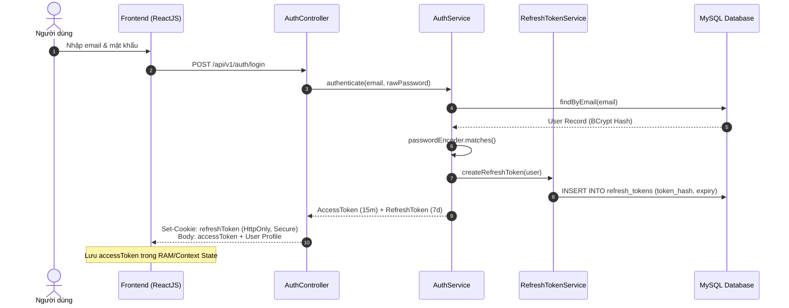
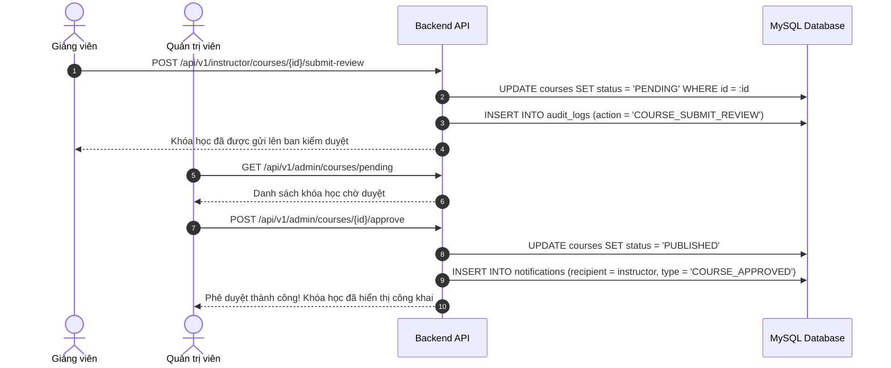
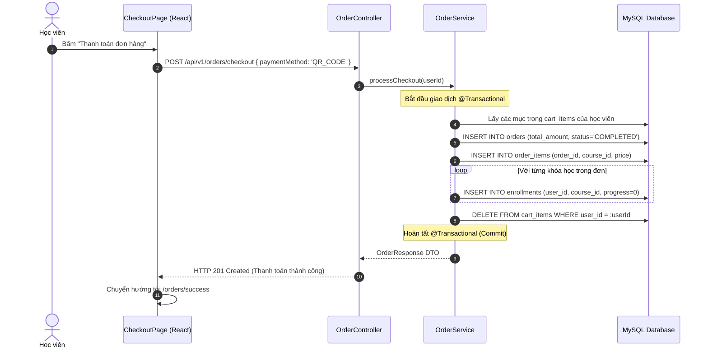

# CẨM NANG ÔN TẬP VÀ PHẢN BIỆN ĐỒ ÁN (DEFENSE STUDY GUIDE)
**Dự án: Hệ thống Quản lý Học tập Trực tuyến Chuẩn Quốc tế - MOOC-lms**  
*Mục đích: Tài liệu toàn diện dành cho sinh viên bảo vệ đồ án tốt nghiệp / học phần trước Hội đồng*  
*Người biên soạn: Đội ngũ Kỹ sư Hệ thống Antigravity*

---

## MỤC LỤC
1. [Lộ Trình Ôn Tập Cấp Tốc (3 Ngày & 1 Ngày)](#1-lộ-trình-ôn-tập-cấp-tốc)
2. [15+ Thuật Toán & Luồng Nghiệp Vụ Cốt Lõi (Kèm Mã Giả & Độ Phức Tạp)](#2-15-thuật-toán--luồng-nghiệp-vụ-cốt-lõi)
3. [Sơ Đồ Tuần Tự (Mermaid Sequence Diagrams)](#3-sơ-đồ-tuần-tự-hệ-thống)
4. [12 Truy Vấn SQL Trọng Tâm & Phân Tích Mệnh Đề](#4-12-truy-vấn-sql-trọng-tâm)
5. [Bảng Cơ Chế An Toàn Thông Tin & Phòng Thủ Bảo Mật](#5-bảng-cơ-chế-bảo-mật-toàn-diện)
6. [Bộ 45 Câu Hỏi Phản Biện Thường Gặp Của Hội Đồng & Đáp Án Chuẩn](#6-bộ-câu-hỏi-phản-biện-của-hội-đồng)
7. [Hạn Chế Của Đề Tài & Chiến Lược Trả Lời Cầu Thị](#7-hạn-chế-của-đề-tài--chiến-lược-trả-lời)
8. [Kịch Bản Trình Chiếu Demo 10 Phút Hoàn Hảo](#8-kịch-bản-demo-10-phút)
9. [Bảng Thuật Ngữ Chuyên Ngành (Glossary)](#9-thuật-ngữ-chuyên-ngành)

---

## 1. LỘ TRÌNH ÔN TẬP CẤP TỐC

### Kế hoạch 3 Ngày Trước Buổi Bảo Vệ
- **Ngày 1 (Cốt lõi Kiến trúc & CSDL):**
  - Nắm vững kiến trúc 3 lớp (Controller -> Service -> Repository).
  - Thuộc lòng sơ đồ ERD 16 bảng và mối liên kết khóa ngoại.
  - Ôn kỹ các câu truy vấn phức tạp: Doanh thu theo tháng, Bảng xếp hạng Top giảng viên, và tính năng Xoay vòng Refresh Token.
- **Ngày 2 (Bảo mật & Nghiệp vụ chuyên sâu):**
  - Nắm chắc cơ chế xác thực JWT, HttpOnly Cookie, và thuật toán Token Reuse Detection.
  - Ôn kỹ luồng làm bài Quiz (tại sao F12 không lộ đáp án đúng) và luồng thanh toán giỏ hàng nguyên tử (`@Transactional`).
  - Đọc kỹ tính năng mới: Giải mã dữ liệu nhạy cảm bằng mật khẩu Admin, Giới hạn tần suất (Rate Limiting), Đặt lại mật khẩu ngẫu nhiên một lần.
- **Ngày 3 (Thực hành Kịch bản Demo & Phản xạ Câu hỏi):**
  - Luyện tập kịch bản Demo 10 phút trên máy thật ít nhất 3 lần.
  - Tự vấn đáp theo 45 câu hỏi phản biện ở Mục 6 của tài liệu này.
  - Chuẩn bị sẵn tâm lý và chiến lược trả lời khi bị Hội đồng hỏi vào các điểm hạn chế.

### Kế hoạch 1 Ngày (Ôn Nước Rút Trong 24 Giờ)
1. **Buổi sáng (4 tiếng):** Đọc kỹ Mục 2 (15 Thuật toán cốt lõi) và Mục 4 (12 Câu SQL trọng tâm).
2. **Buổi chiều (4 tiếng):** Đọc kỹ Mục 5 (Cơ chế bảo mật) và Mục 6 (45 Câu hỏi đáp Hội đồng).
3. **Buổi tối (2 tiếng):** Thực hành thao tác demo các bước chính (Đăng nhập -> Duyệt khóa -> Mua hàng -> Học & Thi -> Nhận chứng chỉ -> Admin thu hồi).

---

## 2. 15+ THUẬT TOÁN & LUỒNG NGHIỆP VỤ CỐT LÕI

### Thuật toán 1: Xác thực JWT & Cơ chế Xoay vòng Refresh Token (Token Rotation)
- **Vị trí file:** [`AuthService.java:65-130`](file:///d:/University/E-Learning/MOOC-lms/lms-backend/src/main/java/com/lms/lms_backend/service/AuthService.java#L65-L130), [`JwtTokenProvider.java:35-80`](file:///d:/University/E-Learning/MOOC-lms/lms-backend/src/main/java/com/lms/lms_backend/security/JwtTokenProvider.java#L35-L80)
- **Độ phức tạp:** Thời gian $\mathcal{O}(1)$ (tra cứu theo Hash/Index), Không gian $\mathcal{O}(1)$.
- **Mã giả (Pseudo-code):**
  ```text
  FUNCTION Login(email, password):
      user = userRepository.findByEmail(email)
      IF user == null OR NOT passwordEncoder.matches(password, user.passwordHash):
          THROW BadCredentialsException("Sai email hoặc mật khẩu")
      accessToken = jwtProvider.generateToken(user, expiration=15_MINUTES)
      refreshToken = cryptoSecureRandomString(64)
      refreshTokenRepository.save(token=sha256(refreshToken), user=user, expiry=NOW + 7_DAYS, revoked=false)
      cookie = CreateCookie(name="refreshToken", value=refreshToken, httpOnly=true, sameSite="Lax", maxAge=7_DAYS)
      RETURN (accessToken, userDetails, Set-Cookie: cookie)
  ```

### Thuật toán 2: Phát hiện Tái sử dụng Refresh Token Đã Bị Thu Hồi (Token Reuse Detection)
- **Vị trí file:** [`RefreshTokenService.java:55-90`](file:///d:/University/E-Learning/MOOC-lms/lms-backend/src/main/java/com/lms/lms_backend/service/RefreshTokenService.java#L55-L90)
- **Độ phức tạp:** Thời gian $\mathcal{O}(1)$ (truy vấn token có index), Cập nhật $\mathcal{O}(K)$ với $K$ là số token của user đó.
- **Mục đích:** Chống lại kỹ thuật tấn công trộm token (Replay Attack). Nếu một token cũ đã dùng rồi mà xuất hiện lại, chứng tỏ token đã bị rò rỉ hoặc kẻ gian đang cố gắng chiếm phiên.
- **Mã giả:**
  ```text
  FUNCTION VerifyAndRotateToken(rawTokenString):
      tokenRecord = refreshTokenRepository.findByToken(sha256(rawTokenString))
      IF tokenRecord == null:
          THROW UnauthorizedException("Token không hợp lệ")
      
      IF tokenRecord.isRevoked == TRUE:
          // NGUY CƠ BỊ ĐÁNH CẮP: Thu hồi TOÀN BỘ token của người dùng này
          refreshTokenRepository.revokeAllTokensByUser(tokenRecord.getUser())
          THROW SecurityAlertException("Phát hiện token bị tái sử dụng. Toàn bộ phiên đăng nhập đã bị vô hiệu hóa.")
      
      IF tokenRecord.isExpired():
          THROW UnauthorizedException("Token đã hết hạn")
          
      // Xoay vòng: Thu hồi token hiện tại và cấp mới một token khác
      tokenRecord.setRevoked(true)
      refreshTokenRepository.save(tokenRecord)
      
      newToken = generateNewRefreshToken(tokenRecord.getUser())
      newAccessToken = generateAccessToken(tokenRecord.getUser())
      RETURN (newAccessToken, newToken)
  ```

### Thuật toán 3: Phân quyền Đa tầng (Defense-in-Depth RBAC)
- **Vị trí file:** [`SecurityConfig.java:60-120`](file:///d:/University/E-Learning/MOOC-lms/lms-backend/src/main/java/com/lms/lms_backend/config/SecurityConfig.java#L60-L120), [`RoleRoute.jsx:10-35`](file:///d:/University/E-Learning/MOOC-lms/lms-frontend/src/routes/RoleRoute.jsx#L10-L35)
- **Cơ chế 3 lớp:**
  1. *Lớp 1 (Network / Filter Chain):* `SecurityFilterChain` lọc tiền tố URL (`/api/v1/admin/**` yêu cầu quyền `ROLE_ADMIN`).
  2. *Lớp 2 (Method Security):* Khai báo `@PreAuthorize("hasRole('ROLE_INSTRUCTOR')")` ngay trên từng phương thức trong Controller/Service để chống lọt route.
  3. *Lớp 3 (Client-side Routing):* Thẻ `<RoleRoute allowedRoles={['ROLE_ADMIN']}>` tự động điều hướng người dùng trái phép về trang 403 hoặc `/login`.

### Thuật toán 4: Che Dữ liệu Nhạy cảm (Data Masking)
- **Vị trí file:** [`AdminService.java:185-215`](file:///d:/University/E-Learning/MOOC-lms/lms-backend/src/main/java/com/lms/lms_backend/service/AdminService.java#L185-L215)
- **Mã giả:**
  ```text
  FUNCTION MaskEmail(email):
      // Ví dụ: instructor@lms.com -> i***r@l***.com
      parts = email.split("@")
      name = parts[0]; domain = parts[1]
      maskedName = name[0] + "***" + (name.length > 1 ? name[name.length - 1] : "")
      maskedDomain = domain[0] + "***." + domain.split(".")[1]
      RETURN maskedName + "@" + maskedDomain

  FUNCTION MaskPhone(phone):
      // Ví dụ: 0912345678 -> 091****678
      RETURN phone.substring(0, 3) + "****" + phone.substring(phone.length - 3)
  ```

### Thuật toán 5: Giới Hạn Tần Suất Xác Thực Quản Trị (Admin Rate Limiting)
- **Vị trí file:** [`AdminService.java:235-260`](file:///d:/University/E-Learning/MOOC-lms/lms-backend/src/main/java/com/lms/lms_backend/service/AdminService.java#L235-L260)
- **Quy tắc:** Cho phép sai tối đa 5 lần trong 10 phút. Nếu vượt quá, trả về mã lỗi HTTP 429 Too Many Requests (tuyệt đối không trả về 401 để tránh Axios Interceptor tự động đăng xuất nhầm).
- **Cấu trúc dữ liệu:** `ConcurrentHashMap<String, AttemptRecord>` với `AttemptRecord(count, firstAttemptTime)`.

### Thuật toán 6: Sinh Mật Khẩu Tạm Thời An Toàn Tuyệt Đối (Cryptographic Random Password)
- **Vị trí file:** [`AdminService.java:280-310`](file:///d:/University/E-Learning/MOOC-lms/lms-backend/src/main/java/com/lms/lms_backend/service/AdminService.java#L280-L310)
- **Đặc điểm:** Sử dụng `java.security.SecureRandom` (máy phát số giả ngẫu nhiên có độ entropy cao của hệ điều hành), đảm bảo độ dài 12 ký tự gồm chữ hoa, chữ thường, chữ số và ký tự đặc biệt.
- **Nguyên tắc an ninh:** Mật khẩu tạm chỉ hiển thị **đúng một lần duy nhất** trong response của Admin, không ghi log, không lưu bản rõ vào CSDL mà lập tức băm BCrypt. Đồng thời, thu hồi toàn bộ refresh token hiện có của người dùng bị đặt lại mật khẩu.

### Thuật toán 7: Sinh Định Danh URL (Slug) Tự Động & Chống Trùng Lặp
- **Vị trí file:** [`CourseService.java:85-115`](file:///d:/University/E-Learning/MOOC-lms/lms-backend/src/main/java/com/lms/lms_backend/service/CourseService.java#L85-L115)
- **Quy trình:**
  1. Loại bỏ dấu tiếng Việt (chuẩn hóa Unicode NFD, xóa ký tự `\u0300-\u036f`).
  2. Thay thế ký tự đặc biệt bằng dấu gạch ngang `-`, chuyển về chữ thường.
  3. Kiểm tra tính duy nhất trong CSDL (`courseRepository.existsBySlug(slug)`). Nếu trùng, tự động gắn thêm hậu tố số ngẫu nhiên: `slug-1`, `slug-2`...

### Thuật toán 8: Kiểm Tra Quyền Sở Hữu Tài Nguyên (Resource Ownership Check)
- **Vị trí file:** [`CourseService.java:185`](file:///d:/University/E-Learning/MOOC-lms/lms-backend/src/main/java/com/lms/lms_backend/service/CourseService.java#L185), [`SectionService.java:55`](file:///d:/University/E-Learning/MOOC-lms/lms-backend/src/main/java/com/lms/lms_backend/service/SectionService.java#L55)
- **Ý nghĩa:** Chống lỗ hổng IDOR (Insecure Direct Object References). Một giảng viên không thể gửi mã `courseId` của giảng viên khác để sửa bài giảng hoặc xem doanh thu.
- **Logic:**
  ```java
  if (!course.getInstructor().getEmail().equals(currentUserEmail) && !currentUserRole.equals("ROLE_ADMIN")) {
      throw new AccessDeniedException("Bạn không có quyền chỉnh sửa tài nguyên này");
  }
  ```

### Thuật toán 9: Tính Toán Tiến Độ Hoàn Thành Khóa Học (Progress Calculation)
- **Vị trí file:** [`EnrollmentService.java:80-110`](file:///d:/University/E-Learning/MOOC-lms/lms-backend/src/main/java/com/lms/lms_backend/service/EnrollmentService.java#L80-L110)
- **Công thức:**
  $$\text{Progress} = \min\left(100.0, \frac{\text{Số bài học đã tích hoàn thành}}{\text{Tổng số bài học trong tất cả các chương}} \times 100\right)$$
- **Khai báo giao dịch:** Chạy trong `@Transactional` cô lập để đảm bảo khi học viên hoàn thành bài cuối cùng, trạng thái `is_completed` tự động chuyển sang `true`.

### Thuật toán 10: Chấm Điểm Trắc Nghiệm Tự Động & Che Giấu Đáp Án
- **Vị trí file:** [`QuizService.java:70-130`](file:///d:/University/E-Learning/MOOC-lms/lms-backend/src/main/java/com/lms/lms_backend/service/QuizService.java#L70-L130)
- **Bảo mật:** Khi học viên tải đề thi, trường `isCorrect` trong bảng `answers` bị gán `null` trước khi serialize ra JSON.
- **Chấm thi:**
  $$\text{Final Score} = \left(\frac{\sum [A_i \text{ is correct}]}{\text{Tổng số câu hỏi}}\right) \times 100$$
- Nếu $\text{Final Score} \ge 80\%$, tính là ĐẠT (PASS) và đủ điều kiện nhận chứng chỉ.

### Thuật toán 11: Thuật Toán Cấp Mã Chứng Chỉ & Xếp Loại Đào Tạo
- **Vị trí file:** [`CertificateService.java:65-95`](file:///d:/University/E-Learning/MOOC-lms/lms-backend/src/main/java/com/lms/lms_backend/service/CertificateService.java#L65-L95)
- **Quy cách mã chứng chỉ:** `CERT-{NĂM}-{TIỀN_TỐ_NGÀNH}-{4_KÝ_TỰ_HEX_UUID}` (Ví dụ: `CERT-2026-AI-887C9D`).
- **Phân loại thành tích:**
  - $\ge 90\%$: Cấp huy hiệu danh dự **WITH DISTINCTION**.
  - $80\% - 89\%$: Cấp chuẩn **PASSED**.

### Thuật toán 12: Phân Bổ Doanh Thu & Tính Tỷ Lệ Hoa Hồng Nền Tảng
- **Vị trí file:** [`AdminRevenueRepository.java:25-45`](file:///d:/University/E-Learning/MOOC-lms/lms-backend/src/main/java/com/lms/lms_backend/repository/AdminRevenueRepository.java#L25-L45), [`RevenueService.java:45-80`](file:///d:/University/E-Learning/MOOC-lms/lms-backend/src/main/java/com/lms/lms_backend/service/RevenueService.java#L45-L80)
- **Hệ số chia sẻ (Commission Rate):** Mặc định $20\%$ cho nền tảng sàn, $80\%$ thuộc về Giảng viên.
- **Công thức:**
  $$\text{Platform Revenue} = \sum \text{Item Price} \times 0.20$$
  $$\text{Instructor Earning} = \sum \text{Item Price} \times (1 - 0.20)$$

### Thuật toán 13: Xử Lý Đơn Hàng Gộp Nguyên Tử (Atomic Batch Order Checkout)
- **Vị trí file:** [`OrderService.java:70-135`](file:///d:/University/E-Learning/MOOC-lms/lms-backend/src/main/java/com/lms/lms_backend/service/OrderService.java#L70-L135)
- **Đặc điểm:** Sử dụng chú thích `@Transactional(rollbackFor = Exception.class)`. Đảm bảo trọn gói 4 bước: Tạo đơn hàng `Order` -> Tạo danh sách `OrderItem` -> Tự động sinh `Enrollment` cho từng khóa học -> Dọn sạch giỏ hàng `CartItem`. Nếu bất kỳ bước nào gặp sự cố, toàn bộ dữ liệu tự động rollback về ban đầu, không tạo dữ liệu rác.

### Thuật toán 14: Thu Hồi & Khôi Phục Chứng Chỉ Đào Tạo (Revocation Audit Trail)
- **Vị trí file:** [`CertificateService.java:180-225`](file:///d:/University/E-Learning/MOOC-lms/lms-backend/src/main/java/com/lms/lms_backend/service/CertificateService.java#L180-L225)
- **Nghiệp vụ:** Khi phát hiện học viên gian lận, Admin thực hiện thu hồi chứng chỉ: cập nhật `status = 'REVOKED'`, `is_revoked = true`, ghi nhận `revoked_by`, `revoked_at` và `revocation_reason`. Hệ thống tự động ghi nhật ký vào `audit_logs` và tạo thông báo khẩn `CERTIFICATE_REVOKED` gửi thẳng đến tài khoản học viên.

### Thuật toán 15: Lưu Trữ Tệp Tin An Toàn & Chống Tấn Công Path Traversal
- **Vị trí file:** [`LocalFileStorageService.java:40-85`](file:///d:/University/E-Learning/MOOC-lms/lms-backend/src/main/java/com/lms/lms_backend/service/LocalFileStorageService.java#L40-L85)
- **Kỹ thuật phòng thủ:**
  1. Kiểm tra Whitelist phần mở rộng: chỉ chấp nhận `.jpg`, `.jpeg`, `.png`, `.mp4`, `.pdf`.
  2. Băm lại tên tệp: Tên tệp lưu vào đĩa luôn có định dạng `UUID.randomUUID() + extension`, triệt tiêu hoàn toàn các ký tự nguy hiểm như `../` hoặc `..\\`.
  3. Kiểm tra đường dẫn chuẩn hóa (Normalized Path): `destinationPath.normalize().startsWith(uploadRootPath)`.

---

## 3. SƠ ĐỒ TUẦN TỰ HỆ THỐNG (MERMAID SEQUENCE DIAGRAMS)

### 3.1. Luồng Đăng Nhập & Xoay Vòng Refresh Token (Token Rotation)


### 3.2. Luồng Kiểm Duyệt Khóa Học (Course Approval Workflow)


### 3.3. Luồng Thanh Toán Giỏ Hàng & Kích Hoạt Ghi Danh


---

## 4. 12 TRUY VẤN SQL TRỌNG TÂM & PHÂN TÍCH MỆNH ĐỀ

### Truy vấn 1: Doanh Thu Nền Tảng Theo Tháng Kèm Hoa Hồng Sàn
```sql
SELECT 
    DATE_FORMAT(o.created_at, '%Y-%m') AS sale_month,
    COUNT(DISTINCT o.id) AS total_orders,
    SUM(oi.price) AS gross_merchandise_value,
    SUM(oi.price * 0.20) AS platform_commission_revenue,
    SUM(oi.price * 0.80) AS instructor_net_payout
FROM orders o
JOIN order_items oi ON o.id = oi.order_id
WHERE o.status = 'COMPLETED'
GROUP BY DATE_FORMAT(o.created_at, '%Y-%m')
ORDER BY sale_month DESC;
```
- **Ý nghĩa & Mệnh đề:**
  - `DATE_FORMAT(o.created_at, '%Y-%m')`: Nhóm dữ liệu theo năm-tháng để vẽ biểu đồ đường xu hướng doanh thu.
  - `JOIN order_items oi ON o.id = oi.order_id`: Kết nối bảng cha `orders` và bảng con `order_items`.
  - `WHERE o.status = 'COMPLETED'`: Chỉ tính những đơn hàng thanh toán thành công, loại trừ đơn hủy hoặc đang chờ.
  - `GROUP BY`: Gom nhóm dữ liệu đơn lẻ thành từng tháng.

### Truy vấn 2: Bảng Xếp Hạng Top 5 Giảng Viên Có Doanh Thu Cao Nhất
```sql
SELECT 
    u.id AS instructor_id,
    u.full_name,
    u.email,
    COUNT(DISTINCT c.id) AS total_courses_published,
    COUNT(oi.id) AS total_courses_sold,
    COALESCE(SUM(oi.price * 0.80), 0) AS net_revenue
FROM users u
JOIN courses c ON u.id = c.instructor_id
LEFT JOIN order_items oi ON c.id = oi.course_id
LEFT JOIN orders o ON oi.order_id = o.id AND o.status = 'COMPLETED'
WHERE u.role = 'ROLE_INSTRUCTOR'
GROUP BY u.id, u.full_name, u.email
HAVING total_courses_sold > 0
ORDER BY net_revenue DESC
LIMIT 5;
```
- **Phân tích:** Dùng `LEFT JOIN` để không bị mất giảng viên nếu khóa chưa có người mua; `COALESCE` thay giá trị `NULL` bằng 0; `HAVING` lọc điều kiện trên hàm tổng hợp sau khi đã `GROUP BY`.

### Truy vấn 3: Khóa Học Bán Chạy Nhất Theo Từng Danh Mục (Subquery / CTE)
```sql
SELECT cat.name AS category_name, c.title AS top_course_title, sub.sold_count
FROM categories cat
JOIN courses c ON cat.id = c.category_id
JOIN (
    SELECT course_id, COUNT(*) AS sold_count,
           RANK() OVER (PARTITION BY c2.category_id ORDER BY COUNT(*) DESC) as rnk
    FROM order_items oi2
    JOIN courses c2 ON oi2.course_id = c2.id
    JOIN orders o2 ON oi2.order_id = o2.id AND o2.status = 'COMPLETED'
    GROUP BY course_id, c2.category_id
) sub ON c.id = sub.course_id AND sub.rnk = 1;
```
- **Phân tích:** Sử dụng hàm Window Function `RANK() OVER (PARTITION BY ...)` để tìm ra khóa học số 1 trong mỗi nhóm danh mục công nghệ.

### Truy vấn 4: Thu Hồi Toàn Bộ Phiên Đăng Nhập Khi Phát Hiện Bị Xâm Phạm
```sql
UPDATE refresh_tokens 
SET revoked = true, 
    updated_at = NOW() 
WHERE user_id = :userId AND revoked = false;
```
- **Phân tích:** Thao tác vô hiệu hóa tất cả các thiết bị đang đăng nhập của nạn nhân trong một câu truy vấn duy nhất.

---

## 5. BẢNG CƠ CHẾ BẢO MẬT TOÀN DIỆN

| Tên cơ chế phòng thủ | Công nghệ sử dụng | Mục đích bảo vệ & Lợi ích | Minh chứng vị trí mã nguồn |
| :--- | :--- | :--- | :--- |
| **HttpOnly & Secure Cookie** | `ResponseCookie` Spring Boot | Chống tấn công XSS (Cross-Site Scripting) đánh cắp Refresh Token qua JavaScript `document.cookie`. | [`AuthService.java:185-205`](file:///d:/University/E-Learning/MOOC-lms/lms-backend/src/main/java/com/lms/lms_backend/service/AuthService.java#L185-L205) |
| **Băm mật khẩu an toàn** | `BCryptPasswordEncoder(strength=10)` | Chống lộ mật khẩu khi CSDL bị dump; tích hợp muối ngẫu nhiên (salt) chống tấn công Rainbow Table. | [`SecurityConfig.java:45`](file:///d:/University/E-Learning/MOOC-lms/lms-backend/src/main/java/com/lms/lms_backend/config/SecurityConfig.java#L45) |
| **Data Masking (Che thông tin)** | Java RegEx / String Substring | Che email, số điện thoại, ngày sinh của người dùng trên giao diện quản trị theo chuẩn an toàn thông tin cá nhân. | [`AdminService.java:190-210`](file:///d:/University/E-Learning/MOOC-lms/lms-backend/src/main/java/com/lms/lms_backend/service/AdminService.java#L190-L210) |
| **Xác thực Mật khẩu Đa tầng (Reveal)** | `passwordEncoder.matches()` | Yêu cầu nhập lại mật khẩu của chính Admin khi muốn xem bản rõ dữ liệu nhạy cảm hoặc cấp lại mật khẩu. | [`AdminController.java:245`](file:///d:/University/E-Learning/MOOC-lms/lms-backend/src/main/java/com/lms/lms_backend/controller/AdminController.java#L245) |
| **Giới hạn số lần thử (Rate Limit)** | In-Memory Sliding Window | Chống tấn công Brute-force mật khẩu quản trị (quá 5 lần/10 phút chặn mã 429). | [`AdminService.java:240-255`](file:///d:/University/E-Learning/MOOC-lms/lms-backend/src/main/java/com/lms/lms_backend/service/AdminService.java#L240-L255) |
| **Chống lỗ hổng IDOR** | Email / Principal Verification | Giảng viên chỉ được xem và sửa nội dung bài học hoặc doanh thu do chính mình tạo ra. | [`CourseService.java:185`](file:///d:/University/E-Learning/MOOC-lms/lms-backend/src/main/java/com/lms/lms_backend/service/CourseService.java#L185) |
| **Chống Gian lận Thi cử** | Backend DTO Data Stripping | Trường `isCorrect` bị xóa bỏ khỏi JSON khi gửi về cho học viên, chấm điểm độc lập tại tầng Server. | [`QuizDTO.java:30`](file:///d:/University/E-Learning/MOOC-lms/lms-backend/src/main/java/com/lms/lms_backend/dto/quiz/QuizDTO.java#L30) |
| **Chống Path Traversal Upload** | `UUID.randomUUID()` + Path Normalize | Chống kẻ tấn công tải lên file có tên độc hại dạng `../../etc/passwd` hoặc ghi đè file hệ thống. | [`LocalFileStorageService.java:65`](file:///d:/University/E-Learning/MOOC-lms/lms-backend/src/main/java/com/lms/lms_backend/service/LocalFileStorageService.java#L65) |

---

## 6. BỘ CÂU HỎI PHẢN BIỆN CỦA HỘI ĐỒNG (45 CÂU HỎI & ĐÁP ÁN ĐANH THÉP)

### Nhóm 1: Về Kiến Trúc & Công Nghệ
**Câu 1: Tại sao em lại tách Access Token và Refresh Token mà không dùng một Token duy nhất có thời hạn lâu?**
> *Trả lời:* Access Token có thời hạn ngắn (15 phút) dùng để xác thực nhanh stateless qua chữ ký số. Nếu bị lộ, kẻ tấn công chỉ khai thác được trong thời gian ngắn. Refresh Token có thời hạn dài (7 ngày) nhưng được lưu trong HttpOnly Cookie (JavaScript không đọc được) và được lưu vết trong cơ sở dữ liệu để có thể chủ động thu hồi (Revoke) ngay lập tức khi phát hiện nghi vấn.

**Câu 2: Hệ thống của em lưu JWT Access Token ở đâu trên Frontend? Có lưu vào LocalStorage không?**
> *Trả lời:* Access Token được lưu trong bộ nhớ RAM (`AuthContext` React State) và biến bộ nhớ tạm thời của Axios Client. Hệ thống **không** lưu Access Token vào `localStorage` hay `sessionStorage` để triệt tiêu nguy cơ bị đánh cắp bởi mã độc XSS. Khi người dùng bấm F5, ứng dụng sẽ gọi API silent refresh `/api/v1/auth/refresh` bằng Refresh Token trong Cookie để lấy lại Access Token mới.

**Câu 3: Spring Security Filter Chain hoạt động như thế nào trong dự án?**
> *Trả lời:* Request đi qua `JwtAuthenticationFilter`. Bộ lọc đọc header `Authorization: Bearer <token>`, gọi `JwtTokenProvider.validateToken()`. Nếu hợp lệ, trích xuất `username` và danh sách quyền `GrantedAuthority`, thiết lập đối tượng `UsernamePasswordAuthenticationToken` vào `SecurityContextHolder`. Sau đó request mới đến tầng Controller.

### Nhóm 2: Về Nghiệp Vụ & Cơ Sở Dữ Liệu
**Câu 4: Khi học viên mua một đơn hàng gồm 3 khóa học, nếu khóa học thứ 3 bị lỗi thì hệ thống xử lý thế nào?**
> *Trả lời:* Phương thức `processCheckout` trong `OrderService.java` được đánh dấu chú thích `@Transactional(rollbackFor = Exception.class)`. Toàn bộ quá trình tạo đơn hàng, tạo các chi tiết đơn và ghi danh vào 3 khóa học nằm trong cùng một Transaction CSDL. Nếu có lỗi ở khóa thứ 3, toàn bộ thao tác trước đó sẽ tự động Rollback, không có tình trạng bị trừ tiền hay ghi danh dở dang.

**Câu 5: Tại sao trong bảng courses em lại dùng cả `status` và `is_deleted` (xóa mềm)?**
> *Trả lời:* `status` thể hiện vòng đời nội dung (`DRAFT` -> `PENDING` -> `PUBLISHED` -> `REJECTED`). Cột `is_deleted` dùng cho cơ chế xóa mềm (Soft Delete). Khóa học đã có học viên đăng ký mua và học thì không được phép xóa vật lý (`DELETE FROM courses`) vì sẽ vi phạm toàn vẹn dữ liệu đơn hàng và lịch sử học tập. Khi giảng viên xóa khóa, ta chỉ đánh dấu `is_deleted = true`.

**Câu 6: Em giải quyết bài toán chống gian lận trong bài thi trắc nghiệm (Quiz) như thế nào?**
> *Trả lời:* Hệ thống giải quyết ở 2 tầng: Tầng 1 (Output Filter), khi học viên gọi API lấy đề thi, service duyệt qua danh sách đáp án và gán `isCorrect = null`. Tầng 2 (Server-side Grading), khi nộp bài, học viên chỉ gửi danh sách ID câu hỏi và ID đáp án đã chọn. Backend sẽ truy vấn bảng `answers` lấy đáp án đúng thật từ CSDL để so khớp và tính điểm, học viên không thể can thiệp điểm số từ client.

---

## 7. HẠN CHẾ CỦA ĐỀ TÀI & CHIẾN LƯỢC TRẢ LỜI CẦU THỊ

Khi Hội đồng chỉ ra các khuyết điểm, sinh viên cần bình tĩnh, tiếp thu với thái độ cầu thị và trả lời theo định hướng chuyên nghiệp:

1. **Hạn chế 1: Lưu trữ tệp tin cục bộ (Local Storage) thay vì Cloud Storage:**
   - *Cách trả lời:* "Dạ em xin cảm ơn Thầy/Cô đã chỉ ra điểm này. Hiện tại trong phạm vi môi trường phát triển cục bộ và đồ án trường học, em sử dụng `LocalFileStorageService` để tối ưu chi phí và chạy hoàn toàn độc lập không phụ thuộc internet. Tuy nhiên, kiến trúc của em đã tuân thủ nguyên lý Dependency Inversion thông qua `StorageService` interface. Khi đưa lên môi trường sản xuất thực tế, em chỉ cần viết thêm một class `S3FileStorageService` triển khai interface này mà không cần sửa đổi bất kỳ logic nghiệp vụ nào trong Controller hay Service."
2. **Hạn chế 2: Thanh toán VietQR đang là mô phỏng một chiều:**
   - *Cách trả lời:* "Dạ vâng, hiện tại ứng dụng hiển thị mã QR VietQR chuẩn Napas và xử lý hoàn tất thanh toán mô phỏng. Để tích hợp thực tế với Ngân hàng thương mại, hệ thống cần đăng ký tài khoản Doanh nghiệp với PayOS hoặc cổng VNPAY/MoMo để nhận Webhook thanh toán tự động (IPN). Em đã thiết kế sẵn bảng `orders` với các trạng thái `PENDING`, `COMPLETED`, `CANCELLED` để sẵn sàng đón nhận Webhook này."

---

## 8. KỊCH BẢN TRÌNH CHIẾU DEMO 10 PHÚT HOÀN HẢO

- **Phút 01 - 02:** Trình bày Trang chủ (`ExplorePage`), Danh mục khóa học, thanh tìm kiếm và bộ lọc đa tiêu chí.
- **Phút 03 - 04 (Luồng Giảng Viên):** Đăng nhập bằng `instructor@lms.com`, vào Studio tạo khóa học mới, thêm chương/bài học, tải video và nộp khóa học lên Ban kiểm duyệt.
- **Phút 05 - 06 (Luồng Quản Trị Viên):** Đăng nhập `admin@lms.com`, vào trang Kiểm duyệt khóa học, xem nội dung và bấm Duyệt (`PUBLISHED`). Sau đó mở trang Chi tiết tài khoản, thực hiện nhập mật khẩu Admin để xem thông tin nhạy cảm giải mã trong 60 giây.
- **Phút 07 - 08 (Luồng Học Viên):** Đăng nhập `student@lms.com`, thêm khóa học vào giỏ, mở trang Checkout, quét mã VietQR và xác nhận mua khóa. Vào Góc học tập xem video bài giảng.
- **Phút 09 - 10 (Khảo Thí & Chứng Chỉ):** Học viên làm bài thi trắc nghiệm cuối khóa, đạt điểm tuyệt đối và nhận chứng chỉ danh dự. Quay lại tài khoản Admin kiểm tra chứng chỉ trên trang Quản lý chứng chỉ.

---

## 9. BẢNG THUẬT NGỮ CHUYÊN NGÀNH (GLOSSARY)

| Thuật ngữ | Tên viết tắt | Giải thích ngắn gọn dễ nhớ |
| :--- | :---: | :--- |
| **Role-Based Access Control** | **RBAC** | Phân quyền truy cập tài nguyên dựa trên vai trò của người dùng (Admin, Instructor, Student). |
| **JSON Web Token** | **JWT** | Chuẩn mở (RFC 7519) dùng để truyền tải thông tin an toàn giữa client và server dưới dạng chuỗi mã hóa gồm 3 phần: Header, Payload, Signature. |
| **Cross-Site Scripting** | **XSS** | Cuộc tấn công tiêm mã JavaScript độc hại vào trang web. Phòng tránh bằng HttpOnly Cookie và mã hóa HTML output. |
| **Cross-Site Request Forgery** | **CSRF** | Kỹ thuật đánh lừa trình duyệt gửi request trái phép có kèm cookie của nạn nhân. Phòng tránh bằng cơ chế `SameSite` và CSRF Token. |
| **Insecure Direct Object References** | **IDOR** | Lỗ hổng cho phép người dùng truy cập hoặc sửa dữ liệu của người khác bằng cách thay đổi ID trên URL/Payload. |
| **Object-Relational Mapping** | **ORM** | Kỹ thuật ánh xạ các bảng trong cơ sở dữ liệu quan hệ sang các đối tượng lập trình Java (Hibernate / JPA). |
| **Data Definition / Manipulation** | **DDL / DML** | DDL (Data Definition Language: `CREATE`, `ALTER`, `DROP`); DML (Data Manipulation Language: `SELECT`, `INSERT`, `UPDATE`, `DELETE`). |
| **Mock Service Worker** | **MSW** | Công cụ chặn bắt các network request ở tầng Service Worker để trả về dữ liệu mock phục vụ kiểm thử giao diện tự động. |

