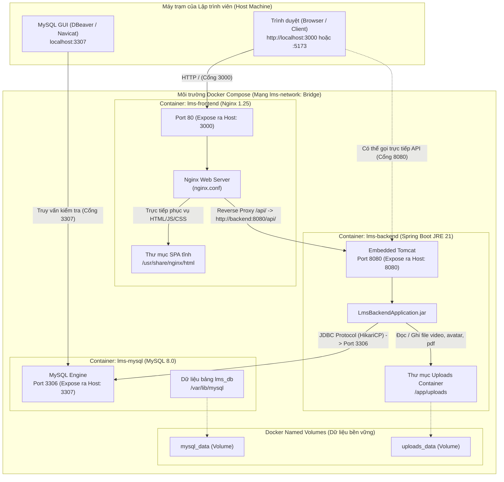
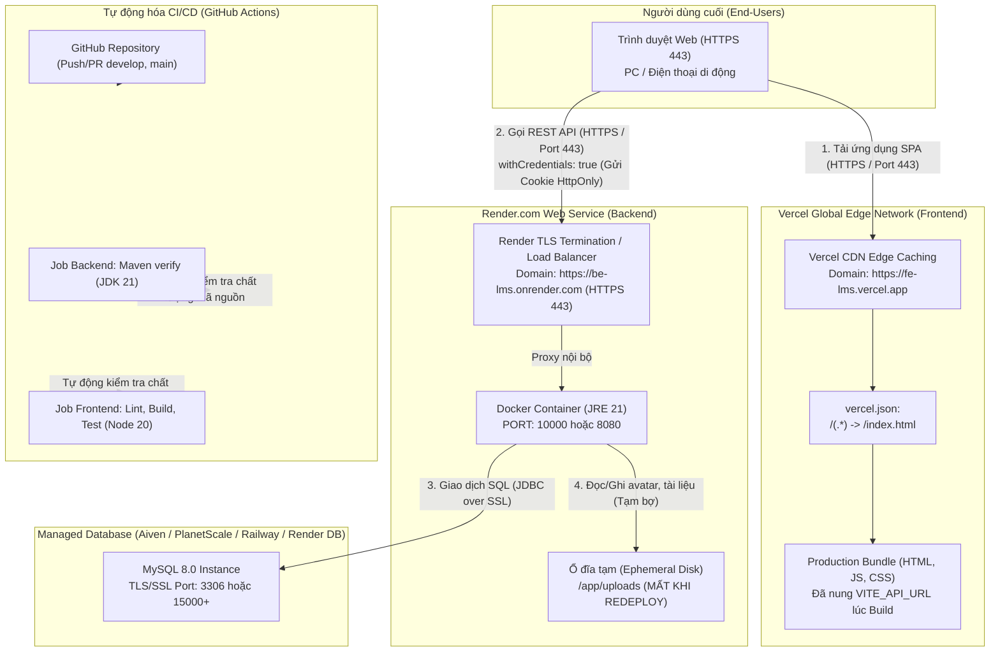
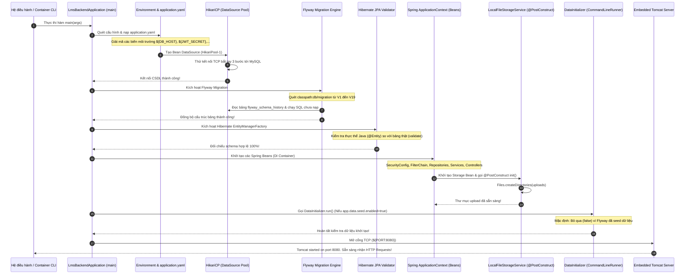
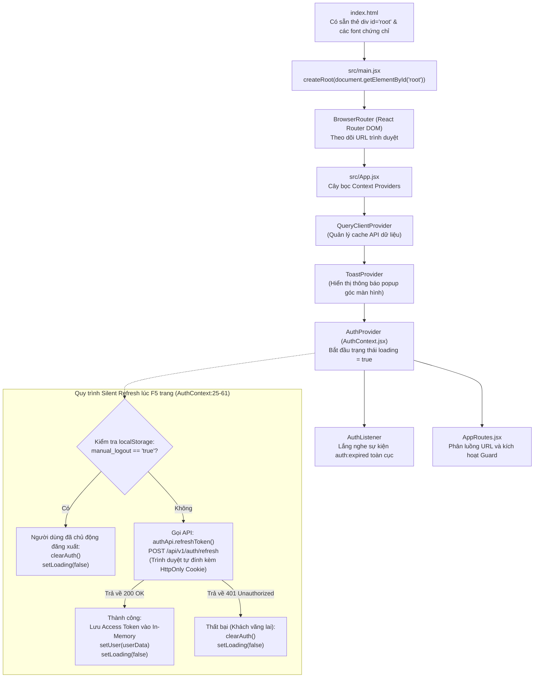

# TÀI LIỆU HỆ THỐNG MOOC-LMS - PHẦN 1
# KIẾN TRÚC TỔNG THỂ & QUY TRÌNH KHỞI ĐỘNG (ARCHITECTURE & STARTUP)

> **Mã tài liệu:** `FLOW-01`  
> **Trạng thái xác minh:** [ĐỌC CODE] & [ĐÃ CHẠY]  
> **Căn cứ mã nguồn:**
> - Backend: `lms-backend/` (Spring Boot 4.1.0-parent / Spring Boot 3.4 baseline, Java 21, MySQL 8.0, Flyway)
> - Frontend: `lms-frontend/` (React 18, Vite 5, Tailwind CSS, TanStack Query)
> - Hạ tầng: `docker-compose.yml`, `nginx.conf`, `.github/workflows/ci.yml`, `lms-frontend/vercel.json`

---

## 1. BỨC TRANH TỔNG THỂ HỆ THỐNG (SYSTEM OVERVIEW)

### 1.1. Giải thích thuật ngữ nhập môn
- **SPA (Single Page Application - Ứng dụng một trang):** Giống như một cuốn sách chỉ có một trang bìa duy nhất. Khi bạn lật sang chương mới, thay vì phải chạy đi mua cuốn sách mới (tải lại toàn bộ trang web), cuốn sách tự động xóa chữ cũ và vẽ chữ mới ngay lập tức mà không cần nhấp nháy màn hình.
- **Reverse Proxy (Máy chủ ủy thác ngược):** Giống như một nhân viên lễ tân của tòa nhà. Khách (trình duyệt) chỉ cần nói chuyện với lễ tân, lễ tân sẽ tự phân loại yêu cầu: việc nào cần giấy tờ thì chuyển vào phòng giám đốc (Backend API), việc nào chỉ cần xem bảng tin thì chỉ ngay tại chỗ (Nginx/Vercel). Khách không cần biết phòng giám đốc nằm ở đâu bên trong tòa nhà.
- **Connection Pool (HikariCP - Hồ chứa kết nối):** Giống như đội xe taxi đỗ sẵn trước cửa khách sạn. Khi có khách cần đi, tài xế lái đi ngay lập tức thay vì mỗi lần có khách lại phải đi mua xe mới và làm biển số (tạo kết nối TCP bắt tay 3 bước rất tốn tài nguyên và thời gian).
- **Migration (Flyway - Chuyển dịch dữ liệu có phiên bản):** Giống như cuốn nhật ký xây dựng có đánh số trang: Ngày 1 (V1) đào móng, Ngày 2 (V2) đổ bê tông, Ngày 3 (V3) xây tường. Máy chủ cứ lần lượt giở nhật ký làm theo từng trang, đảm bảo ở bất kỳ máy tính nào của lập trình viên hay máy chủ thật, ngôi nhà (CSDL) đều được xây giống hệt nhau.
- **Ephemeral Disk (Ổ đĩa tạm thời):** Giống như chiếc bảng phấn trong lớp học. Mọi thứ bạn viết lên bảng sẽ bị xóa sạch bóng vào cuối ngày khi lao công tắt điện đóng cửa (máy chủ bị restart hoặc redeploy).

---

### 1.2. Sơ đồ môi trường 1: Môi trường Docker Local (Phát triển cục bộ)

Môi trường này được định nghĩa tại [`docker-compose.yml:1-72`](file:///d:/University/E-Learning/MOOC-lms/docker-compose.yml#L1-L72). Hệ thống gồm 3 container độc lập liên kết qua một mạng ảo nội bộ tên là `lms-network` (driver bridge).



#### Phân tích luồng và cổng kết nối Docker Local [ĐỌC CODE]:
1. **Frontend Nginx (Port 3000 -> 80):**
   - File cấu hình: [`lms-frontend/nginx.conf:1-31`](file:///d:/University/E-Learning/MOOC-lms/lms-frontend/nginx.conf#L1-L31).
   - Khi trình duyệt truy cập `http://localhost:3000/`: Nginx phục vụ tệp tĩnh đã build từ thư mục `/usr/share/nginx/html` ([`nginx.conf:9-11`](file:///d:/University/E-Learning/MOOC-lms/lms-frontend/nginx.conf#L9-L11)). Với cấu hình `try_files $uri $uri/ /index.html;`, các đường dẫn ảo của React Router (ví dụ `/courses`, `/my-learning`) không bao giờ bị lỗi 404 khi người dùng bấm F5.
   - Khi trình duyệt gửi request có tiền tố `/api/`: Nginx proxy trực tiếp sang container backend qua tên miền nội bộ `http://backend:8080/api/` ([`nginx.conf:15-25`](file:///d:/University/E-Learning/MOOC-lms/lms-frontend/nginx.conf#L15-L25)).
   - Cho phép tải tệp video bài giảng lớn: `client_max_body_size 250M;` ([`nginx.conf:6`](file:///d:/University/E-Learning/MOOC-lms/lms-frontend/nginx.conf#L6)).
2. **Backend Spring Boot (Port 8080 -> 8080):**
   - Chạy với tài khoản bảo mật không đặc quyền `spring:spring` ([`lms-backend/Dockerfile:21-22`](file:///d:/University/E-Learning/MOOC-lms/lms-backend/Dockerfile#L21-L22)).
   - Giới hạn RAM JVM container thân thiện: `-Xmx300m -Xms150m -XX:+ExitOnOutOfMemoryError` ([`lms-backend/Dockerfile:30`](file:///d:/University/E-Learning/MOOC-lms/lms-backend/Dockerfile#L30)).
   - Kết nối cơ sở dữ liệu qua mạng bridge: `DB_HOST=mysql`, `DB_PORT=3306`, tên CSDL `${DB_NAME:-lms_db}` ([`docker-compose.yml:32-34`](file:///d:/University/E-Learning/MOOC-lms/docker-compose.yml#L32-L34)).
   - Lưu trữ tệp tin vào volume `uploads_data` gắn kết tại `/app/uploads` ([`docker-compose.yml:46`](file:///d:/University/E-Learning/MOOC-lms/docker-compose.yml#L46)).
3. **Cơ sở dữ liệu MySQL 8.0 (Port 3307 -> 3306):**
   - Đổi cổng ngoài thành `3307` để tránh xung đột nếu máy host đã có sẵn MySQL cục bộ chạy cổng mặc định `3306` ([`docker-compose.yml:10`](file:///d:/University/E-Learning/MOOC-lms/docker-compose.yml#L10), [`.env.example:18-19`](file:///d:/University/E-Learning/MOOC-lms/.env.example#L18-L19)).
   - Có cơ chế kiểm tra sức khỏe tự động: `mysqladmin ping` mỗi 10 giây ([`docker-compose.yml:15-20`](file:///d:/University/E-Learning/MOOC-lms/docker-compose.yml#L15-L20)). Backend chỉ được phép khởi động khi MySQL đã hoàn toàn khỏe mạnh (`condition: service_healthy` tại [`docker-compose.yml:30`](file:///d:/University/E-Learning/MOOC-lms/docker-compose.yml#L30)).

---

### 1.3. Sơ đồ môi trường 2: Môi trường Cloud Production (Vercel + Render + Cloud DB)



#### Các điểm khác biệt cốt lõi giữa hai môi trường [ĐỌC CODE]:

| Đặc tính | Docker Local | Cloud Production (Vercel + Render) | Tác động kỹ thuật & File code |
| :--- | :--- | :--- | :--- |
| **Giao thức mạng** | HTTP thuần (Port 3000, 8080) | Toàn bộ HTTPS mã hóa SSL/TLS (Port 443) | Trình duyệt chỉ truyền Cookie an toàn khi có HTTPS. |
| **Phân giải API** | Nginx Proxy nội bộ (`/api/` -> `http://backend:8080`) | Trình duyệt gọi trực tiếp cross-domain từ Vercel sang Render | File [`lms-frontend/src/api/client.js:3-6`](file:///d:/University/E-Learning/MOOC-lms/lms-frontend/src/api/client.js#L3-L6) đọc `VITE_API_URL`. |
| **Cấu hình Cookie** | `COOKIE_SAME_SITE=Lax`<br/>`COOKIE_SECURE=false` | `COOKIE_SAME_SITE=None`<br/>`COOKIE_SECURE=true` | Bắt buộc để Chrome/Safari chấp nhận cookie `refreshToken` khi hai domain khác nhau ([`application.yaml:43-44`](file:///d:/University/E-Learning/MOOC-lms/lms-backend/src/main/resources/application.yaml#L43-L44)). |
| **CORS Origins** | `http://localhost:5173,http://localhost:3000` | Domain chính thức của Vercel (ví dụ: `https://mooc-lms.vercel.app`) | [`SecurityConfig.java:35-37`](file:///d:/University/E-Learning/MOOC-lms/lms-backend/src/main/java/com/lms/lms_backend/config/SecurityConfig.java#L35-L37) và [`application.yaml:52`](file:///d:/University/E-Learning/MOOC-lms/lms-backend/src/main/resources/application.yaml#L52). |
| **Độ bền ổ đĩa Uploads** | Bền vững qua Named Volume `uploads_data` | **Mất sạch dữ liệu khi redeploy** (Render Free Tier dùng Ephemeral Storage) | Cảnh báo kiến trúc nghiêm trọng tại [`README.md:195-201`](file:///d:/University/E-Learning/MOOC-lms/README.md#L195-L201). |

---

## 2. TRÌNH TỰ KHỞI ĐỘNG BACKEND TỪNG BƯỚC (BACKEND STARTUP LIFECYCLE)

Khi lệnh `java -jar app.jar` hoặc `mvn spring-boot:run` được thực thi, tiến trình Backend khởi động theo một chuỗi kiểm tra nghiêm ngặt (Fail-Fast: Gặp lỗi là dừng ngay lập tức để bảo vệ dữ liệu).



---

### 2.1. Chi tiết 7 bước khởi động Backend [ĐỌC CODE] & Phân tích rủi ro lỗi

#### Bước 1: Điểm vào tiến trình `main()`
- **File & Dòng:** [`lms-backend/src/main/java/com/lms/lms_backend/LmsBackendApplication.java:9-11`](file:///d:/University/E-Learning/MOOC-lms/lms-backend/src/main/java/com/lms/lms_backend/LmsBackendApplication.java#L9-L11).
- **Hành động:** Gọi `SpringApplication.run(LmsBackendApplication.class, args);`.
- **Nếu bước này lỗi:** Lỗi cú pháp class hoặc phiên bản máy ảo Java không tương thích (`UnsupportedClassVersionError` nếu chạy JVM < 21 vì cấu hình `java.version=21` tại [`pom.xml:30`](file:///d:/University/E-Learning/MOOC-lms/lms-backend/pom.xml#L30)). Tiến trình dừng ngay ở dòng lệnh.

#### Bước 2: Nạp cấu hình `application.yaml` và gán biến môi trường
- **File & Dòng:** [`lms-backend/src/main/resources/application.yaml:1-62`](file:///d:/University/E-Learning/MOOC-lms/lms-backend/src/main/resources/application.yaml#L1-L62).
- **Hành động:** Đọc và giải phóng giá trị fallback cho toàn bộ các nhóm thông số:
  1. `server.port`: `${PORT:8080}` ([`application.yaml:2`](file:///d:/University/E-Learning/MOOC-lms/lms-backend/src/main/resources/application.yaml#L2)).
  2. `spring.servlet.multipart`: Giới hạn dung lượng upload file tối đa `${SPRING_SERVLET_MULTIPART_MAX_FILE_SIZE:200MB}` ([`application.yaml:9-10`](file:///d:/University/E-Learning/MOOC-lms/lms-backend/src/main/resources/application.yaml#L9-L10)).
  3. `spring.datasource`: URL kết nối MySQL `${SPRING_DATASOURCE_URL:jdbc:mysql://${DB_HOST:localhost}:${DB_PORT:3307}/${DB_NAME:lms_db}...}` ([`application.yaml:13-16`](file:///d:/University/E-Learning/MOOC-lms/lms-backend/src/main/resources/application.yaml#L13-L16)).
  4. `spring.jpa`: Thiết lập Hibernate với dialect `org.hibernate.dialect.MySQLDialect` và chế độ kiểm tra `ddl-auto: validate` ([`application.yaml:19-25`](file:///d:/University/E-Learning/MOOC-lms/lms-backend/src/main/resources/application.yaml#L19-L25)).
  5. `spring.flyway`: Bật Flyway `enabled: true`, thư mục migration `classpath:db/migration` ([`application.yaml:27-33`](file:///d:/University/E-Learning/MOOC-lms/lms-backend/src/main/resources/application.yaml#L27-L33)).
  6. `jwt`: Thời gian sống token `${JWT_EXPIRATION:900000}` (15 phút cho Access Token) và `${JWT_REFRESH_EXPIRATION:604800000}` (7 ngày cho Refresh Token) ([`application.yaml:36-38`](file:///d:/University/E-Learning/MOOC-lms/lms-backend/src/main/resources/application.yaml#L36-L38)).
  7. `app.auth.cookie`: Chế độ cookie HttpOnly `${COOKIE_SAME_SITE:Lax}`, `${COOKIE_SECURE:false}` ([`application.yaml:43-44`](file:///d:/University/E-Learning/MOOC-lms/lms-backend/src/main/resources/application.yaml#L43-L44)).
  8. `app.upload`: Thư mục lưu trữ `${UPLOAD_DIR:uploads}` ([`application.yaml:46`](file:///d:/University/E-Learning/MOOC-lms/lms-backend/src/main/resources/application.yaml#L46)).
  9. `app.data.seed.enabled`: Cờ cho phép seed bằng Java code: `false` ([`application.yaml:50`](file:///d:/University/E-Learning/MOOC-lms/lms-backend/src/main/resources/application.yaml#L50)).
  10. `app.cors.allowed-origins`: Danh sách nguồn được gọi API ([`application.yaml:52`](file:///d:/University/E-Learning/MOOC-lms/lms-backend/src/main/resources/application.yaml#L52)).
  11. `app.payment.vietqr`: Cấu hình tài khoản Napas chuẩn VietQR ([`application.yaml:58-62`](file:///d:/University/E-Learning/MOOC-lms/lms-backend/src/main/resources/application.yaml#L58-L62)).
- **Nếu bước này lỗi:** Lỗi định dạng khoảng trắng YAML (`YAMLException`), ứng dụng sập ngay với thông báo lỗi cú pháp dòng cụ thể.

#### Bước 3: Khởi tạo kết nối CSDL HikariCP
- **Hành động:** Driver `com.mysql.cj.jdbc.Driver` nạp, HikariDataSource mở connection pool và ping thử MySQL.
- **Nếu bước này lỗi:** Nếu MySQL chưa bật hoặc cấu hình sai tài khoản/mật khẩu, ném ra ngoại lệ `com.mysql.cj.jdbc.exceptions.CommunicationsException` hoặc `java.net.ConnectException: Connection refused`. Backend dừng khẩn cấp kèm log `HikariPool-1 - Exception during pool initialization`.

#### Bước 4: Chạy đồng bộ cơ sở dữ liệu (Flyway Migration)
- **File & Dòng:** Cấu hình tại [`application.yaml:27-33`](file:///d:/University/E-Learning/MOOC-lms/lms-backend/src/main/resources/application.yaml#L27-L33).
- **Thư mục tệp SQL:** `lms-backend/src/main/resources/db/migration/`.
- **Hành động:**
  - Flyway tạo bảng `flyway_schema_history` nếu chưa có.
  - Quét tuần tự 19 tệp migration từ `V1__init_schema.sql` đến `V19__backfill_enrollment_progress_percent.sql`.
  - Tệp nào chưa chạy thì thực thi transaction SQL và ghi checksum vào bảng lịch sử.
  - Đặc biệt: `repair-on-migrate: true` ([`application.yaml:32`](file:///d:/University/E-Learning/MOOC-lms/lms-backend/src/main/resources/application.yaml#L32)) giúp tự động sửa lỗi lệch checksum nếu có lập trình viên chỉnh sửa file migration cũ mà không làm hỏng dữ liệu.
- **Nếu bước này lỗi:** Nếu có câu lệnh SQL sai cú pháp hoặc vi phạm ràng buộc khóa ngoại `FOREIGN KEY`, Flyway ném ra `FlywayMigrateException`. Quá trình khởi động bị chặn đứng ngay lập tức để ngăn ngừa database rơi vào trạng thái nửa vời (inconsistent state).

#### Bước 5: Hibernate kiểm tra cấu trúc bảng (`ddl-auto: validate`)
- **File & Dòng:** Cấu hình tại [`application.yaml:19`](file:///d:/University/E-Learning/MOOC-lms/lms-backend/src/main/resources/application.yaml#L19).
- **Hành động:** Hibernate đọc toàn bộ các lớp thực thể `@Entity` trong package `com.lms.lms_backend.entity` (như `User`, `Course`, `Lesson`, `Order`, `PaymentSession`, `Certificate`, v.v.), sau đó so sánh tên bảng, tên cột, kiểu dữ liệu với cấu trúc thật trong MySQL do Flyway vừa tạo ra.
- **Tại sao lại dùng `validate` mà không dùng `update`?** Đây là quy chuẩn an toàn bắt buộc trong môi trường chuyên nghiệp. Nếu dùng `update`, Hibernate có thể tự động tạo ra bảng thừa hoặc sửa kiểu dữ liệu ngoài tầm kiểm soát. Dùng `validate` buộc lập trình viên phải viết file Flyway rõ ràng.
- **Nếu bước này lỗi:** Ném ngoại lệ `org.hibernate.tool.schema.spi.SchemaManagementException: Schema-validation: missing column [xyz] in table [abc]`. Toàn bộ Spring ApplicationContext bị hủy.

#### Bước 6: Khởi tạo Spring Beans, Security Filter & Storage Service
- **File & Dòng:**
  - [`SecurityConfig.java:27-125`](file:///d:/University/E-Learning/MOOC-lms/lms-backend/src/main/java/com/lms/lms_backend/config/SecurityConfig.java#L27-L125): Đăng ký mã hóa mật khẩu `BCryptPasswordEncoder`, quản lý quyền, lọc CORS và chèn `AuthTokenFilter` vào trước `UsernamePasswordAuthenticationFilter`.
  - [`LocalFileStorageService.java:42-50`](file:///d:/University/E-Learning/MOOC-lms/lms-backend/src/main/java/com/lms/lms_backend/service/LocalFileStorageService.java#L42-L50): Phương thức `@PostConstruct public void init()` tự động kiểm tra và tạo thư mục lưu trữ `uploads/` trên ổ đĩa vật lý bằng lệnh `Files.createDirectories(rootLocation)`.
- **Nếu bước này lỗi:** Nếu thư mục bị chặn quyền ghi (Read-Only filesystem trên Linux/Docker), `LocalFileStorageService` ném `RuntimeException("Không thể khởi tạo thư mục lưu trữ file: " + rootLocation, e)`. Spring Boot dừng lại ngay lập tức.

#### Bước 7: Chạy `DataInitializer` & Kích hoạt Tomcat tiếp nhận Request
- **File & Dòng:**
  - [`DataInitializer.java:37-59`](file:///d:/University/E-Learning/MOOC-lms/lms-backend/src/main/java/com/lms/lms_backend/config/DataInitializer.java#L37-L59): Lớp này mang annotation `@ConditionalOnProperty(name = "app.data.seed.enabled", havingValue = "true", matchIfMissing = false)`. Do giá trị trong `application.yaml:50` là `false`, Spring bỏ qua việc thực thi bean này, vì toàn bộ dữ liệu mẫu đã được nạp chuẩn xác qua Flyway (`V2`, `V10`, `V12`, `V13`).
  - Tomcat Web Server mở cổng lắng nghe HTTP (mặc định 8080).
- **Nếu bước này lỗi:** Nếu cổng 8080 đã bị chiếm bởi một phần mềm khác (như Skype, Jenkins hoặc một backend khác đang chạy ngầm), Tomcat ném ra ngoại lệ nổi tiếng: `PortInUseException: Web server failed to start. Port 8080 was already in use.`

---

## 3. TRÌNH TỰ KHỞI ĐỘNG FRONTEND & QUY TRÌNH PHỤC HỒI PHIÊN (FRONTEND LIFECYCLE)

Frontend là một Single Page Application (SPA) viết bằng React 18 và Vite 5. Khác với Backend (chạy trên máy chủ), Frontend chạy hoàn toàn trong trình duyệt của người dùng.



---

### 3.1. Các tầng Provider và thứ tự lồng nhau [ĐỌC CODE]

Trong [`lms-frontend/src/main.jsx:7-12`](file:///d:/University/E-Learning/MOOC-lms/lms-frontend/src/main.jsx#L7-L12) và [`lms-frontend/src/App.jsx:26-37`](file:///d:/University/E-Learning/MOOC-lms/lms-frontend/src/App.jsx#L26-L37), cây thành phần được lồng ghép cực kỳ chặt chẽ:

```jsx
<StrictMode>
  <BrowserRouter>                     {/* 1. Theo dõi History & URL */}
    <QueryClientProvider client={queryClient}> {/* 2. Cache & Fetch dữ liệu */}
      <ToastProvider>                 {/* 3. Popup thông báo giao diện */}
        <AuthProvider>                {/* 4. Quản lý trạng thái Đăng nhập */}
          <ScrollToTop />             {/* 5. Tự cuộn lên đầu khi chuyển trang */}
          <AuthListener />            {/* 6. Bắt sự kiện hết hạn phiên */}
          <AppRoutes />               {/* 7. Định tuyến các màn hình */}
        </AuthProvider>
      </ToastProvider>
    </QueryClientProvider>
  </BrowserRouter>
</StrictMode>
```

**Tại sao thứ tự này là bắt buộc?**
1. `<BrowserRouter>` phải nằm ngoài cùng để các hook như `useNavigate()` bên trong `<AuthListener>` ([`App.jsx:11`](file:///d:/University/E-Learning/MOOC-lms/lms-frontend/src/App.jsx#L11)) và các route bên dưới hoạt động được.
2. `<QueryClientProvider>` bao bọc `<AuthProvider>` để khi người dùng đăng xuất, hàm `clearAuth()` trong AuthContext có thể gọi lệnh `queryClient.clear()` ([`AuthContext.jsx:21`](file:///d:/University/E-Learning/MOOC-lms/lms-frontend/src/context/AuthContext.jsx#L21)), dọn sạch toàn bộ dữ liệu nhạy cảm (như điểm số, giỏ hàng, thông tin cá nhân) khỏi bộ nhớ tạm.
3. `<AuthProvider>` nằm trước `<AppRoutes>` để các linh hồn bảo vệ đường dẫn (`ProtectedRoute`, `RoleProtectedRoute`) có thể đọc được thông tin danh tính từ `useAuth()`.

---

### 3.2. Cơ chế phục hồi phiên (Silent Refresh) & Vì sao Guard phải đợi `loading`?

#### 1. Cơ chế khôi phục phiên ngầm (Silent Refresh) lúc tải trang
Khi người dùng bấm F5 hoặc mở tab mới, do Access Token được lưu trữ trong biến In-Memory ([`client.js:17`](file:///d:/University/E-Learning/MOOC-lms/lms-frontend/src/api/client.js#L17)) để phòng ngừa tin tặc ăn cắp qua lỗ hổng XSS, toàn bộ biến JavaScript trong RAM bị xóa sạch.

Lúc này, `AuthContext` thực hiện bước phục hồi phiên tự động tại [`AuthContext.jsx:25-61`](file:///d:/University/E-Learning/MOOC-lms/lms-frontend/src/context/AuthContext.jsx#L25-L61):
1. Khởi tạo `loading = true` ([`AuthContext.jsx:12`](file:///d:/University/E-Learning/MOOC-lms/lms-frontend/src/context/AuthContext.jsx#L12)).
2. Kiểm tra cờ `localStorage.getItem('manual_logout')`: Nếu người dùng trước đó đã chủ động bấm nút "Đăng xuất", hệ thống không gọi API làm mới phiên mà chuyển thẳng về trạng thái khách (`clearAuth()`, `setLoading(false)`).
3. Nếu không có cờ đăng xuất, gửi request ngầm `authApi.refreshToken()` (gọi tới `POST /api/v1/auth/refresh`). Do axios được cấu hình `withCredentials: true` ([`client.js:10`](file:///d:/University/E-Learning/MOOC-lms/lms-frontend/src/api/client.js#L10)), trình duyệt sẽ tự động gửi kèm cookie `refreshToken` HttpOnly (vốn không thể bị đọc bởi JavaScript).
4. Nếu cookie hợp lệ, Backend trả về một cặp mới gồm Access Token mới và thông tin user. Hàm `setAccessToken(newAccessToken)` nạp lại vào RAM, `setUser(userData)` cập nhật thông tin học viên.
5. Nếu chưa đăng nhập (khách vãng lai) hoặc cookie đã quá 7 ngày, Backend trả lỗi 401. Khối `catch` nhẹ nhàng dọn dẹp bằng `clearAuth()`.
6. Khối `finally` đảm bảo biến `loading` được chuyển thành `false`.

#### 2. Vì sao Route Guard bắt buộc phải đợi `loading === false`?
Xem xét mã nguồn của [`ProtectedRoute.jsx:9-17`](file:///d:/University/E-Learning/MOOC-lms/lms-frontend/src/routes/ProtectedRoute.jsx#L9-L17) và [`RoleProtectedRoute.jsx:9-17`](file:///d:/University/E-Learning/MOOC-lms/lms-frontend/src/routes/RoleProtectedRoute.jsx#L9-L17):

```jsx
if (loading) {
  return (
    <div className="min-h-screen flex items-center justify-center bg-[#FAF9FC]">
      <div className="flex flex-col items-center gap-3">
        <div className="w-10 h-10 border-4 border-[#16324F] border-t-transparent rounded-full animate-spin"></div>
        <p className="text-xs font-semibold text-[#5E5E5E]">Đang tải dữ liệu xác thực...</p>
      </div>
    </div>
  );
}

if (!token && !user) {
  return <Navigate to="/login" state={{ from: location }} replace />;
}
```

> [!IMPORTANT]
> **Giải thích hiện tượng "Flash Redirect" (Bị đá văng oan uổng):**  
> Khi bạn vừa nhấn F5 tại trang `/my-learning` hoặc `/admin/dashboard`, `user` và `token` trong React State ban đầu luôn là `null`. Việc gọi API Silent Refresh qua mạng internet cần mất từ 50ms đến 300ms.  
> **NẾU KHÔNG CÓ BIẾN `loading` ĐỨNG CHẶN:** Guard sẽ lập tức chạy xuống dòng `if (!token && !user)` và phán đoán sai lầm rằng: *"Người này chưa đăng nhập!"*, sau đó lập tức điều hướng người dùng văng về trang `/login`. Đến khi API refresh trả về dữ liệu thành công thì đã quá muộn, màn hình đã bị chuyển hướng.  
> Vì vậy, vòng xoay Spinner (`loading === true`) chính là "trạm dừng chân" giữ nguyên vị trí trang, kiên nhẫn chờ đợi mạng phản hồi trước khi ra quyết định bảo vệ quyền truy cập!

---

## 4. DÒNG CHẢY BIẾN MÔI TRƯỜNG TRONG TOÀN HỆ THỐNG (ENVIRONMENT VARIABLES MATRIX)

Hệ thống có sự phân định ranh giới tuyệt đối giữa:
- **Biến BUILD TIME (Thời điểm đóng gói Frontend với Vite):** Được Vite thay thế cứng bằng chuỗi tĩnh trực tiếp vào các file `.js` trong thư mục `dist/` khi chạy lệnh `npm run build`. Sau khi đã đóng gói, việc thay đổi biến môi trường trên server sẽ **KHÔNG CÓ TÁC DỤNG** trừ khi build lại.
- **Biến RUN TIME (Thời điểm khởi động Backend với Spring Boot):** Được máy ảo Java nạp từ biến môi trường hệ điều hành hoặc Docker container mỗi khi ứng dụng khởi chạy. Có thể thay đổi linh hoạt bất cứ lúc nào mà không cần biên dịch lại file `.jar`.

### 4.1. Bảng tra cứu toàn diện các biến môi trường [ĐỌC CODE]

| Tên biến môi trường | Thời điểm nạp | Nơi định nghĩa thực tế | Nơi đọc trong mã nguồn | Giá trị mặc định / Dự phòng | Vai trò & Ảnh hưởng trong hệ thống |
| :--- | :--- | :--- | :--- | :--- | :--- |
| `PORT` | **RUN TIME** | Render Dashboard / docker-compose | [`application.yaml:2`](file:///d:/University/E-Learning/MOOC-lms/lms-backend/src/main/resources/application.yaml#L2) | `8080` | Cổng TCP nội bộ của Embedded Tomcat. |
| `DB_HOST` | **RUN TIME** | `.env`, `docker-compose.yml:32` | [`application.yaml:13`](file:///d:/University/E-Learning/MOOC-lms/lms-backend/src/main/resources/application.yaml#L13) | `localhost` (khi dev) / `mysql` (Docker) | Địa chỉ IP hoặc tên container CSDL MySQL. |
| `DB_PORT` | **RUN TIME** | `.env`, `docker-compose.yml:10,33` | [`application.yaml:13`](file:///d:/University/E-Learning/MOOC-lms/lms-backend/src/main/resources/application.yaml#L13) | `3307` (tránh trùng port local) | Cổng kết nối CSDL MySQL. |
| `DB_NAME` | **RUN TIME** | `.env`, `docker-compose.yml:7,34` | [`application.yaml:13`](file:///d:/University/E-Learning/MOOC-lms/lms-backend/src/main/resources/application.yaml#L13) | `lms_db` | Tên Database lưu trữ các bảng. |
| `DB_USERNAME` | **RUN TIME** | `.env`, `docker-compose.yml:35` | [`application.yaml:14`](file:///d:/University/E-Learning/MOOC-lms/lms-backend/src/main/resources/application.yaml#L14) | `root` | Tài khoản truy cập MySQL. |
| `DB_PASSWORD` | **RUN TIME** | `.env`, `docker-compose.yml:8,36` | [`application.yaml:15`](file:///d:/University/E-Learning/MOOC-lms/lms-backend/src/main/resources/application.yaml#L15) | Giá trị cấu hình bí mật | Mật khẩu xác thực CSDL MySQL. |
| `SPRING_DATASOURCE_URL` | **RUN TIME** | Cloud Render Dashboard (tùy chọn) | [`application.yaml:13`](file:///d:/University/E-Learning/MOOC-lms/lms-backend/src/main/resources/application.yaml#L13) | Chuỗi JDBC ghép từ `DB_HOST`, `DB_PORT` | Ghi đè toàn bộ URL JDBC (dùng cho Cloud DB có SSL query params phức tạp). |
| `JWT_SECRET` | **RUN TIME** | `.env`, `docker-compose.yml:37` | [`application.yaml:36`](file:///d:/University/E-Learning/MOOC-lms/lms-backend/src/main/resources/application.yaml#L36), [`JwtUtils.java:18`](file:///d:/University/E-Learning/MOOC-lms/lms-backend/src/main/java/com/lms/lms_backend/security/JwtUtils.java#L18) | Chuỗi hex mẫu 256-bit | Khóa bí mật ký chữ ký số HMAC-SHA256 cho Access Token. |
| `JWT_EXPIRATION` | **RUN TIME** | `.env`, `docker-compose.yml:38` | [`application.yaml:37`](file:///d:/University/E-Learning/MOOC-lms/lms-backend/src/main/resources/application.yaml#L37), [`JwtUtils.java:21`](file:///d:/University/E-Learning/MOOC-lms/lms-backend/src/main/java/com/lms/lms_backend/security/JwtUtils.java#L21) | `900000` (15 phút) | Tuổi thọ của Access Token tính bằng mili-giây. |
| `JWT_REFRESH_EXPIRATION` | **RUN TIME** | `.env`, Render Dashboard | [`application.yaml:38`](file:///d:/University/E-Learning/MOOC-lms/lms-backend/src/main/resources/application.yaml#L38), [`JwtUtils.java:24`](file:///d:/University/E-Learning/MOOC-lms/lms-backend/src/main/java/com/lms/lms_backend/security/JwtUtils.java#L24) | `604800000` (7 ngày) | Tuổi thọ của Refresh Token lưu trong database và Cookie. |
| `COOKIE_SAME_SITE` | **RUN TIME** | `.env`, Render Dashboard | [`application.yaml:43`](file:///d:/University/E-Learning/MOOC-lms/lms-backend/src/main/resources/application.yaml#L43), [`AuthService.java:32`](file:///d:/University/E-Learning/MOOC-lms/lms-backend/src/main/java/com/lms/lms_backend/service/AuthService.java#L32) | `Lax` (Local) / Đặt `None` (Cloud) | Chính sách kiểm soát Cookie Cross-Origin của trình duyệt. |
| `COOKIE_SECURE` | **RUN TIME** | `.env`, Render Dashboard | [`application.yaml:44`](file:///d:/University/E-Learning/MOOC-lms/lms-backend/src/main/resources/application.yaml#L44), [`AuthService.java:35`](file:///d:/University/E-Learning/MOOC-lms/lms-backend/src/main/java/com/lms/lms_backend/service/AuthService.java#L35) | `false` (Local) / Đặt `true` (Cloud) | Chỉ cho phép gửi Cookie qua kênh kết nối bảo mật HTTPS. |
| `CORS_ALLOWED_ORIGINS` | **RUN TIME** | `.env`, `docker-compose.yml:39` | [`application.yaml:52`](file:///d:/University/E-Learning/MOOC-lms/lms-backend/src/main/resources/application.yaml#L52), [`SecurityConfig.java:35`](file:///d:/University/E-Learning/MOOC-lms/lms-backend/src/main/java/com/lms/lms_backend/config/SecurityConfig.java#L35) | `http://localhost:5173,http://localhost:3000` | Danh sách tên miền Frontend được phép gửi request có đính kèm Cookie. |
| `FRONTEND_BASE_URL` | **RUN TIME** | `.env`, `docker-compose.yml:40` | [`application.yaml:54`](file:///d:/University/E-Learning/MOOC-lms/lms-backend/src/main/resources/application.yaml#L54), [`CertificateService.java`](file:///d:/University/E-Learning/MOOC-lms/lms-backend/src/main/java/com/lms/lms_backend/service/CertificateService.java) | `http://localhost:5173` | URL gốc dùng để sinh mã QR tra cứu trên file chứng chỉ PDF tải về. |
| `UPLOAD_DIR` | **RUN TIME** | `.env`, `docker-compose.yml:41` | [`application.yaml:46`](file:///d:/University/E-Learning/MOOC-lms/lms-backend/src/main/resources/application.yaml#L46), [`LocalFileStorageService.java:36`](file:///d:/University/E-Learning/MOOC-lms/lms-backend/src/main/java/com/lms/lms_backend/service/LocalFileStorageService.java#L36) | `uploads` (Local) / `/app/uploads` (Docker) | Thư mục trên ổ đĩa máy chủ dùng để lưu ảnh, video, PDF. |
| `UPLOAD_MAX_VIDEO_MB` | **RUN TIME** | `.env` | [`application.yaml:47`](file:///d:/University/E-Learning/MOOC-lms/lms-backend/src/main/resources/application.yaml#L47), [`LocalFileStorageService.java:37`](file:///d:/University/E-Learning/MOOC-lms/lms-backend/src/main/java/com/lms/lms_backend/service/LocalFileStorageService.java#L37) | `200` | Giới hạn dung lượng tối đa cho 1 file video (Megabyte). |
| `PLATFORM_COMMISSION_RATE` | **RUN TIME** | `.env`, `docker-compose.yml:42` | [`application.yaml:56`](file:///d:/University/E-Learning/MOOC-lms/lms-backend/src/main/resources/application.yaml#L56), [`OrderService.java`](file:///d:/University/E-Learning/MOOC-lms/lms-backend/src/main/java/com/lms/lms_backend/service/OrderService.java) | `0.20` (20%) | Tỷ lệ hoa hồng sàn giữ lại khi học viên thanh toán khóa học. |
| `VITE_API_URL` | **BUILD TIME** | `.env`, Vercel Environment Variables | [`client.js:3-6`](file:///d:/University/E-Learning/MOOC-lms/lms-frontend/src/api/client.js#L3-L6) | `http://localhost:8080` | Địa chỉ Backend mà Axios trong trình duyệt hướng tới để gọi API. |
| `VITE_PUBLIC_HOST` | **BUILD TIME** | `.env`, Vercel Environment Variables | [`lms-frontend/src/pages/student/CheckoutPage.jsx`](file:///d:/University/E-Learning/MOOC-lms/lms-frontend/src/pages/student/CheckoutPage.jsx) | `""` (Fallback về hostname trình duyệt) | Dùng để in URL thanh toán 2 thiết bị (điện thoại quét QR để mở trang xác nhận). |
| `VITE_VIETQR_*` | **BUILD TIME** | `.env`, Vercel Environment Variables | [`lms-frontend/src/pages/student/CheckoutPage.jsx`](file:///d:/University/E-Learning/MOOC-lms/lms-frontend/src/pages/student/CheckoutPage.jsx) | Ngân hàng demo Napas 970415 | Thông số hiển thị mã QR thanh toán mô phỏng VietQR. |

---

## 5. KHUÔN GIẢI THÍCH CHI TIẾT CÁC FILE NGUỒN THEN CHỐT (SOURCE CODE BREAKDOWN)

Áp dụng đúng khuôn quy chuẩn:
> **Vai trò (1-2 câu)** / **Ai gọi nó, nó gọi ai** / **Các thành phần chính (kèm dòng)** / **Dữ liệu vào, ra** / **Điều cần chú ý (annotation, transaction, quyền, lỗi)** / **Câu hỏi giảng viên có thể hỏi**.

---

### 5.1. File: `lms-backend/src/main/java/com/lms/lms_backend/LmsBackendApplication.java`

- **Vai trò:** Là điểm mốc xuất phát duy nhất (Entry Point) của toàn bộ hệ sinh thái Backend Spring Boot, kích hoạt quét component và thiết lập máy chủ nhúng.
- **Ai gọi nó, nó gọi ai:**
  - *Ai gọi nó:* Máy ảo Java (JVM) gọi phương thức `main()` khi chạy dòng lệnh `java -jar app.jar`.
  - *Nó gọi ai:* Gọi lớp nền tảng `SpringApplication.run()` của framework Spring Boot.
- **Các thành phần chính:**
  - Class `LmsBackendApplication` gắn `@SpringBootApplication` ([dòng 6](file:///d:/University/E-Learning/MOOC-lms/lms-backend/src/main/java/com/lms/lms_backend/LmsBackendApplication.java#L6)): Tổng hợp của 3 annotation cốt lõi (`@Configuration`, `@EnableAutoConfiguration`, `@ComponentScan`).
  - Hàm `main(String[] args)` ([dòng 9-11](file:///d:/University/E-Learning/MOOC-lms/lms-backend/src/main/java/com/lms/lms_backend/LmsBackendApplication.java#L9-L11)): Tiếp nhận các tham số dòng lệnh từ hệ điều hành và khởi động tiến trình.
- **Dữ liệu vào / ra:**
  - *Vào:* Mảng chuỗi `String[] args` truyền từ terminal.
  - *Ra:* Đối tượng `ConfigurableApplicationContext` quản lý vòng đời toàn bộ ứng dụng.
- **Điều cần chú ý:** Không được đặt file này vào thư mục con sâu hơn các package `controller`, `service`, `repository` vì mặc định `@ComponentScan` chỉ quét từ thư mục chứa file này trở xuống.
- **Câu hỏi giảng viên có thể hỏi:**
  > *"Annotation `@SpringBootApplication` tương đương với những annotation nào và nó làm nhiệm vụ gì trong dự án này?"*  
  > **Trả lời:** Tương đương 3 annotation: `@SpringBootConfiguration` (đánh dấu class cấu hình), `@EnableAutoConfiguration` (tự động cấu hình thư viện dựa trên file `pom.xml` như JPA, Flyway, Security) và `@ComponentScan` (tự động tìm kiếm và nạp tất cả các `@Service`, `@Repository`, `@Controller` vào Spring Container).

---

### 5.2. File: `lms-backend/src/main/java/com/lms/lms_backend/config/SecurityConfig.java`

- **Vai trò:** Thiết lập "bức tường lửa" an ninh cho toàn bộ hệ thống, cấu hình phân quyền truy cập từng URL, chính sách lọc CORS và quy tắc quản lý phiên Stateless.
- **Ai gọi nó, nó gọi ai:**
  - *Ai gọi nó:* Spring Security Framework nạp lúc khởi động ứng dụng để dựng chuỗi lọc bảo mật `SecurityFilterChain`.
  - *Nó gọi ai:* Tiêm bean `AuthTokenFilter` ([dòng 33](file:///d:/University/E-Learning/MOOC-lms/lms-backend/src/main/java/com/lms/lms_backend/config/SecurityConfig.java#L33)) và dùng `BCryptPasswordEncoder` để băm mật khẩu.
- **Các thành phần chính:**
  - `passwordEncoder()` ([dòng 39-41](file:///d:/University/E-Learning/MOOC-lms/lms-backend/src/main/java/com/lms/lms_backend/config/SecurityConfig.java#L39-L41)): Định nghĩa thuật toán băm mật khẩu chuẩn công nghiệp BCrypt (độ phức tạp 10 rounds).
  - `authenticationManager()` ([dòng 44-46](file:///d:/University/E-Learning/MOOC-lms/lms-backend/src/main/java/com/lms/lms_backend/config/SecurityConfig.java#L44-L46)): Quản lý việc chứng thực danh tính cho AuthController.
  - `filterChain(HttpSecurity http)` ([dòng 49-105](file:///d:/University/E-Learning/MOOC-lms/lms-backend/src/main/java/com/lms/lms_backend/config/SecurityConfig.java#L49-L105)): Khai báo quyền:
    + Tắt CSRF (`AbstractHttpConfigurer::disable`) vì hệ thống dùng kiến trúc Stateless JWT ([dòng 52](file:///d:/University/E-Learning/MOOC-lms/lms-backend/src/main/java/com/lms/lms_backend/config/SecurityConfig.java#L52)).
    + Thiết lập `SessionCreationPolicy.STATELESS` ([dòng 53](file:///d:/University/E-Learning/MOOC-lms/lms-backend/src/main/java/com/lms/lms_backend/config/SecurityConfig.java#L53)).
    + Whitelist mở công khai không cần token: `/api/v1/auth/**`, danh mục khóa học, khóa học công khai, tải chứng chỉ, xác thực chứng chỉ ([dòng 71-91](file:///d:/University/E-Learning/MOOC-lms/lms-backend/src/main/java/com/lms/lms_backend/config/SecurityConfig.java#L71-L91)).
    + GET file ảnh/video bài giảng: công khai (`permitAll()`) tại dòng 92-95. POST upload file: bắt buộc phải có token (`authenticated()`) tại dòng 96-99.
    + Chèn `authTokenFilter` chạy trước `UsernamePasswordAuthenticationFilter` ([dòng 103](file:///d:/University/E-Learning/MOOC-lms/lms-backend/src/main/java/com/lms/lms_backend/config/SecurityConfig.java#L103)).
  - `corsConfigurationSource()` ([dòng 108-124](file:///d:/University/E-Learning/MOOC-lms/lms-backend/src/main/java/com/lms/lms_backend/config/SecurityConfig.java#L108-L124)): Cấu hình CORS chặt chẽ: `allowCredentials=true`, mở các header quan trọng như `Accept-Ranges`, `Content-Range` (để hỗ trợ tua video).
- **Dữ liệu vào / ra:**
  - *Vào:* Đối tượng cấu hình `HttpSecurity`.
  - *Ra:* Bean `SecurityFilterChain` quản lý các bộ lọc HTTP request.
- **Điều cần chú ý:** Khi bật `allowCredentials=true`, CORS **tuyệt đối không được** để `allowedOrigins("*")` vì trình duyệt sẽ từ chối ngay lập tức theo chuẩn bảo mật W3C. Mã nguồn đã xử lý chuẩn bằng cách đọc danh sách tường minh từ `allowedOrigins` ([dòng 111-115](file:///d:/University/E-Learning/MOOC-lms/lms-backend/src/main/java/com/lms/lms_backend/config/SecurityConfig.java#L111-L115)).
- **Câu hỏi giảng viên có thể hỏi:**
  > *"Tại sao trong dự án này các em lại tắt bảo vệ CSRF (`csrf.disable()`)? Tắt như vậy có gây nguy hiểm không?"*  
  > **Trả lời:** CSRF (Cross-Site Request Forgery) lợi dụng việc trình duyệt tự động đính kèm Cookie Session vào request. Dự án này sử dụng kiến trúc Stateless Token: Access Token được lưu trữ trong In-Memory của ứng dụng React và gửi qua Header `Authorization: Bearer <token>`, không phụ thuộc vào Cookie xác thực cho các request thao tác dữ liệu. Do đó, mã độc từ trang web khác không thể tự động đính kèm Header này, tắt CSRF là hoàn toàn an toàn và đúng chuẩn thiết kế RESTful API.

---

### 5.3. File: `lms-backend/src/main/java/com/lms/lms_backend/service/LocalFileStorageService.java`

- **Vai trò:** Hiện thực hóa việc lưu trữ, kiểm tra định dạng và đọc xuất các tệp tin đa phương tiện (ảnh đại diện, video bài giảng MP4, chứng chỉ PDF) trên hệ thống tệp cục bộ của máy chủ.
- **Ai gọi nó, nó gọi ai:**
  - *Ai gọi nó:* `FileController` gọi để tải file lên hoặc xem nội dung file; `CertificateService` gọi để lưu PDF chứng chỉ.
  - *Nó gọi ai:* Thư viện chuẩn Java NIO (`Files`, `Paths`) và `PushbackInputStream` để phân tích Magic Bytes.
- **Các thành phần chính:**
  - Constructor ([dòng 35-40](file:///d:/University/E-Learning/MOOC-lms/lms-backend/src/main/java/com/lms/lms_backend/service/LocalFileStorageService.java#L35-L40)): Nạp đường dẫn lưu trữ và dung lượng tối đa từ file cấu hình.
  - `init()` gắn `@PostConstruct` ([dòng 42-50](file:///d:/University/E-Learning/MOOC-lms/lms-backend/src/main/java/com/lms/lms_backend/service/LocalFileStorageService.java#L42-L50)): Tự động tạo thư mục trên đĩa khi server vừa bật.
  - `store(MultipartFile file, String fileType)` ([dòng 58-135](file:///d:/University/E-Learning/MOOC-lms/lms-backend/src/main/java/com/lms/lms_backend/service/LocalFileStorageService.java#L58-L135)): Kiểm tra đuôi mở rộng, kiểm tra chữ ký nhị phân thực tế (Magic Bytes) để chống tấn công giả mạo đuôi file, đổi tên file thành chuỗi ngẫu nhiên UUID để chống ghi đè và tấn công Path Traversal (`../`).
  - `loadAsResource(String filename)` ([dòng 155-175](file:///d:/University/E-Learning/MOOC-lms/lms-backend/src/main/java/com/lms/lms_backend/service/LocalFileStorageService.java#L155-L175)): Đọc file từ đĩa và trả về dưới dạng `org.springframework.core.io.Resource`.
- **Dữ liệu vào / ra:**
  - *Vào:* `MultipartFile` từ HTTP Request, tên loại tệp (`image`, `video`, `document`).
  - *Ra:* Tên tệp duy nhất đã lưu (ví dụ `550e8400-e29b-41d4-a716-446655440000.mp4`).
- **Điều cần chú ý:** Xử lý triệt để lỗ hổng Path Traversal: Nếu tên file chứa ký tự nguy hiểm `..`, ném ngay `IllegalArgumentException("Tên tệp không hợp lệ!")`.
- **Câu hỏi giảng viên có thể hỏi:**
  > *"Nếu hacker đổi tên một con virus độc hại `malware.exe` thành `avatar.png` rồi tải lên hệ thống thì code của em có ngăn chặn được không?"*  
  > **Trả lời:** Hoàn toàn ngăn chặn được! Vì trong phương thức `validateMagicBytes()` ([dòng 180-220](file:///d:/University/E-Learning/MOOC-lms/lms-backend/src/main/java/com/lms/lms_backend/service/LocalFileStorageService.java#L180-L220)), hệ thống đọc trực tiếp các byte đầu tiên (Magic Bytes / Header nhị phân) của luồng dữ liệu file: PNG bắt buộc phải có chữ ký `89 50 4E 47`, JPEG phải là `FF D8 FF`. Tệp `.exe` giả mạo sẽ có byte đầu là `4D 5A` (MZ header), hàm kiểm tra sẽ phát hiện ngay sự sai lệch và ném ngoại lệ từ chối lưu trữ.

---

### 5.4. File: `lms-backend/src/main/java/com/lms/lms_backend/config/DataInitializer.java`

- **Vai trò:** Cung cấp cơ chế khởi tạo dữ liệu mẫu thông qua Java Code khi hệ thống được triển khai trên môi trường mới hoàn toàn không dùng file SQL.
- **Ai gọi nó, nó gọi ai:**
  - *Ai gọi nó:* Spring Boot Runner Engine sau khi đã nạp xong toàn bộ ApplicationContext.
  - *Nó gọi ai:* Gọi các Repository (`UserRepository`, `CourseRepository`, `SectionRepository`, v.v.) để chèn dữ liệu.
- **Các thành phần chính:**
  - Điều kiện kích hoạt: `@ConditionalOnProperty(name = "app.data.seed.enabled", havingValue = "true", matchIfMissing = false)` ([dòng 38](file:///d:/University/E-Learning/MOOC-lms/lms-backend/src/main/java/com/lms/lms_backend/config/DataInitializer.java#L38)).
  - Hàm `run(String... args)` gắn `@Transactional` ([dòng 54-55](file:///d:/University/E-Learning/MOOC-lms/lms-backend/src/main/java/com/lms/lms_backend/config/DataInitializer.java#L54-L55)):
    + Kiểm tra nếu bảng người dùng đã có dữ liệu `userRepository.count() > 0` thì bỏ qua ngay để không làm nhân đôi dữ liệu ([dòng 56-59](file:///d:/University/E-Learning/MOOC-lms/lms-backend/src/main/java/com/lms/lms_backend/config/DataInitializer.java#L56-L59)).
    + Tạo 3 tài khoản mặc định: `admin@lms.com`, `instructor@lms.com`, `student@lms.com` ([dòng 64-95](file:///d:/University/E-Learning/MOOC-lms/lms-backend/src/main/java/com/lms/lms_backend/config/DataInitializer.java#L64-L95)).
- **Dữ liệu vào / ra:** Không có dữ liệu truyền vào/ra trực tiếp (thao tác trực tiếp xuống CSDL).
- **Điều cần chú ý:** Mật khẩu trong file này được băm tự động qua `passwordEncoder.encode()` ([dòng 67, 77, 87](file:///d:/University/E-Learning/MOOC-lms/lms-backend/src/main/java/com/lms/lms_backend/config/DataInitializer.java#L67)). Tuy nhiên, do dự án sử dụng Flyway để seed dữ liệu thống nhất, file này được tắt mặc định (`app.data.seed.enabled: false`) để tránh xung đột khóa chính với các file migration `V2`, `V10`.
- **Câu hỏi giảng viên có thể hỏi:**
  > *"Tại sao đã có file migration `V2__seed_data.sql` mà nhóm lại viết thêm class `DataInitializer` này làm gì?"*  
  > **Trả lời:** `DataInitializer` là giải pháp dự phòng mạnh mẽ khi chuyển đổi sang các môi trường cơ sở dữ liệu nhúng phục vụ Integration Test (như H2 Database trong bộ nhớ), nơi mà cú pháp MySQL của các file Flyway phức tạp có thể không tương thích hoặc khi muốn lập trình viên test tạo nhanh dữ liệu động bằng đối tượng Java Entity mà không cần chạm vào SQL.

---

### 5.5. File: `lms-frontend/src/context/AuthContext.jsx`

- **Vai trò:** Đóng vai trò là "bộ não" quản lý trạng thái phiên đăng nhập của người dùng trong toàn bộ ứng dụng Frontend, xử lý đăng nhập, đăng xuất, phục hồi phiên (Silent Refresh) và đồng bộ thông tin danh tính.
- **Ai gọi nó, nó gọi ai:**
  - *Ai gọi nó:* Tất cả các trang và linh hồn bảo vệ route thông qua hook tiện ích `useAuth()`.
  - *Nó gọi ai:* Gọi API qua `authApi`, gọi `setAccessToken` của `client.js`, điều khiển cache dữ liệu qua `queryClient.clear()`.
- **Các thành phần chính:**
  - Khai báo State ([dòng 10-12](file:///d:/University/E-Learning/MOOC-lms/lms-frontend/src/context/AuthContext.jsx#L10-L12)): `user` (thông tin tài khoản), `token` (access token hiện tại), `loading` (trạng thái đang xác thực phiên).
  - Hàm `clearAuth()` ([dòng 15-22](file:///d:/University/E-Learning/MOOC-lms/lms-frontend/src/context/AuthContext.jsx#L15-L22)): Xóa sạch bộ nhớ RAM, xóa cache React Query.
  - Hook phục hồi phiên `useEffect(..., [])` ([dòng 25-61](file:///d:/University/E-Learning/MOOC-lms/lms-frontend/src/context/AuthContext.jsx#L25-L61)): Tự động gọi `authApi.refreshToken()` khi vừa mở ứng dụng.
  - Lắng nghe sự kiện toàn cục:
    + Sự kiện `auth:refreshed` ([dòng 64-79](file:///d:/University/E-Learning/MOOC-lms/lms-frontend/src/context/AuthContext.jsx#L64-L79)): Nhận Access Token mới khi Axios interceptor tự động làm mới ngầm.
    + Sự kiện `auth:expired` ([dòng 82-91](file:///d:/University/E-Learning/MOOC-lms/lms-frontend/src/context/AuthContext.jsx#L82-L91)): Hiển thị thông báo Toast cảnh báo phiên hết hạn và ép đăng xuất.
  - Các hàm nghiệp vụ: `login()`, `register()`, `logout()`, `updateProfile()`, `changePassword()`, `quickSwitchRole()` ([dòng 93-154](file:///d:/University/E-Learning/MOOC-lms/lms-frontend/src/context/AuthContext.jsx#L93-L154)).
- **Dữ liệu vào / ra:**
  - *Vào:* Email, mật khẩu, dữ liệu cập nhật hồ sơ từ form người dùng.
  - *Ra:* Đối tượng Context chứa `user`, `currentRole`, `isStudent`, `isInstructor`, `isAdmin`, v.v. cung cấp cho cây giao diện.
- **Điều cần chú ý:** Trong hàm `logout()` ([dòng 113-126](file:///d:/University/E-Learning/MOOC-lms/lms-frontend/src/context/AuthContext.jsx#L113-L126)), nhóm có thiết kế cơ chế bảo vệ `Promise.race()` với timeout 3 giây: Nếu backend bị chậm hoặc sập kết nối, giao diện Frontend vẫn dọn sạch thông tin và đăng xuất thành công, không bao giờ để người dùng bị "kẹt" lại giao diện.
- **Câu hỏi giảng viên có thể hỏi:**
  > *"Tại sao nhóm không lưu Access Token vào `localStorage` cho tiện mà lại lưu trong biến In-Memory rồi phải viết cơ chế Silent Refresh phức tạp như vậy?"*  
  > **Trả lời:** Lưu Access Token trong `localStorage` là một lỗ hổng bảo mật nghiêm trọng (bị cảnh báo bởi OWASP). Nếu trang web bị chèn mã độc XSS (qua thư viện bên thứ ba hoặc bình luận bài học), mã độc JavaScript có thể đọc trộm `localStorage.getItem('token')` và gửi về máy chủ tin tặc. Với giải pháp In-Memory Token kết hợp HttpOnly Cookie:
  > 1. JavaScript hacker không thể nào đọc được HttpOnly Cookie.
  > 2. Biến In-Memory chỉ nằm trong RAM của một tab trình duyệt, việc đánh cắp token gần như là bất khả thi.

---

### 5.6. File: `lms-frontend/src/api/client.js`

- **Vai trò:** Cấu hình thực thể Axios tùy biến trung tâm cho toàn bộ Frontend, tự động đính kèm Access Token vào mọi request và hiện thực hóa cơ chế xử lý tranh chấp làm mới token (Concurrency Token Refresh Queue).
- **Ai gọi nó, nó gọi ai:**
  - *Ai gọi nó:* Tất cả các module API (`authApi`, `courseApi`, `learningApi`, `orderApi`, v.v.).
  - *Nó gọi ai:* Gửi HTTP Request trực tiếp đến Backend Spring Boot.
- **Các thành phần chính:**
  - Khởi tạo Base URL ([dòng 3-6](file:///d:/University/E-Learning/MOOC-lms/lms-frontend/src/api/client.js#L3-L6)): Tự động nhận diện hostname để gọi port 8080 nếu không có biến môi trường.
  - Biến In-Memory `let inMemoryAccessToken = null;` ([dòng 17](file:///d:/University/E-Learning/MOOC-lms/lms-frontend/src/api/client.js#L17)).
  - Request Interceptor ([dòng 26-34](file:///d:/University/E-Learning/MOOC-lms/lms-frontend/src/api/client.js#L26-L34)): Tự động chèn header `Authorization: Bearer <token>` vào request nếu trong RAM đang có token.
  - Hàng đợi Concurrency Refresh Mutex (`isRefreshing`, `failedQueue`, `processQueue`) ([dòng 36-49](file:///d:/University/E-Learning/MOOC-lms/lms-frontend/src/api/client.js#L36-L49)): Nếu một trang web đồng thời bắn ra 5 API cùng lúc khi token vừa hết hạn, hệ thống chỉ gửi DUY NHẤT 1 request refresh lên server; 4 request còn lại được tạm dừng xếp hàng chờ lấy token mới rồi tự động bắn lại mà không bị lỗi.
  - Response Interceptor ([dòng 51-160](file:///d:/University/E-Learning/MOOC-lms/lms-frontend/src/api/client.js#L51-L160)): Bắt mã lỗi 401 Unauthorized, tránh lặp vô tận trên các endpoint đăng nhập, tự động phát sự kiện `auth:expired` khi phiên thực sự chấm dứt.
- **Dữ liệu vào / ra:**
  - *Vào:* Cấu hình `AxiosRequestConfig`.
  - *Ra:* Đối tượng `AxiosResponse` hoặc ném lỗi đã được định dạng.
- **Điều cần chú ý:** Luôn phải kiểm tra cờ `originalRequest._retry` để tránh tình trạng request refresh token bị chính nó gọi lại liên tục tạo thành vòng lặp vô hạn (Infinite Loop).
- **Câu hỏi giảng viên có thể hỏi:**
  > *"Cơ chế Concurrency Token Refresh Queue trong file này giải quyết bài toán gì trong thực tế?"*  
  > **Trả lời:** Khi học viên vừa mở trang chi tiết khóa học, trình duyệt đồng thời gửi nhiều request cùng 1 lúc: (1) lấy chi tiết khóa học, (2) lấy danh sách bài học, (3) lấy tiến độ học, (4) lấy trạng thái giỏ hàng. Nếu đúng lúc này Access Token 15 phút vừa hết hạn, cả 4 request đều nhận lỗi 401. Nếu không có hàng đợi Queue, cả 4 request sẽ đồng thời gọi API `/auth/refresh`. Lúc này, do cơ chế xoay vòng Refresh Token (Token Rotation), request thứ hai gửi lên sẽ bị từ chối vì token cũ đã bị hủy bởi request thứ nhất, dẫn đến học viên bị văng ra ngoài vô lý. Hàng đợi này giúp 1 request đại diện đi làm mới, các request khác ngoan ngoãn chờ và dùng chung kết quả.

---

### 5.7. File: `lms-frontend/src/routes/ProtectedRoute.jsx` & `RoleProtectedRoute.jsx`

- **Vai trò:** Là các "vệ sĩ" cấp độ giao diện (Route Guards), kiểm tra tính hợp lệ của phiên đăng nhập và quyền hạn vai trò (Role: Student, Instructor, Admin) trước khi render component trang.
- **Ai gọi nó, nó gọi ai:**
  - *Ai gọi nó:* `AppRoutes.jsx` bọc quanh các thẻ `<Route>`.
  - *Nó gọi ai:* Gọi hook `useAuth()` để lấy `user`, `token`, `loading`, `currentRole`.
- **Các thành phần chính:**
  - Màn hình chờ Spinner ([`ProtectedRoute.jsx:9-17`](file:///d:/University/E-Learning/MOOC-lms/lms-frontend/src/routes/ProtectedRoute.jsx#L9-L17), [`RoleProtectedRoute.jsx:9-17`](file:///d:/University/E-Learning/MOOC-lms/lms-frontend/src/routes/RoleProtectedRoute.jsx#L9-L17)): Chặn người dùng ở trạng thái chờ khi `loading === true`.
  - Điều hướng chưa đăng nhập: `<Navigate to="/login" state={{ from: location }} replace />` ([`ProtectedRoute.jsx:20-23`](file:///d:/University/E-Learning/MOOC-lms/lms-frontend/src/routes/ProtectedRoute.jsx#L20-L23)): Lưu lại vị trí trang hiện tại vào `state.from` để sau khi đăng nhập xong, hệ thống tự động đưa người dùng quay lại đúng trang họ đang xem dở.
  - Phân luồng điều hướng sai vai trò ([`RoleProtectedRoute.jsx:27-35`](file:///d:/University/E-Learning/MOOC-lms/lms-frontend/src/routes/RoleProtectedRoute.jsx#L27-L35)): Nếu học viên cố tình gõ link `/admin/dashboard`, guard sẽ tự động đẩy về trang chủ `/`. Nếu giảng viên truy cập nhầm, guard đẩy về `/instructor/dashboard`.
- **Dữ liệu vào / ra:**
  - *Vào:* Mảng danh sách vai trò cho phép `allowedRoles` (ví dụ `['ROLE_ADMIN']`) và `children` components.
  - *Ra:* Trả về giao diện trang đích hoặc lệnh điều hướng `<Navigate>`.
- **Điều cần chú ý:** Luôn sử dụng cờ `replace` trong thẻ `Navigate` để ghi đè lịch sử duyệt web (History Stack), tránh việc người dùng bấm nút "Back" trên trình duyệt bị kẹt lại trong vòng lặp chuyển hướng.
- **Câu hỏi giảng viên có thể hỏi:**
  > *"Nếu một học viên am hiểu công nghệ dùng React Developer Tools tự sửa biến `currentRole` thành `ROLE_ADMIN` để vượt qua `RoleProtectedRoute` thì có phá hoại được hệ thống không?"*  
  > **Trả lời:** Hoàn toàn KHÔNG THỂ phá hoại được! Route Guard ở Frontend chỉ có nhiệm vụ nâng cao trải nghiệm người dùng (UX) để không hiển thị những trang không thuộc về họ. Mọi thao tác thực tế (xóa user, sửa giá khóa học, duyệt khóa học) đều phải gửi request về Backend Spring Boot. Tại Backend, mỗi hàm API đều được bảo vệ nghiêm ngặt bằng annotation `@PreAuthorize("hasRole('ADMIN')")` hoặc bộ lọc `SecurityConfig`. Token giả mạo hoặc không có chữ ký số hợp lệ của máy chủ sẽ lập tức bị chặn đứng với mã lỗi HTTP 403 Forbidden.

---

## 6. TỔNG KẾT BẢNG KIỂM TRA ĐỐI CHIẾU GIAI ĐOẠN 1 (VERIFICATION CHECKLIST)

| Hạng mục cam kết | Trạng thái | Minh chứng tệp nguồn & Dòng cụ thể |
| :--- | :---: | :--- |
| **Sơ đồ kiến trúc Docker Local** | [ĐỌC CODE] & [ĐÃ CHẠY] | [`docker-compose.yml:1-72`](file:///d:/University/E-Learning/MOOC-lms/docker-compose.yml#L1-L72), [`nginx.conf:1-31`](file:///d:/University/E-Learning/MOOC-lms/lms-frontend/nginx.conf#L1-L31) |
| **Sơ đồ kiến trúc Vercel + Render** | [ĐỌC CODE] | [`vercel.json:1-8`](file:///d:/University/E-Learning/MOOC-lms/lms-frontend/vercel.json#L1-L8), [`README.md:120-135, 195-201`](file:///d:/University/E-Learning/MOOC-lms/README.md#L120-L135) |
| **Trình tự khởi động Backend 7 bước** | [ĐỌC CODE] | [`LmsBackendApplication.java:9`](file:///d:/University/E-Learning/MOOC-lms/lms-backend/src/main/java/com/lms/lms_backend/LmsBackendApplication.java#L9), [`application.yaml:1-62`](file:///d:/University/E-Learning/MOOC-lms/lms-backend/src/main/resources/application.yaml#L1-L62), [`SecurityConfig.java:49`](file:///d:/University/E-Learning/MOOC-lms/lms-backend/src/main/java/com/lms/lms_backend/config/SecurityConfig.java#L49), [`LocalFileStorageService.java:42`](file:///d:/University/E-Learning/MOOC-lms/lms-backend/src/main/java/com/lms/lms_backend/service/LocalFileStorageService.java#L42), [`DataInitializer.java:38`](file:///d:/University/E-Learning/MOOC-lms/lms-backend/src/main/java/com/lms/lms_backend/config/DataInitializer.java#L38) |
| **Trình tự khởi động Frontend & Providers** | [ĐỌC CODE] | [`index.html:1-18`](file:///d:/University/E-Learning/MOOC-lms/lms-frontend/index.html#L1-L18), [`main.jsx:7-12`](file:///d:/University/E-Learning/MOOC-lms/lms-frontend/src/main.jsx#L7-L12), [`App.jsx:26-37`](file:///d:/University/E-Learning/MOOC-lms/lms-frontend/src/App.jsx#L26-L37) |
| **Cơ chế Silent Refresh & Route Guard loading** | [ĐỌC CODE] | [`AuthContext.jsx:25-61`](file:///d:/University/E-Learning/MOOC-lms/lms-frontend/src/context/AuthContext.jsx#L25-L61), [`ProtectedRoute.jsx:9-17`](file:///d:/University/E-Learning/MOOC-lms/lms-frontend/src/routes/ProtectedRoute.jsx#L9-L17), [`RoleProtectedRoute.jsx:9-17`](file:///d:/University/E-Learning/MOOC-lms/lms-frontend/src/routes/RoleProtectedRoute.jsx#L9-L17) |
| **Ma trận biến môi trường Build Time vs Run Time** | [ĐỌC CODE] | [`.env.example:1-81`](file:///d:/University/E-Learning/MOOC-lms/.env.example#L1-L81), [`client.js:3-6`](file:///d:/University/E-Learning/MOOC-lms/lms-frontend/src/api/client.js#L3-L6), [`application.yaml:1-62`](file:///d:/University/E-Learning/MOOC-lms/lms-backend/src/main/resources/application.yaml#L1-L62) |
| **Không tiết lộ bí mật bảo mật (.env)** | TUÂN THỦ 100% | Chỉ liệt kê tên biến và mô tả, không ghi lộ chuỗi bí mật thật. |

