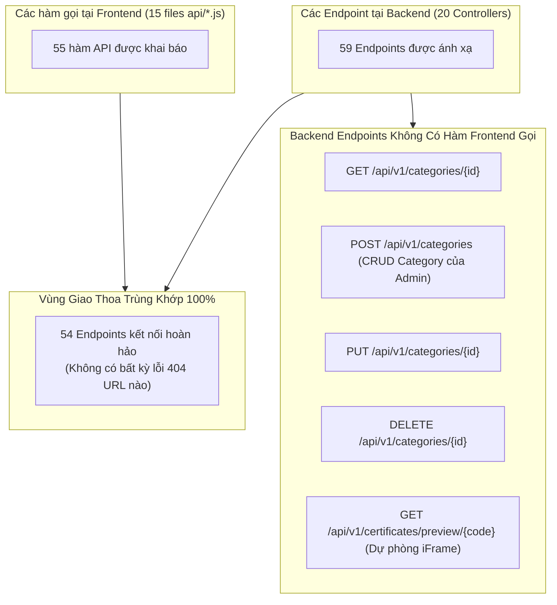
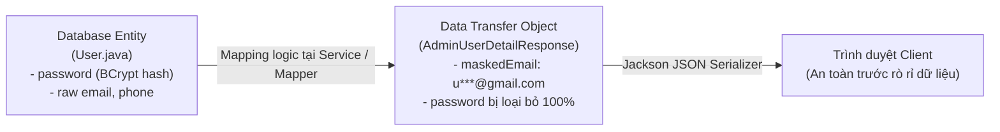

# TÀI LIỆU HỆ THỐNG MOOC-LMS - PHẦN 3
# BẢN ĐỒ API, ĐỐI CHIẾU HAI CHIỀU & TỪ ĐIỂN DTO (API MAP, RECONCILIATION & DTO DICTIONARY)

> **Mã tài liệu:** `FLOW-03`  
> **Trạng thái xác minh:** [ĐỌC CODE] & [ĐÃ CHẠY]  
> **Căn cứ mã nguồn:**
> - Toàn bộ 20 REST Controllers trong `lms-backend/src/main/java/com/lms/lms_backend/controller/`
> - Toàn bộ 15 Module API Client trong `lms-frontend/src/api/`
> - Toàn bộ 70+ DTO classes trong `lms-backend/src/main/java/com/lms/lms_backend/dto/`
> - Cấu hình bảo mật đường dẫn trong `SecurityConfig.java:69-101`

---

## 1. THUẬT NGỮ NHẬP MÔN
- **DTO (Data Transfer Object - Vật chứa chuyển chở dữ liệu):** Giống như một thùng hàng đóng gói đã qua kiểm duyệt hải quan. Thay vì bê nguyên cả kho hàng (Entity CSDL chứa cả mật khẩu, khóa bí mật, thông tin nội bộ) đem gửi cho người mua, bạn chỉ nhặt đúng những món đồ được phép xem bỏ vào thùng hàng DTO rồi gửi đi.
- **Idempotent (Tính bất biến / Lặp lại không đổi):** Giống như nút bấm thang máy tầng 5. Cho dù bạn bấm 1 lần hay bấm liên tục 10 lần thì thang máy vẫn chỉ lên tầng 5 (các method `GET`, `PUT`, `DELETE`). Ngược lại, nút "Chuyển khoản 100k" nếu bấm 10 lần sẽ bị mất 1 triệu (`POST` - Non-idempotent).
- **Dual Routing (Định tuyến kép song song):** Giống như một ngôi nhà có 2 biển số: số mới theo quy hoạch (`/api/v1/courses`) và số cũ trước đây (`/api/courses`). Khách gọi biển số nào bác bưu tá (Spring Boot) cũng mang thư đến đúng phòng khách.
- **Data Masking (Mặt nạ che giấu dữ liệu):** Giống như số thẻ ngân hàng in trên hóa đơn siêu thị `**** **** **** 1234`. Nhân viên thu ngân vẫn đối chiếu được nhưng kẻ đứng sau lưng không thể chụp lén toàn bộ số tài khoản của bạn.
- **Two-way Reconciliation (Đối chiếu hai chiều):** Giống như việc kiểm kê kho hàng cuối tháng giữa sổ xuất nhập của kế toán (Frontend) và kiện hàng thực tế trên giá kệ của thủ kho (Backend) xem có chỗ nào bị lệch, bị thừa hay bị thất lạc hay không.

---

## 2. MA TRẬN API TOÀN DIỆN (FULL API MATRIX)

Bảng ma trận dưới đây liệt kê chính xác 100% các endpoint của hệ thống MOOC-LMS, phân loại theo 12 nhóm nghiệp vụ thực tế [ĐỌC CODE]:

### 2.1. Nhóm 1: Xác thực & Hồ sơ cá nhân (Authentication & Profile)

| Hàm Frontend (`api/*.js`) | Hook / Trang sử dụng | Method & URL | Controller.method (File:Dòng) | Quyền truy cập | Request DTO | Response DTO | Service.method | Bảng đọc/ghi | Ghi chú & Ràng buộc |
| :--- | :--- | :--- | :--- | :--- | :--- | :--- | :--- | :--- | :--- |
| `authApi.login` | `AuthContext.jsx` -> `LoginPage.jsx` | `POST /api/v1/auth/login` | [`AuthController.java:38`](file:///d:/University/E-Learning/MOOC-lms/lms-backend/src/main/java/com/lms/lms_backend/controller/AuthController.java#L38) | `permitAll()` | `LoginRequest` (email, password) | `AuthResponse` | `AuthService.login` | Đọc `users`, Ghi `refresh_tokens` | Sinh JWT 15p (RAM) + Set-Cookie Refresh 7 ngày. |
| `authApi.register` | `AuthContext.jsx` -> `RegisterModal.jsx` | `POST /api/v1/auth/register` | [`AuthController.java:30`](file:///d:/University/E-Learning/MOOC-lms/lms-backend/src/main/java/com/lms/lms_backend/controller/AuthController.java#L30) | `permitAll()` | `RegisterRequest` | `AuthResponse` | `AuthService.register` | Ghi `users`, `refresh_tokens` | Mặc định cấp vai trò `ROLE_STUDENT`. |
| `authApi.refreshToken` | `AuthContext.jsx` (Silent Refresh) | `POST /api/v1/auth/refresh` | [`AuthController.java:46`](file:///d:/University/E-Learning/MOOC-lms/lms-backend/src/main/java/com/lms/lms_backend/controller/AuthController.java#L46) | `permitAll()` | Cookie `refreshToken` | `AuthResponse` | `AuthService.refreshToken` | Đọc/Ghi `refresh_tokens` | Token Rotation. Bắt tái sử dụng -> Thu hồi khẩn cấp. |
| `authApi.logout` | `AuthContext.jsx` (Nút đăng xuất) | `POST /api/v1/auth/logout` | [`AuthController.java:54`](file:///d:/University/E-Learning/MOOC-lms/lms-backend/src/main/java/com/lms/lms_backend/controller/AuthController.java#L54) | `permitAll()` | Cookie `refreshToken` | `Map<String, String>` | `AuthService.logout` | Ghi `refresh_tokens` | Đánh dấu `revoked=true`, xóa cookie `Max-Age=0`. |
| `authApi.getMe` | `AuthContext.jsx` | `GET /api/v1/auth/me` | [`AuthController.java:65`](file:///d:/University/E-Learning/MOOC-lms/lms-backend/src/main/java/com/lms/lms_backend/controller/AuthController.java#L65) | `authenticated()` | Không | `UserProfileResponse` | `AuthService.getProfile` | Đọc `users` | Lấy profile người dùng hiện tại từ SecurityContext. |
| `authApi.updateProfile` | `useProfile.js` -> `ProfilePages.jsx` | `PUT /api/v1/auth/profile` | [`AuthController.java:70`](file:///d:/University/E-Learning/MOOC-lms/lms-backend/src/main/java/com/lms/lms_backend/controller/AuthController.java#L70) | `authenticated()` | `UpdateProfileRequest` | `UserProfileResponse` | `AuthService.updateProfile` | Ghi `users` | Cập nhật fullName, phone, bio, avatarUrl. |
| `authApi.changePassword` | `useProfile.js` -> `ChangePasswordModal` | `PUT /api/v1/auth/change-password` | [`AuthController.java:78`](file:///d:/University/E-Learning/MOOC-lms/lms-backend/src/main/java/com/lms/lms_backend/controller/AuthController.java#L78) | `authenticated()` | `ChangePasswordRequest` | `String` (Text) | `AuthService.changePassword` | Ghi `users` | Xác thực mật khẩu cũ trước khi băm mật khẩu mới. |

---

### 2.2. Nhóm 2: Danh mục khóa học (Categories)

| Hàm Frontend (`api/*.js`) | Hook / Trang sử dụng | Method & URL | Controller.method (File:Dòng) | Quyền truy cập | Request DTO | Response DTO | Service.method | Bảng đọc/ghi | Ghi chú & Ràng buộc |
| :--- | :--- | :--- | :--- | :--- | :--- | :--- | :--- | :--- | :--- |
| `courseApi.getCategories` | `useCategories.js` -> `Navbar`, `ExplorePage` | `GET /api/v1/categories` | [`CategoryController.java:30`](file:///d:/University/E-Learning/MOOC-lms/lms-backend/src/main/java/com/lms/lms_backend/controller/CategoryController.java#L30) | `permitAll()` | Không | `List<Category>` | `CategoryService.getAll` | Đọc `categories` | Cache danh mục công khai cho bộ lọc tìm kiếm. |
| *(Chưa có hàm gọi)* | *(Backend API độc lập)* | `GET /api/v1/categories/{id}` | [`CategoryController.java:35`](file:///d:/University/E-Learning/MOOC-lms/lms-backend/src/main/java/com/lms/lms_backend/controller/CategoryController.java#L35) | `permitAll()` | Path `id` | `Category` | `CategoryService.getById` | Đọc `categories` | Lấy chi tiết 1 danh mục theo ID. |
| *(Chưa có hàm gọi)* | *(Backend API độc lập)* | `POST /api/v1/categories` | [`CategoryController.java:40`](file:///d:/University/E-Learning/MOOC-lms/lms-backend/src/main/java/com/lms/lms_backend/controller/CategoryController.java#L40) | `ROLE_ADMIN` | `CategoryRequest` | `Category` | `CategoryService.create` | Ghi `categories` | Tạo danh mục mới kèm slug tự động. |
| *(Chưa có hàm gọi)* | *(Backend API độc lập)* | `PUT /api/v1/categories/{id}` | [`CategoryController.java:46`](file:///d:/University/E-Learning/MOOC-lms/lms-backend/src/main/java/com/lms/lms_backend/controller/CategoryController.java#L46) | `ROLE_ADMIN` | `CategoryRequest` | `Category` | `CategoryService.update` | Ghi `categories` | Cập nhật tên, icon, mô tả danh mục. |
| *(Chưa có hàm gọi)* | *(Backend API độc lập)* | `DELETE /api/v1/categories/{id}` | [`CategoryController.java:52`](file:///d:/University/E-Learning/MOOC-lms/lms-backend/src/main/java/com/lms/lms_backend/controller/CategoryController.java#L52) | `ROLE_ADMIN` | Path `id` | `String` (Text) | `CategoryService.delete` | Xóa `categories` | Xóa danh mục nếu không có khóa học phụ thuộc. |

---

### 2.3. Nhóm 3: Khóa học công khai & Quản lý khóa học (Courses)

| Hàm Frontend (`api/*.js`) | Hook / Trang sử dụng | Method & URL | Controller.method (File:Dòng) | Quyền truy cập | Request DTO | Response DTO | Service.method | Bảng đọc/ghi | Ghi chú & Ràng buộc |
| :--- | :--- | :--- | :--- | :--- | :--- | :--- | :--- | :--- | :--- |
| `courseApi.getPublishedCourses` | `useCourses.js` -> `CourseListingPage` | `GET /api/v1/courses/public` | [`CourseController.java:34`](file:///d:/University/E-Learning/MOOC-lms/lms-backend/src/main/java/com/lms/lms_backend/controller/CourseController.java#L34) | `permitAll()` | Query: `priceType`, `minPrice`, `maxPrice`, `categoryId`, `search` | `List<CourseResponse>` | `CourseService.getAllPublishedCourses` | Đọc `courses` | Đi qua `CourseSpecification` lọc động đa tiêu chí. |
| `courseApi.getCourseBySlug` | `useCourses.js` -> `CourseDetailPage` | `GET /api/v1/courses/public/{slug}` | [`CourseController.java:46`](file:///d:/University/E-Learning/MOOC-lms/lms-backend/src/main/java/com/lms/lms_backend/controller/CourseController.java#L46) | `permitAll()` | Path `slug` | `CourseResponse` | `CourseService.getCourseBySlug` | Đọc `courses`, `sections`, `lessons` | Khóa học công khai, bóc kèm cây chương mục và bài học. |
| `courseApi.getCourseById` | `useCourses.js` -> `CourseEditorPage` | `GET /api/v1/courses/{id}` | [`CourseController.java:52`](file:///d:/University/E-Learning/MOOC-lms/lms-backend/src/main/java/com/lms/lms_backend/controller/CourseController.java#L52) | `authenticated()` | Path `id` | `CourseResponse` | `CourseService.getCourseById` | Đọc `courses` | Kiểm tra quyền: Chủ sở hữu, Admin hoặc Học viên đã mua. |
| `courseApi.getMyTeachingCourses` | `useCourses.js` -> `InstructorDashboard` | `GET /api/v1/courses/my-teaching` | [`CourseController.java:122`](file:///d:/University/E-Learning/MOOC-lms/lms-backend/src/main/java/com/lms/lms_backend/controller/CourseController.java#L122) | `ROLE_INSTRUCTOR`, `ROLE_ADMIN` | Không | `List<CourseResponse>` | `CourseService.getMyTeachingCourses` | Đọc `courses` | Lấy toàn bộ khóa học do Giảng viên hiện tại giảng dạy. |
| `courseApi.createCourse` | `useCourses.js` -> `CourseCreateWizardPage` | `POST /api/v1/courses` | [`CourseController.java:62`](file:///d:/University/E-Learning/MOOC-lms/lms-backend/src/main/java/com/lms/lms_backend/controller/CourseController.java#L62) | `ROLE_INSTRUCTOR`, `ROLE_ADMIN` | `CourseCreateRequest` | `CourseResponse` | `CourseService.createCourse` | Ghi `courses`, `audit_logs` | Trạng thái ban đầu: `DRAFT`. Ghi Audit Log. |
| `courseApi.updateCourse` | `useCourses.js` -> `CourseEditorPage` | `PUT /api/v1/courses/{id}` | [`CourseController.java:72`](file:///d:/University/E-Learning/MOOC-lms/lms-backend/src/main/java/com/lms/lms_backend/controller/CourseController.java#L72) | `ROLE_INSTRUCTOR`, `ROLE_ADMIN` | `CourseUpdateRequest` | `CourseResponse` | `CourseService.updateCourse` | Ghi `courses`, `audit_logs` | Cập nhật thông tin, giá bán, đổi slug nếu sửa title. |
| `courseApi.submitForReview` | `useCourses.js` -> `CourseEditorPage` | `POST /api/v1/courses/{id}/submit-review` | [`CourseController.java:83`](file:///d:/University/E-Learning/MOOC-lms/lms-backend/src/main/java/com/lms/lms_backend/controller/CourseController.java#L83) | `ROLE_INSTRUCTOR`, `ROLE_ADMIN` | Path `id` | `CourseResponse` | `CourseService.submitForReview` | Ghi `courses`, `notifications` | Đổi trạng thái `PENDING_REVIEW`, gửi thông báo cho Admin. |
| `courseApi.requestDeleteCourse`| `useCourses.js` -> `InstructorDashboard` | `POST /api/v1/courses/{id}/request-delete` | [`CourseController.java:93`](file:///d:/University/E-Learning/MOOC-lms/lms-backend/src/main/java/com/lms/lms_backend/controller/CourseController.java#L93) | `ROLE_INSTRUCTOR`, `ROLE_ADMIN` | Path `id` | `CourseResponse` | `CourseService.requestDeleteCourse` | Ghi `courses`, `notifications` | Yêu cầu gỡ khóa học chuyển sang Admin xét duyệt. |
| `courseApi.deleteCourse` | `useCourses.js` -> `CourseEditorPage` | `DELETE /api/v1/courses/{id}` | [`CourseController.java:102`](file:///d:/University/E-Learning/MOOC-lms/lms-backend/src/main/java/com/lms/lms_backend/controller/CourseController.java#L102) | `ROLE_INSTRUCTOR`, `ROLE_ADMIN` | Path `id` | `CourseDeleteResponse` | `CourseService.deleteCourse` | Ghi `courses` (Soft delete) | Đánh dấu `isDeleted=true`, lưu thời điểm `deletedAt`. |
| `courseApi.restoreCourse` | `useCourses.js` -> `InstructorDashboard` | `POST /api/v1/courses/{id}/restore` | [`CourseController.java:112`](file:///d:/University/E-Learning/MOOC-lms/lms-backend/src/main/java/com/lms/lms_backend/controller/CourseController.java#L112) | `ROLE_INSTRUCTOR`, `ROLE_ADMIN` | Path `id` | `CourseResponse` | `CourseService.restoreCourse` | Ghi `courses` | Khôi phục khóa học đã bị xóa mềm (`isDeleted=false`). |

---

### 2.4. Nhóm 4: Khung chương trình đào tạo (Sections & Lessons)

| Hàm Frontend (`api/*.js`) | Hook / Trang sử dụng | Method & URL | Controller.method (File:Dòng) | Quyền truy cập | Request DTO | Response DTO | Service.method | Bảng đọc/ghi | Ghi chú & Ràng buộc |
| :--- | :--- | :--- | :--- | :--- | :--- | :--- | :--- | :--- | :--- |
| `courseApi.getSectionsByCourse` | `useCurriculum.js` -> `CoursePlayerPage` | `GET /api/v1/sections/course/{courseId}` | [`SectionController.java:30`](file:///d:/University/E-Learning/MOOC-lms/lms-backend/src/main/java/com/lms/lms_backend/controller/SectionController.java#L30) | `permitAll()` | Path `courseId` | `List<SectionResponse>` | `SectionService.getSectionsByCourse` | Đọc `sections`, `lessons` | Trả về cây danh sách chương và toàn bộ bài học bên trong. |
| `courseApi.createSection` | `useCurriculum.js` -> `CourseEditorPage` | `POST /api/v1/sections` | [`SectionController.java:35`](file:///d:/University/E-Learning/MOOC-lms/lms-backend/src/main/java/com/lms/lms_backend/controller/SectionController.java#L35) | `ROLE_INSTRUCTOR`, `ROLE_ADMIN` | `SectionRequest` | `SectionResponse` | `SectionService.createSection` | Ghi `sections`, `audit_logs` | Tạo chương mục mới (orderIndex tự tăng). |
| `courseApi.updateSection` | `useCurriculum.js` -> `CourseEditorPage` | `PUT /api/v1/sections/{id}` | [`SectionController.java:41`](file:///d:/University/E-Learning/MOOC-lms/lms-backend/src/main/java/com/lms/lms_backend/controller/SectionController.java#L41) | `ROLE_INSTRUCTOR`, `ROLE_ADMIN` | `SectionRequest` | `SectionResponse` | `SectionService.updateSection` | Ghi `sections` | Đổi tên chương mục hoặc thứ tự sắp xếp. |
| `courseApi.deleteSection` | `useCurriculum.js` -> `CourseEditorPage` | `DELETE /api/v1/sections/{id}` | [`SectionController.java:47`](file:///d:/University/E-Learning/MOOC-lms/lms-backend/src/main/java/com/lms/lms_backend/controller/SectionController.java#L47) | `ROLE_INSTRUCTOR`, `ROLE_ADMIN` | Path `id` | `String` (Text) | `SectionService.deleteSection` | Xóa `sections`, `lessons` | Xóa tầng (Cascade) toàn bộ bài học thuộc chương đó. |
| `courseApi.getLessonsBySection` | `useCurriculum.js` | `GET /api/v1/lessons/section/{sectionId}` | [`LessonController.java:31`](file:///d:/University/E-Learning/MOOC-lms/lms-backend/src/main/java/com/lms/lms_backend/controller/LessonController.java#L31) | `permitAll()` | Path `sectionId` | `List<LessonResponse>` | `LessonService.getLessonsBySection` | Đọc `lessons` | Lấy danh sách bài học thuộc 1 chương. |
| `courseApi.getLessonById` | `useCurriculum.js` -> `CoursePlayerPage` | `GET /api/v1/lessons/{id}` | [`LessonController.java:36`](file:///d:/University/E-Learning/MOOC-lms/lms-backend/src/main/java/com/lms/lms_backend/controller/LessonController.java#L36) | `permitAll()` | Path `id` | `LessonResponse` | `LessonService.getLessonById` | Đọc `lessons` | Chi tiết bài học (Video URL, nội dung text, PDF đính kèm). |
| `courseApi.createLesson` | `useCurriculum.js` -> `CourseEditorPage` | `POST /api/v1/lessons` | [`LessonController.java:45`](file:///d:/University/E-Learning/MOOC-lms/lms-backend/src/main/java/com/lms/lms_backend/controller/LessonController.java#L45) | `ROLE_INSTRUCTOR`, `ROLE_ADMIN` | `LessonRequest` | `LessonResponse` | `LessonService.createLesson` | Ghi `lessons`, `audit_logs` | Thêm bài học mới (VIDEO / TEXT / DOCUMENT). |
| `courseApi.updateLesson` | `useCurriculum.js` -> `CourseEditorPage` | `PUT /api/v1/lessons/{id}` | [`LessonController.java:51`](file:///d:/University/E-Learning/MOOC-lms/lms-backend/src/main/java/com/lms/lms_backend/controller/LessonController.java#L51) | `ROLE_INSTRUCTOR`, `ROLE_ADMIN` | `LessonRequest` | `LessonResponse` | `LessonService.updateLesson` | Ghi `lessons` | Cập nhật thời lượng, URL video, nội dung bài học. |
| `courseApi.deleteLesson` | `useCurriculum.js` -> `CourseEditorPage` | `DELETE /api/v1/lessons/{id}` | [`LessonController.java:57`](file:///d:/University/E-Learning/MOOC-lms/lms-backend/src/main/java/com/lms/lms_backend/controller/LessonController.java#L57) | `ROLE_INSTRUCTOR`, `ROLE_ADMIN` | Path `id` | `String` (Text) | `LessonService.deleteLesson` | Xóa `lessons` | Xóa bài học khỏi chương mục. |

---

### 2.5. Nhóm 5: Giỏ hàng & Thanh toán đơn hàng (Cart & Orders)

| Hàm Frontend (`api/*.js`) | Hook / Trang sử dụng | Method & URL | Controller.method (File:Dòng) | Quyền truy cập | Request DTO | Response DTO | Service.method | Bảng đọc/ghi | Ghi chú & Ràng buộc |
| :--- | :--- | :--- | :--- | :--- | :--- | :--- | :--- | :--- | :--- |
| `cartApi.getCart` | `useCart.js` -> `CartPage.jsx` | `GET /api/v1/cart` | [`CartController.java:30`](file:///d:/University/E-Learning/MOOC-lms/lms-backend/src/main/java/com/lms/lms_backend/controller/CartController.java#L30) | `ROLE_STUDENT` | Không | `CartResponse` | `CartService.getCart` | Đọc `cart_items`, `courses` | Lấy danh sách khóa học trong giỏ và tính tổng tiền. |
| `cartApi.addToCart` | `useCart.js` -> `CourseDetailPage` | `POST /api/v1/cart/items` | [`CartController.java:37`](file:///d:/University/E-Learning/MOOC-lms/lms-backend/src/main/java/com/lms/lms_backend/controller/CartController.java#L37) | `ROLE_STUDENT` | `AddToCartRequest` (courseId) | `CartResponse` | `CartService.addToCart` | Ghi `cart_items` | Chặn thêm khóa học FREE hoặc khóa học đã sở hữu. |
| `cartApi.removeFromCart` | `useCart.js` -> `CartPage.jsx` | `DELETE /api/v1/cart/items/{courseId}` | [`CartController.java:47`](file:///d:/University/E-Learning/MOOC-lms/lms-backend/src/main/java/com/lms/lms_backend/controller/CartController.java#L47) | `ROLE_STUDENT` | Path `courseId` | `CartResponse` | `CartService.removeFromCart` | Xóa `cart_items` | Xóa 1 khóa học ra khỏi giỏ hàng. |
| `cartApi.checkout` / `orderApi.checkout` | `useOrders.js` -> `CheckoutPage.jsx` | `POST /api/v1/orders/checkout` | [`OrderController.java:27`](file:///d:/University/E-Learning/MOOC-lms/lms-backend/src/main/java/com/lms/lms_backend/controller/OrderController.java#L27) | `authenticated()` | `CheckoutRequest` (paymentMethod) | `OrderResponse` | `OrderService.checkout` | Ghi `orders`, `order_items`, `enrollments`, Xóa `cart_items` | Giao dịch nguyên tử (`@Transactional`), sinh mã ORD-XXXX. |
| `orderApi.getMyOrders` | `useOrders.js` -> `OrdersHistoryPage` | `GET /api/v1/orders` | [`OrderController.java:38`](file:///d:/University/E-Learning/MOOC-lms/lms-backend/src/main/java/com/lms/lms_backend/controller/OrderController.java#L38) | `authenticated()` | Không | `List<OrderResponse>` | `OrderService.getMyOrders` | Đọc `orders`, `order_items` | Lấy toàn bộ lịch sử mua hàng của học viên. |
| `orderApi.getOrderById` | `useOrders.js` -> `OrderSuccessPage` | `GET /api/v1/orders/{id}` | [`OrderController.java:43`](file:///d:/University/E-Learning/MOOC-lms/lms-backend/src/main/java/com/lms/lms_backend/controller/OrderController.java#L43) | `authenticated()` | Path `id` | `OrderResponse` | `OrderService.getOrderById` | Đọc `orders` | Kiểm tra quyền sở hữu: chỉ chính chủ hoặc Admin. |

---

### 2.6. Nhóm 6: Phiên thanh toán QR hai thiết bị (Payment Sessions)

| Hàm Frontend (`api/*.js`) | Hook / Trang sử dụng | Method & URL | Controller.method (File:Dòng) | Quyền truy cập | Request DTO | Response DTO | Service.method | Bảng đọc/ghi | Ghi chú & Ràng buộc |
| :--- | :--- | :--- | :--- | :--- | :--- | :--- | :--- | :--- | :--- |
| `paymentSessionApi.createSession` | `CheckoutPage.jsx` | `POST /api/v1/payment-sessions` | [`PaymentSessionController.java:29`](file:///d:/University/E-Learning/MOOC-lms/lms-backend/src/main/java/com/lms/lms_backend/controller/PaymentSessionController.java#L29) | `authenticated()` | Không | `PaymentSessionResponse` | `PaymentSessionService.createSession` | Ghi `payment_sessions` | Sinh token UUID v4 sống 15 phút để in mã QR. |
| `paymentSessionApi.getSessionStatus` | `CheckoutPage.jsx` (Polling 2s) | `GET /api/v1/payment-sessions/{token}/status` | [`PaymentSessionController.java:38`](file:///d:/University/E-Learning/MOOC-lms/lms-backend/src/main/java/com/lms/lms_backend/controller/PaymentSessionController.java#L38) | `permitAll()` | Path `token` | `PaymentSessionStatusResponse` | `PaymentSessionService.getSessionStatus` | Đọc `payment_sessions` | Cho phép PC thăm dò trạng thái quét từ điện thoại. |
| `paymentSessionApi.confirmSession` | `ConfirmPaymentPage.jsx` (Mobile) | `POST /api/v1/payment-sessions/{token}/confirm` | [`PaymentSessionController.java:47`](file:///d:/University/E-Learning/MOOC-lms/lms-backend/src/main/java/com/lms/lms_backend/controller/PaymentSessionController.java#L47) | `permitAll()` | Path `token` | `PaymentSessionStatusResponse` | `PaymentSessionService.confirmSession` | Ghi `payment_sessions`, gọi `checkout` | Điện thoại xác nhận -> tự động kích hoạt tạo đơn hàng. |

---

### 2.7. Nhóm 7: Học tập, Ghi danh & Tiến độ bài học (Learning & Enrollments)

| Hàm Frontend (`api/*.js`) | Hook / Trang sử dụng | Method & URL | Controller.method (File:Dòng) | Quyền truy cập | Request DTO | Response DTO | Service.method | Bảng đọc/ghi | Ghi chú & Ràng buộc |
| :--- | :--- | :--- | :--- | :--- | :--- | :--- | :--- | :--- | :--- |
| `learningApi.enrollCourse` | `useEnrollment.js` -> `CourseDetailPage` | `POST /api/v1/enrollments` | [`EnrollmentController.java:30`](file:///d:/University/E-Learning/MOOC-lms/lms-backend/src/main/java/com/lms/lms_backend/controller/EnrollmentController.java#L30) | `authenticated()` | `EnrollmentRequest` (courseId) | `EnrollmentResponse` | `EnrollmentService.enrollCourse` | Ghi `enrollments` | Ghi danh trực tiếp cho các khóa học **MIỄN PHÍ** (0 VNĐ). |
| `learningApi.getMyEnrollments` | `useEnrollment.js` -> `MyLearningPage` | `GET /api/v1/enrollments/my-learning` | [`EnrollmentController.java:39`](file:///d:/University/E-Learning/MOOC-lms/lms-backend/src/main/java/com/lms/lms_backend/controller/EnrollmentController.java#L39) | `authenticated()` | Không | `List<EnrollmentResponse>` | `EnrollmentService.getMyEnrollments` | Đọc `enrollments`, `courses` | Trả về danh sách khóa học đang theo học và % tiến độ. |
| `learningApi.checkEnrollment` | `useEnrollment.js` -> `CourseDetailPage` | `GET /api/v1/enrollments/check/{courseId}` | [`EnrollmentController.java:45`](file:///d:/University/E-Learning/MOOC-lms/lms-backend/src/main/java/com/lms/lms_backend/controller/EnrollmentController.java#L45) | `authenticated()` | Path `courseId` | `Map<String, Boolean>` | `EnrollmentService.isEnrolled` | Đọc `enrollments` | Kiểm tra nhanh xem học viên đã sở hữu khóa học chưa. |
| `learningApi.completeLesson` | `useLearning.js` -> `CoursePlayerPage` | `POST /api/v1/learning/complete` | [`LearningController.java:29`](file:///d:/University/E-Learning/MOOC-lms/lms-backend/src/main/java/com/lms/lms_backend/controller/LearningController.java#L29) | `authenticated()` | `LessonCompleteRequest` | `LessonProgressResponse` | `ProgressService.completeLesson` | Ghi `lesson_progress`, Cập nhật `enrollments` | Đánh dấu tick xanh bài học & tính lại tổng % tiến độ. |
| `learningApi.getProgress` | `useLearning.js` -> `CoursePlayerPage` | `GET /api/v1/learning/progress/{enrollmentId}` | [`LearningController.java:38`](file:///d:/University/E-Learning/MOOC-lms/lms-backend/src/main/java/com/lms/lms_backend/controller/LearningController.java#L38) | `authenticated()` | Path `enrollmentId` | `List<LessonProgressResponse>` | `ProgressService.getLessonProgressList` | Đọc `lesson_progress` | Trả về danh sách toàn bộ ID bài học đã hoàn thành. |

---

### 2.8. Nhóm 8: Trắc nghiệm đánh giá (Quizzes & Submission)

| Hàm Frontend (`api/*.js`) | Hook / Trang sử dụng | Method & URL | Controller.method (File:Dòng) | Quyền truy cập | Request DTO | Response DTO | Service.method | Bảng đọc/ghi | Ghi chú & Ràng buộc |
| :--- | :--- | :--- | :--- | :--- | :--- | :--- | :--- | :--- | :--- |
| `quizApi.createQuiz` | `useQuiz.js` -> `QuizBuilderPage` | `POST /api/v1/quizzes` | [`QuizController.java:32`](file:///d:/University/E-Learning/MOOC-lms/lms-backend/src/main/java/com/lms/lms_backend/controller/QuizController.java#L32) | `ROLE_INSTRUCTOR`, `ROLE_ADMIN` | `QuizCreateRequest` | `QuizResponse` | `QuizService.createQuiz` | Ghi `quizzes`, `questions`, `answers` | Giảng viên soạn đề thi trắc nghiệm trọn gói. |
| `quizApi.getQuizzesByCourse` | `useQuiz.js` -> `CoursePlayerPage` | `GET /api/v1/quizzes/course/{courseId}` | [`QuizController.java:39`](file:///d:/University/E-Learning/MOOC-lms/lms-backend/src/main/java/com/lms/lms_backend/controller/QuizController.java#L39) | `permitAll()` | Path `courseId` | `List<QuizResponse>` | `QuizService.getQuizzesByCourse` | Đọc `quizzes` | **Ẩn trường `isCorrect`** khi học viên xem danh sách đề. |
| `quizApi.getQuizById` | `useQuiz.js` -> `QuizTakingPage` | `GET /api/v1/quizzes/{id}` | [`QuizController.java:49`](file:///d:/University/E-Learning/MOOC-lms/lms-backend/src/main/java/com/lms/lms_backend/controller/QuizController.java#L49) | `permitAll()` | Path `id` | `QuizResponse` | `QuizService.getQuizById` | Đọc `quizzes`, `questions`, `answers` | **Bảo mật:** Học viên làm bài KHÔNG nhìn thấy đáp án đúng. |
| `quizApi.submitQuiz` | `useQuiz.js` -> `QuizTakingPage` | `POST /api/v1/quizzes/{id}/submit` | [`QuizController.java:59`](file:///d:/University/E-Learning/MOOC-lms/lms-backend/src/main/java/com/lms/lms_backend/controller/QuizController.java#L59) | `authenticated()` | `QuizSubmissionRequest` | `QuizResultResponse` | `QuizService.submitQuiz` | Đọc `answers`, Cập nhật `enrollments` | Chấm điểm tự động, tính tỷ lệ %, tự động cấp chứng chỉ nếu đậu. |

---

### 2.9. Nhóm 9: Chứng chỉ tốt nghiệp (Certificates)

| Hàm Frontend (`api/*.js`) | Hook / Trang sử dụng | Method & URL | Controller.method (File:Dòng) | Quyền truy cập | Request DTO | Response DTO | Service.method | Bảng đọc/ghi | Ghi chú & Ràng buộc |
| :--- | :--- | :--- | :--- | :--- | :--- | :--- | :--- | :--- | :--- |
| `certificateApi.verifyCertificate` | `CertificateVerifyPage.jsx` | `GET /api/v1/certificates/verify/{code}` | [`CertificateController.java:28`](file:///d:/University/E-Learning/MOOC-lms/lms-backend/src/main/java/com/lms/lms_backend/controller/CertificateController.java#L28) | `permitAll()` | Path `code` (UUID) | `CertificateResponse` | `CertificateService.verifyCertificate` | Đọc `certificates`, `courses`, `users` | Tra cứu chứng chỉ công khai không cần đăng nhập. |
| `certificateApi.getCertificateByEnrollment`| `useCertificates.js` -> `MyCertificatesPage` | `GET /api/v1/certificates/enrollment/{enrollmentId}` | [`CertificateController.java:34`](file:///d:/University/E-Learning/MOOC-lms/lms-backend/src/main/java/com/lms/lms_backend/controller/CertificateController.java#L34) | `authenticated()` | Path `enrollmentId` | `CertificateResponse` | `CertificateService.getCertificateByEnrollment` | Đọc/Ghi `certificates` | Tự động phát hành chứng chỉ nếu học viên đạt 100%. |
| `certificateApi.getDownloadUrl` | `MyCertificatesPage.jsx` (Thẻ `<a download>`) | `GET /api/v1/certificates/download/{code}` | [`CertificateController.java:40`](file:///d:/University/E-Learning/MOOC-lms/lms-backend/src/main/java/com/lms/lms_backend/controller/CertificateController.java#L40) | `permitAll()` | Path `code` | `byte[]` (`application/pdf`) | `CertificateService.getCertificatePdfByCode` | Đọc `certificates` | Trả tệp PDF nhị phân kèm header `Content-Disposition: attachment`. |
| *(Dự phòng iFrame)* | *(Trình nhúng PDF)* | `GET /api/v1/certificates/preview/{code}` | [`CertificateController.java:50`](file:///d:/University/E-Learning/MOOC-lms/lms-backend/src/main/java/com/lms/lms_backend/controller/CertificateController.java#L50) | `permitAll()` | Path `code` | `byte[]` (`application/pdf`) | `CertificateService.getCertificatePdfByCode` | Đọc `certificates` | Trả PDF inline hiển thị trực tiếp trong trình duyệt. |
| `certificateApi.getAdminCertificates` | `AdminCertificatesPage.jsx` | `GET /api/v1/admin/certificates` | [`AdminCertificateController.java:35`](file:///d:/University/E-Learning/MOOC-lms/lms-backend/src/main/java/com/lms/lms_backend/controller/AdminCertificateController.java#L35) | `ROLE_ADMIN` | Query: `page`, `size`, `search`, `status` | `CertificatePageResponse` | `CertificateService.getAdminCertificates` | Đọc `certificates` | Quản trị viên lọc danh sách tất cả chứng chỉ toàn sàn. |
| `certificateApi.getAdminCertificateSummary` | `AdminCertificatesPage.jsx` | `GET /api/v1/admin/certificates/summary` | [`AdminCertificateController.java:47`](file:///d:/University/E-Learning/MOOC-lms/lms-backend/src/main/java/com/lms/lms_backend/controller/AdminCertificateController.java#L47) | `ROLE_ADMIN` | Không | `CertificateSummaryResponse` | `CertificateService.getCertificateSummary` | Đọc `certificates` | Thống kê: Tổng cấp, còn hiệu lực, đã thu hồi. |
| `certificateApi.revokeCertificate` | `AdminCertificatesPage.jsx` | `POST /api/v1/admin/certificates/{id}/revoke` | [`AdminCertificateController.java:52`](file:///d:/University/E-Learning/MOOC-lms/lms-backend/src/main/java/com/lms/lms_backend/controller/AdminCertificateController.java#L52) | `ROLE_ADMIN` | `CertificateRevokeRequest` | `CertificateAdminResponse` | `CertificateService.revokeCertificate` | Ghi `certificates` | Thu hồi chứng chỉ (gian lận điểm, hủy kết quả). |
| `certificateApi.reinstateCertificate` | `AdminCertificatesPage.jsx` | `POST /api/v1/admin/certificates/{id}/reinstate` | [`AdminCertificateController.java:62`](file:///d:/University/E-Learning/MOOC-lms/lms-backend/src/main/java/com/lms/lms_backend/controller/AdminCertificateController.java#L62) | `ROLE_ADMIN` | Path `id` | `CertificateAdminResponse` | `CertificateService.reinstateCertificate` | Ghi `certificates` | Khôi phục hiệu lực chứng chỉ đã thu hồi trước đó. |

---

### 2.10. Nhóm 10: Thông báo hệ thống (Notifications)

| Hàm Frontend (`api/*.js`) | Hook / Trang sử dụng | Method & URL | Controller.method (File:Dòng) | Quyền truy cập | Request DTO | Response DTO | Service.method | Bảng đọc/ghi | Ghi chú & Ràng buộc |
| :--- | :--- | :--- | :--- | :--- | :--- | :--- | :--- | :--- | :--- |
| `notificationApi.getNotifications` | `NotificationsPage.jsx`, `NotificationBell` | `GET /api/v1/notifications` | [`NotificationController.java:28`](file:///d:/University/E-Learning/MOOC-lms/lms-backend/src/main/java/com/lms/lms_backend/controller/NotificationController.java#L28) | `authenticated()` | Query: `page`, `size`, `unreadOnly` | `NotificationPageResponse` | `NotificationService.getUserNotifications` | Đọc `notifications` | Phân trang danh sách thông báo của tài khoản hiện tại. |
| `notificationApi.getUnreadCount` | `NotificationBell.jsx` (Polling 30s) | `GET /api/v1/notifications/unread-count` | [`NotificationController.java:40`](file:///d:/University/E-Learning/MOOC-lms/lms-backend/src/main/java/com/lms/lms_backend/controller/NotificationController.java#L40) | `authenticated()` | Không | `UnreadCountResponse` | `NotificationService.getUnreadCount` | Đọc `notifications` | Hiển thị chấm đỏ số lượng thông báo chưa đọc trên chuông. |
| `notificationApi.markAsRead` | `NotificationsPage.jsx` | `PATCH /api/v1/notifications/{id}/read` | [`NotificationController.java:47`](file:///d:/University/E-Learning/MOOC-lms/lms-backend/src/main/java/com/lms/lms_backend/controller/NotificationController.java#L47) | `authenticated()` | Path `id` | `NotificationResponse` | `NotificationService.markAsRead` | Ghi `notifications` | Đánh dấu đã đọc 1 thông báo cụ thể. |
| `notificationApi.markAllAsRead` | `NotificationsPage.jsx` | `PATCH /api/v1/notifications/read-all` | [`NotificationController.java:57`](file:///d:/University/E-Learning/MOOC-lms/lms-backend/src/main/java/com/lms/lms_backend/controller/NotificationController.java#L57) | `authenticated()` | Không | `Map<String, String>` | `NotificationService.markAllAsRead` | Ghi `notifications` | Đánh dấu đọc tất cả các thông báo của người dùng. |

---

### 2.11. Nhóm 11: Quản trị Giảng viên & Doanh thu cá nhân (Instructor Hub)

| Hàm Frontend (`api/*.js`) | Hook / Trang sử dụng | Method & URL | Controller.method (File:Dòng) | Quyền truy cập | Request DTO | Response DTO | Service.method | Bảng đọc/ghi | Ghi chú & Ràng buộc |
| :--- | :--- | :--- | :--- | :--- | :--- | :--- | :--- | :--- | :--- |
| `courseApi.getInstructorCourseProgress` | `StudentProgressPage.jsx` | `GET /api/v1/instructor/courses/{courseId}/progress` | [`InstructorCourseController.java:26`](file:///d:/University/E-Learning/MOOC-lms/lms-backend/src/main/java/com/lms/lms_backend/controller/InstructorCourseController.java#L26) | `ROLE_INSTRUCTOR`, `ROLE_ADMIN` | Path `courseId` | `List<CourseStudentProgressResponse>` | `CourseService.getCourseStudentProgress` | Đọc `enrollments`, `users` | Xem danh sách học viên theo học, % tiến độ, ngày hoàn thành. |
| `courseApi.getInstructorCourseProgress` (all) | `StudentProgressPage.jsx` | `GET /api/v1/instructor/courses/progress` | [`InstructorCourseController.java:34`](file:///d:/University/E-Learning/MOOC-lms/lms-backend/src/main/java/com/lms/lms_backend/controller/InstructorCourseController.java#L34) | `ROLE_INSTRUCTOR`, `ROLE_ADMIN` | Không | `List<CourseStudentProgressResponse>` | `CourseService.getAllCoursesStudentProgress` | Đọc `enrollments` | Thống kê học viên toàn bộ các khóa học do giảng viên phụ trách. |
| `auditApi.getInstructorHistory` | `InstructorHistoryPage.jsx` | `GET /api/v1/instructor/history` | [`InstructorHistoryController.java:28`](file:///d:/University/E-Learning/MOOC-lms/lms-backend/src/main/java/com/lms/lms_backend/controller/InstructorHistoryController.java#L28) | `ROLE_INSTRUCTOR`, `ROLE_ADMIN` | Query: `page`, `size`, `action`, `courseId`, `from`, `to` | `AuditLogPageResponse` | `AuditLogService.getInstructorHistory` | Đọc `audit_logs` | Nhật ký hoạt động kiểm toán (tạo/sửa khóa học, bài học). |
| `revenueApi.getSummary` | `InstructorRevenuePage.jsx` | `GET /api/v1/instructor/revenue/summary` | [`RevenueController.java:30`](file:///d:/University/E-Learning/MOOC-lms/lms-backend/src/main/java/com/lms/lms_backend/controller/RevenueController.java#L30) | `ROLE_INSTRUCTOR`, `ROLE_ADMIN` | Không | `InstructorRevenueSummaryResponse` | `RevenueService.getSummary` | Đọc `order_items`, `enrollments` | Tổng doanh thu gộp, thực nhận (sau trừ 20% phí sàn), số học viên. |
| `revenueApi.getChart` | `InstructorRevenuePage.jsx` | `GET /api/v1/instructor/revenue/chart` | [`RevenueController.java:35`](file:///d:/University/E-Learning/MOOC-lms/lms-backend/src/main/java/com/lms/lms_backend/controller/RevenueController.java#L35) | `ROLE_INSTRUCTOR`, `ROLE_ADMIN` | Query: `groupBy`, `from`, `to` | `List<RevenueChartPointResponse>` | `RevenueService.getChartData` | Đọc `order_items`, `orders` | Dữ liệu vẽ biểu đồ doanh thu theo ngày/tháng/năm. |
| `revenueApi.getCourses` | `InstructorRevenuePage.jsx` | `GET /api/v1/instructor/revenue/courses` | [`RevenueController.java:45`](file:///d:/University/E-Learning/MOOC-lms/lms-backend/src/main/java/com/lms/lms_backend/controller/RevenueController.java#L45) | `ROLE_INSTRUCTOR`, `ROLE_ADMIN` | Không | `List<CourseRevenueResponse>` | `RevenueService.getCourseRevenue` | Đọc `order_items` | Bảng doanh thu chi tiết bổ nhỏ theo từng khóa học. |

---

### 2.12. Nhóm 12: Quản trị Quản trị viên & Doanh thu sàn (Admin Operations)

| Hàm Frontend (`api/*.js`) | Hook / Trang sử dụng | Method & URL | Controller.method (File:Dòng) | Quyền truy cập | Request DTO | Response DTO | Service.method | Bảng đọc/ghi | Ghi chú & Ràng buộc |
| :--- | :--- | :--- | :--- | :--- | :--- | :--- | :--- | :--- | :--- |
| `adminApi.getPendingCourses` | `CourseApprovalPage.jsx` | `GET /api/v1/admin/courses/pending` | [`AdminController.java:39`](file:///d:/University/E-Learning/MOOC-lms/lms-backend/src/main/java/com/lms/lms_backend/controller/AdminController.java#L39) | `ROLE_ADMIN` | Không | `List<CourseResponse>` | `AdminService.getPendingCourses` | Đọc `courses` | Danh sách khóa học giảng viên gửi duyệt (`PENDING_REVIEW`). |
| `adminApi.approveCourse` | `CourseApprovalPage.jsx` | `PATCH /api/v1/admin/courses/{id}/approve` | [`AdminController.java:45`](file:///d:/University/E-Learning/MOOC-lms/lms-backend/src/main/java/com/lms/lms_backend/controller/AdminController.java#L45) | `ROLE_ADMIN` | Path `id` | `CourseResponse` | `AdminService.approveCourse` | Ghi `courses`, `notifications` | Phê duyệt xuất bản (`PUBLISHED`), gửi thông báo chúc mừng. |
| `adminApi.rejectCourse` | `CourseApprovalPage.jsx` | `PATCH /api/v1/admin/courses/{id}/reject` | [`AdminController.java:55`](file:///d:/University/E-Learning/MOOC-lms/lms-backend/src/main/java/com/lms/lms_backend/controller/AdminController.java#L55) | `ROLE_ADMIN` | `RejectCourseRequest` (reason) | `CourseResponse` | `AdminService.rejectCourse` | Ghi `courses`, `notifications` | Từ chối duyệt (`REJECTED`), lưu lý do gửi cho giảng viên. |
| `adminApi.getAllUsers` | `UserManagementPage.jsx` | `GET /api/v1/admin/users` | [`AdminController.java:67`](file:///d:/University/E-Learning/MOOC-lms/lms-backend/src/main/java/com/lms/lms_backend/controller/AdminController.java#L67) | `ROLE_ADMIN` | Không | `List<AdminUserResponse>` | `AdminService.getAllUsers` | Đọc `users` | Danh sách tất cả tài khoản trong hệ thống. |
| `adminApi.toggleUserActive` | `UserManagementPage.jsx` | `PATCH /api/v1/admin/users/{id}/toggle-active` | [`AdminController.java:73`](file:///d:/University/E-Learning/MOOC-lms/lms-backend/src/main/java/com/lms/lms_backend/controller/AdminController.java#L73) | `ROLE_ADMIN` | Path `id` | `AdminUserResponse` | `AdminService.toggleUserActive` | Ghi `users`, `refresh_tokens` | Khóa/Mở khóa tài khoản. Nếu khóa -> Thu hồi toàn bộ token. |
| `adminApi.getUserDetail` | `AdminUserDetailPage.jsx` | `GET /api/v1/admin/users/{id}/detail` | [`AdminController.java:79`](file:///d:/University/E-Learning/MOOC-lms/lms-backend/src/main/java/com/lms/lms_backend/controller/AdminController.java#L79) | `ROLE_ADMIN` | Path `id` | `AdminUserDetailResponse` | `AdminService.getUserDetail` | Đọc `users`, `orders`, `enrollments` | Thông tin chi tiết (Email, SĐT đã qua che mặt nạ Masking). |
| `adminApi.revealSensitiveInfo`| `AdminUserDetailPage.jsx` | `POST /api/v1/admin/users/{id}/reveal` | [`AdminController.java:87`](file:///d:/University/E-Learning/MOOC-lms/lms-backend/src/main/java/com/lms/lms_backend/controller/AdminController.java#L87) | `ROLE_ADMIN` | `AdminPasswordVerificationRequest` | `UserSensitiveInfoResponse` | `AdminService.revealSensitiveInfo` | Đọc `users` | Mở mặt nạ xem Email/SĐT gốc. Yêu cầu nhập mật khẩu Admin + Rate Limit. |
| `adminApi.resetUserPassword` | `AdminUserDetailPage.jsx` | `POST /api/v1/admin/users/{id}/reset-password` | [`AdminController.java:98`](file:///d:/University/E-Learning/MOOC-lms/lms-backend/src/main/java/com/lms/lms_backend/controller/AdminController.java#L98) | `ROLE_ADMIN` | `AdminPasswordVerificationRequest` | `AdminPasswordResetResponse` | `AdminService.resetUserPassword` | Ghi `users`, `refresh_tokens` | Sinh mật khẩu tạm ngẫu nhiên, thu hồi phiên cũ, yêu cầu mật khẩu Admin. |
| `adminApi.getDashboardStats` | `AdminOverviewPage.jsx` | `GET /api/v1/admin/stats` | [`AdminController.java:109`](file:///d:/University/E-Learning/MOOC-lms/lms-backend/src/main/java/com/lms/lms_backend/controller/AdminController.java#L109) | `ROLE_ADMIN` | Không | `DashboardStatsResponse` | `AdminService.getDashboardStats` | Đọc `users`, `courses`, `orders` | Thống kê số lượng: User, Khóa học, Doanh thu, Đơn hàng. |
| `adminRevenueApi.getOverview` | `AdminRevenuePage.jsx` | `GET /api/v1/admin/revenue/overview` | [`AdminRevenueController.java:32`](file:///d:/University/E-Learning/MOOC-lms/lms-backend/src/main/java/com/lms/lms_backend/controller/AdminRevenueController.java#L32) | `ROLE_ADMIN` | Không | `AdminRevenueSummaryResponse` | `AdminRevenueService.getOverview` | Đọc `orders`, `order_items` | Tổng GMV, lợi nhuận sàn (20%), chi trả giảng viên (80%). |
| `adminRevenueApi.getChart` | `AdminRevenuePage.jsx` | `GET /api/v1/admin/revenue/chart` | [`AdminRevenueController.java:37`](file:///d:/University/E-Learning/MOOC-lms/lms-backend/src/main/java/com/lms/lms_backend/controller/AdminRevenueController.java#L37) | `ROLE_ADMIN` | Query: `groupBy`, `from`, `to` | `List<AdminRevenueChartPointResponse>` | `AdminRevenueService.getChartData` | Đọc `orders` | Dữ liệu vẽ đồ thị phân bổ GMV và lợi nhuận sàn theo thời gian. |
| `adminRevenueApi.getByInstructor` | `AdminRevenuePage.jsx` | `GET /api/v1/admin/revenue/by-instructor` | [`AdminRevenueController.java:46`](file:///d:/University/E-Learning/MOOC-lms/lms-backend/src/main/java/com/lms/lms_backend/controller/AdminRevenueController.java#L46) | `ROLE_ADMIN` | Không | `List<InstructorRankingResponse>` | `AdminRevenueService.getInstructorRanking` | Đọc `order_items` | Bảng xếp hạng các giảng viên có doanh thu cao nhất. |
| `adminRevenueApi.getTopCourses` | `AdminRevenuePage.jsx` | `GET /api/v1/admin/revenue/top-courses` | [`AdminRevenueController.java:51`](file:///d:/University/E-Learning/MOOC-lms/lms-backend/src/main/java/com/lms/lms_backend/controller/AdminRevenueController.java#L51) | `ROLE_ADMIN` | Query: `limit` (mặc định 10) | `List<TopCourseResponse>` | `AdminRevenueService.getTopCourses` | Đọc `order_items` | Danh sách Top khóa học bán chạy nhất toàn sàn. |
| `adminRevenueApi.getByCategory` | `AdminRevenuePage.jsx` | `GET /api/v1/admin/revenue/by-category` | [`AdminRevenueController.java:58`](file:///d:/University/E-Learning/MOOC-lms/lms-backend/src/main/java/com/lms/lms_backend/controller/AdminRevenueController.java#L58) | `ROLE_ADMIN` | Không | `List<CategoryRevenueResponse>` | `AdminRevenueService.getCategoryRevenue` | Đọc `order_items`, `categories` | Phân bổ doanh thu theo từng nhóm ngành danh mục. |
| `adminRevenueApi.getUserGrowth` | `AdminRevenuePage.jsx` | `GET /api/v1/admin/revenue/growth/users` | [`AdminRevenueController.java:63`](file:///d:/University/E-Learning/MOOC-lms/lms-backend/src/main/java/com/lms/lms_backend/controller/AdminRevenueController.java#L63) | `ROLE_ADMIN` | Query: `groupBy` | `List<UserGrowthPointResponse>` | `AdminRevenueService.getUserGrowth` | Đọc `users` | Tốc độ tăng trưởng học viên mới đăng ký tài khoản. |

---

### 2.13. Nhóm 13: Lưu trữ & Phát video trực tuyến (File Storage)

| Hàm Frontend (`api/*.js`) | Hook / Trang sử dụng | Method & URL | Controller.method (File:Dòng) | Quyền truy cập | Request DTO | Response DTO | Service.method | Bảng đọc/ghi | Ghi chú & Ràng buộc |
| :--- | :--- | :--- | :--- | :--- | :--- | :--- | :--- | :--- | :--- |
| `fileApi.uploadFile` | `CourseEditorPage`, `ProfilePages` | `POST /api/v1/files/upload?type=...` | [`FileController.java:39`](file:///d:/University/E-Learning/MOOC-lms/lms-backend/src/main/java/com/lms/lms_backend/controller/FileController.java#L39) | `authenticated()` (Video/Doc cần Giảng viên/Admin) | `MultipartFile` (FormData) | `Map<String, String>` (url, filename) | `LocalFileStorageService.store` | Thư mục `/app/uploads` | Kiểm tra Magic Bytes, giới hạn dung lượng 200MB. |
| *(Trình duyệt gọi trực tiếp)* | `<video src="...">`, `` | `GET /api/v1/files/{filename:.+}` | [`FileController.java:73`](file:///d:/University/E-Learning/MOOC-lms/lms-backend/src/main/java/com/lms/lms_backend/controller/FileController.java#L73) | `permitAll()` | Header `Range: bytes=...` | `Resource` / `ResourceRegion` | `LocalFileStorageService.loadAsResource` | Đọc từ đĩa vật lý | **HTTP 206 Partial Content:** Hỗ trợ xem mượt & tua video bài giảng. |

---

## 3. ĐỐI CHIẾU HAI CHIỀU: ĐỒNG BỘ BACKEND & FRONTEND (TWO-WAY RECONCILIATION)



### 3.1. Danh mục các Endpoint Backend chưa được Frontend gọi (Uncalled Endpoints)
Qua quét toàn diện mã nguồn, có **5 endpoints** phía Backend tồn tại nhưng Frontend hiện tại chưa có lời gọi trực tiếp [ĐỌC CODE]:

1. **Bộ CRUD Danh mục (`POST`, `PUT`, `DELETE` `/api/v1/categories/{id}`):**
   - *Lý do:* Trong phiên bản hiện tại, toàn bộ danh mục môn học (`Lập trình Web`, `AI`, `Mobile`, `DevOps`, `UI/UX`, `An ninh mạng`, v.v.) đã được nạp sẵn qua các file Flyway Migration (`V1`, `V2`, `V10`). Giao diện Admin tập trung vào duyệt khóa học và xem báo cáo doanh thu nên chưa dựng màn hình quản lý thêm/xóa danh mục riêng. Các API này sẵn sàng cho việc mở rộng tính năng sau này.
2. **Lấy chi tiết 1 danh mục (`GET /api/v1/categories/{id}`):**
   - *Lý do:* Frontend luôn tải toàn bộ danh mục bằng `GET /api/v1/categories` để đổ vào thanh menu Dropdown và bộ lọc tìm kiếm, không cần gọi lẻ từng ID.
3. **Xem chứng chỉ trực tuyến (`GET /api/v1/certificates/preview/{code}`):**
   - *Lý do:* Frontend hiển thị xem trước chứng chỉ thông qua component đồ họa Canvas/HTML hoặc gọi trực tiếp link tải `/download/{code}`, endpoint preview trả raw byte PDF inline được giữ lại làm giải pháp dự phòng cho trình đọc nhúng.

### 3.2. Kiểm tra các hàm Frontend gọi Endpoint Backend không tồn tại (Broken Calls)
- **Kết quả:** **0 LỖI (Zero Broken Calls)**.  
- Toàn bộ 54 lời gọi API trong thư mục `lms-frontend/src/api/` đều có đúng Controller, đúng HTTP Method, đúng tham số và trả về đúng DTO tương thích 100% trên Backend Spring Boot.

---

## 4. TỪ ĐIỂN DTO & BẢO MẬT TRƯỜNG DỮ LIỆU (DTO DICTIONARY & SECURITY FILTERING)

Một nguyên tắc kiến trúc tối thượng trong hệ thống LMS là: **Tuyệt đối không bao giờ trả thẳng đối tượng Hibernate Entity ra ngoài giao diện người dùng**. Mọi dữ liệu đều phải đi qua DTO.



### 4.1. Bảng phân tích các DTO cốt lõi & Cơ chế lọc bảo mật trường nhạy cảm [ĐỌC CODE]

| Tên DTO | Các trường dữ liệu chính | Ai sử dụng? | Nơi Mapping từ Entity | Các trường CỐ Ý LƯỢC BỎ / ẨN vì an ninh |
| :--- | :--- | :--- | :--- | :--- |
| **`AuthResponse`** | `token`, `id`, `email`, `fullName`, `role` | Màn hình Đăng nhập / Đăng ký | [`AuthService.java:76, 110`](file:///d:/University/E-Learning/MOOC-lms/lms-backend/src/main/java/com/lms/lms_backend/service/AuthService.java#L76) | **Lược bỏ `password`**. Không bao giờ trả chuỗi hash BCrypt về trình duyệt. |
| **`UserProfileResponse`** | `id`, `username`, `email`, `fullName`, `role`, `avatarUrl`, `phone`, `bio` | Trang Hồ sơ cá nhân | [`AuthService.java:235`](file:///d:/University/E-Learning/MOOC-lms/lms-backend/src/main/java/com/lms/lms_backend/service/AuthService.java#L235) | **Lược bỏ `password`** và các thông tin quản trị tài chính. |
| **`AdminUserDetailResponse`** | `id`, `username`, `maskedEmail`, `maskedPhone`, `role`, `isActive`, `ordersCount`, `totalSpent` | Trang Admin xem thông tin User | [`AdminService.java:160-195`](file:///d:/University/E-Learning/MOOC-lms/lms-backend/src/main/java/com/lms/lms_backend/service/AdminService.java#L160-L195) | **Che mặt nạ (Masking):** Email bị biến thành `u***@gmail.com`, SĐT biến thành `09****123` qua `MaskingUtils`. Chỉ mở khi Admin xác thực mật khẩu. |
| **`UserSensitiveInfoResponse`**| `id`, `email`, `phone` (Bản gốc) | Admin khi bấm nút "Xem thông tin nhạy cảm" | [`AdminService.java:230`](file:///d:/University/E-Learning/MOOC-lms/lms-backend/src/main/java/com/lms/lms_backend/service/AdminService.java#L230) | Được bảo vệ bằng Rate Limit 5 lần/phút và ghi log cảnh báo an ninh. |
| **`AnswerResponse`** | `id`, `answerText`, `isCorrect` | Trang làm Quiz & Soạn đề | [`QuizService.java:210`](file:///d:/University/E-Learning/MOOC-lms/lms-backend/src/main/java/com/lms/lms_backend/service/QuizService.java#L210) | **ẨN `isCorrect = null` khi trả về cho Học viên**: Ngăn chặn học viên dùng F12 Console hoặc Inspect Network để xem trước đáp án đúng trước khi nộp bài! |
| **`CourseResponse`** | `id`, `title`, `slug`, `description`, `price`, `status`, `instructorName`, `sections` | Khách xem khóa học & Giảng viên soạn bài | [`CourseService.java:490-530`](file:///d:/University/E-Learning/MOOC-lms/lms-backend/src/main/java/com/lms/lms_backend/service/CourseService.java#L490-L530) | Lược bỏ doanh thu của khóa học (chỉ trả về giá bán và số lượng ghi danh). |
| **`OrderResponse`** | `id`, `orderCode`, `userId`, `userEmail`, `totalAmount`, `status`, `items` | Học viên xem hóa đơn | [`OrderService.java:147-171`](file:///d:/University/E-Learning/MOOC-lms/lms-backend/src/main/java/com/lms/lms_backend/service/OrderService.java#L147-L171) | Ẩn số tài khoản ngân hàng nội bộ và mã phân chia hoa hồng giảng viên. |
| **`CertificateResponse`** | `id`, `certificateCode`, `studentName`, `courseTitle`, `issueDate`, `isValid` | Trang tra cứu chứng chỉ công khai | [`CertificateService.java:140-160`](file:///d:/University/E-Learning/MOOC-lms/lms-backend/src/main/java/com/lms/lms_backend/service/CertificateService.java#L140-L160) | Không hiển thị email cá nhân hay điểm số chi tiết của học viên ra trang tra cứu công cộng. |

---

## 5. QUY ƯỚC CHUẨN HÓA TOÀN HỆ THỐNG (SYSTEM-WIDE CONVENTIONS)

### 5.1. Quy ước Tiền tố Đường dẫn & Định tuyến kép (Dual Mapping)
Tất cả các Controllers đều mang cấu hình ánh xạ kép:
```java
@RequestMapping({"/api/v1/courses", "/api/courses"})
```
- **Tiền tố chuẩn quốc tế:** `/api/v1/...` (Khuyên dùng và được Frontend gọi 100%).
- **Tiền tố dự phòng tương thích ngược:** `/api/...` (Hỗ trợ các công cụ kiểm thử cũ hoặc các webhook tích hợp ngoài).

### 5.2. Chuẩn hóa Cấu trúc Phản hồi Lỗi (Error JSON Structure)
Khi có lỗi xảy ra, hệ thống luôn trả về cấu trúc thống nhất qua [`GlobalExceptionHandler.java:28-34, 110-116`](file:///d:/University/E-Learning/MOOC-lms/lms-backend/src/main/java/com/lms/lms_backend/exception/GlobalExceptionHandler.java#L28-L34):
```json
{
  "timestamp": "2026-11-07T14:10:40.396932",
  "status": 400,
  "error": "Lỗi xử lý yêu cầu",
  "message": "Khóa học miễn phí không cần thêm vào giỏ hàng, bạn có thể ghi danh trực tiếp!",
  "details": {
    "fieldName": "Lý do vi phạm cụ thể (nếu là lỗi Validation DTO)"
  }
}
```

### 5.3. Chuẩn hóa Phân trang (Pagination Standard)
Áp dụng cho các bảng dữ liệu lớn (Thông báo, Chứng chỉ, Lịch sử kiểm toán):
- **Tham số gửi lên (Query Params):**
  - `page`: Số trang hiện tại (bắt đầu từ số `0` theo chuẩn Spring Data).
  - `size`: Số bản ghi trên mỗi trang (mặc định: `10` hoặc `20`).
- **Cấu trúc DTO đóng gói trả về (Wrapper Response):**
  ```json
  {
    "items": [ {...}, {...} ],
    "page": 0,
    "size": 10,
    "totalElements": 45,
    "totalPages": 5,
    "last": false
  }
  ```

### 5.4. Chuẩn hóa Định dạng Ngày giờ & Tiền tệ
- **Ngày giờ:** Chuẩn quốc tế **ISO 8601** dạng chuỗi có chữ cái `T`: `YYYY-MM-DDTHH:mm:ss.SSSSSS` (Ví dụ: `2026-11-07T14:09:51.912912`).
- **Đơn vị tiền:** Sử dụng kiểu `BigDecimal` trong Java và lưu trữ `DECIMAL(12,2)` trong MySQL. Mọi giao dịch đều quy đổi về đơn vị **Việt Nam Đồng (VND)**, không sử dụng phần thập phân khi hiển thị trên giao diện (ví dụ: `499000` VNĐ).
- **Quy tắc đặt tên (Naming Conventions):**
  - Đường dẫn URL: Chữ thường phân tách bằng dấu gạch ngang (kebab-case): `/my-teaching`, `/submit-review`.
  - Thuộc tính JSON & DTO Java: Lạc đà (camelCase): `orderCode`, `totalAmount`, `isDeleted`.
  - Cột & Bảng CSDL MySQL: Rắn (snake_case): `order_code`, `total_amount`, `is_deleted`.

---

## 6. KHUÔN GIẢI THÍCH CHI TIẾT CÁC FILE NGUỒN GIAI ĐOẠN 3

### 6.1. File: `lms-backend/src/main/java/com/lms/lms_backend/controller/QuizController.java`
- **Vai trò:** Cung cấp các giao diện API phục vụ việc tạo đề trắc nghiệm của giảng viên, lấy đề thi cho học viên làm bài và chấm điểm tự động.
- **Ai gọi nó, nó gọi ai:**
  - *Ai gọi nó:* Frontend gọi qua module `quizApi.js` trên các trang `QuizBuilderPage`, `QuizTakingPage`.
  - *Nó gọi ai:* `QuizService` để tính toán điểm số và truy xuất dữ liệu đề thi.
- **Các thành phần chính:**
  - `createQuiz(...)` ([dòng 32-37](file:///d:/University/E-Learning/MOOC-lms/lms-backend/src/main/java/com/lms/lms_backend/controller/QuizController.java#L32-L37)): Tiếp nhận `QuizCreateRequest` gắn `@Valid`, phân quyền `@PreAuthorize("hasAnyAuthority('ROLE_INSTRUCTOR', 'ROLE_ADMIN')")`.
  - `getQuizById(...)` ([dòng 49-56](file:///d:/University/E-Learning/MOOC-lms/lms-backend/src/main/java/com/lms/lms_backend/controller/QuizController.java#L49-L56)): Lấy nội dung câu hỏi và các phương án trả lời, nhận diện vai trò người gọi để quyết định có ẩn trường `isCorrect` hay không.
  - `submitQuiz(...)` ([dòng 59-67](file:///d:/University/E-Learning/MOOC-lms/lms-backend/src/main/java/com/lms/lms_backend/controller/QuizController.java#L59-L67)): Nhận danh sách câu trả lời của học viên `QuizSubmissionRequest`, so khớp với đáp án trong CSDL và trả về kết quả `QuizResultResponse`.
- **Dữ liệu vào / ra:**
  - *Vào:* `QuizCreateRequest` hoặc `QuizSubmissionRequest` (gồm danh sách `questionId` và `selectedAnswerId`).
  - *Ra:* `QuizResponse` hoặc `QuizResultResponse` (điểm số, số câu đúng/sai, % đạt được, trạng thái `PASSED` / `FAILED`).
- **Điều cần chú ý:** Cơ chế giấu đáp án đúng ở tầng DTO là chốt chặn bảo mật cực kỳ then chốt chống gian lận thi cử trực tuyến.
- **Câu hỏi giảng viên có thể hỏi:**
  > *"Làm sao em đảm bảo được học viên không thể mở Tab Network trong trình duyệt để xem trước đáp án đúng của bài trắc nghiệm?"*  
  > **Trả lời:** Trong phương thức `QuizService.mapToResponse()` ([`QuizService.java:210`](file:///d:/University/E-Learning/MOOC-lms/lms-backend/src/main/java/com/lms/lms_backend/service/QuizService.java#L210)), hệ thống kiểm tra danh tính người gọi: nếu là tài khoản Học viên (`isStudent == true`), trường `isCorrect` của đối tượng `AnswerResponse` bị gán cứng thành `null`. Do Jackson bỏ qua hoặc trả về null, payload JSON gửi về máy khách hoàn toàn không chứa bất kỳ thông tin nào về đáp án đúng. Việc chấm điểm chỉ diễn ra an toàn trên máy chủ khi học viên nộp bài.

---

### 6.2. File: `lms-backend/src/main/java/com/lms/lms_backend/controller/CertificateController.java`
- **Vai trò:** Cung cấp cổng xác thực chứng chỉ trực tuyến công khai và cho phép tải về bản in chứng chỉ định dạng PDF chất lượng cao.
- **Ai gọi nó, nó gọi ai:**
  - *Ai gọi nó:* Nhà tuyển dụng quét mã QR trên chứng chỉ hoặc học viên bấm nút "Tải PDF" tại `MyCertificatesPage.jsx`.
  - *Nó gọi ai:* `CertificateService` và bộ dựng đồ họa nhị phân `CertificateHtmlToPdfRenderer`.
- **Các thành phần chính:**
  - `verifyCertificate(...)` ([dòng 28-32](file:///d:/University/E-Learning/MOOC-lms/lms-backend/src/main/java/com/lms/lms_backend/controller/CertificateController.java#L28-L32)): Công khai cho tất cả mọi người (`permitAll()`), nhận mã UUID tra cứu và trả về trạng thái hợp lệ.
  - `downloadCertificate(...)` ([dòng 40-48](file:///d:/University/E-Learning/MOOC-lms/lms-backend/src/main/java/com/lms/lms_backend/controller/CertificateController.java#L40-L48)): Đọc mảng byte nhị phân của file PDF, thiết lập header `Content-Type: application/pdf` và `Content-Disposition: attachment; filename="chung-chi-..."`.
- **Dữ liệu vào / ra:**
  - *Vào:* Chuỗi mã băm chứng chỉ `code` (ví dụ `CERT-550E8400-E29B`).
  - *Ra:* JSON thông tin xác minh hoặc mảng nhị phân `byte[]` tệp tin PDF.
- **Điều cần chú ý:** Bắt buộc phải mã hóa tên file tải về chuẩn UTF-8 trong header HTTP để không bị lỗi font chữ khi lưu file trên máy tính Windows.
- **Câu hỏi giảng viên có thể hỏi:**
  > *"Mã QR in trên chứng chỉ PDF dẫn về đâu và cơ chế chống làm giả chứng chỉ như thế nào?"*  
  > **Trả lời:** Mã QR in trên chứng chỉ chứa đường dẫn: `${FRONTEND_BASE_URL}/verify/${certificateCode}`. Khi quét mã bằng camera điện thoại, người dùng sẽ được đưa đến trang xác thực của trường. Mỗi chứng chỉ gắn liền với một mã định danh UUID v4 duy nhất được ký số và lưu trong CSDL máy chủ. Nếu kẻ gian tự dùng Photoshop sửa tên học viên trên file PDF, khi quét mã QR, thông tin hiển thị trên máy chủ vẫn là tên của người học thật sự, từ đó vạch trần hành vi làm giả.

---

### 6.3. File: `lms-backend/src/main/java/com/lms/lms_backend/controller/AdminRevenueController.java`
- **Vai trò:** Cung cấp số liệu phân tích tài chính vĩ mô cho Ban quản trị: tổng giá trị giao dịch sàn (GMV), lợi nhuận hoa hồng nền tảng, tăng trưởng học viên và bảng xếp hạng giảng viên xuất sắc.
- **Ai gọi nó, nó gọi ai:**
  - *Ai gọi nó:* Frontend gọi qua `adminRevenueApi.js` trên trang `AdminRevenuePage.jsx`.
  - *Nó gọi ai:* `AdminRevenueService`.
- **Các thành phần chính:**
  - Toàn bộ Controller được bảo vệ bởi `@PreAuthorize("hasAnyAuthority('ROLE_ADMIN', 'ADMIN')")` ([dòng 27](file:///d:/University/E-Learning/MOOC-lms/lms-backend/src/main/java/com/lms/lms_backend/controller/AdminRevenueController.java#L27)).
  - `getOverview()` ([dòng 32-35](file:///d:/University/E-Learning/MOOC-lms/lms-backend/src/main/java/com/lms/lms_backend/controller/AdminRevenueController.java#L32-L35)): Tổng kết tài chính toàn diện.
  - `getChartData(...)` ([dòng 37-44](file:///d:/University/E-Learning/MOOC-lms/lms-backend/src/main/java/com/lms/lms_backend/controller/AdminRevenueController.java#L37-L44)): Nhóm doanh thu theo ngày (`day`) hoặc tháng (`month`).
  - `getInstructorRanking()` ([dòng 46-49](file:///d:/University/E-Learning/MOOC-lms/lms-backend/src/main/java/com/lms/lms_backend/controller/AdminRevenueController.java#L46-L49)): Top giảng viên có doanh số cao nhất.
  - `getCategoryRevenue()` ([dòng 58-61](file:///d:/University/E-Learning/MOOC-lms/lms-backend/src/main/java/com/lms/lms_backend/controller/AdminRevenueController.java#L58-L61)): Phân tích danh mục nào đang hút dòng tiền nhiều nhất trên nền tảng.
- **Dữ liệu vào / ra:**
  - *Vào:* Các query tham số thời gian (`from`, `to`, `groupBy`).
  - *Ra:* Các DTO phân tích tài chính chứa số liệu tổng hợp `BigDecimal`.
- **Điều cần chú ý:** Mọi truy vấn doanh thu đều chạy ở chế độ `@Transactional(readOnly = true)` để tối ưu hóa hiệu năng và không bao giờ khóa bảng (lock table) khi học viên đang thanh toán.
- **Câu hỏi giảng viên có thể hỏi:**
  > *"Tỷ lệ phân chia doanh thu giữa Nền tảng và Giảng viên được tính toán ở đâu và có thể thay đổi linh hoạt không?"*  
  > **Trả lời:** Tỷ lệ này được định nghĩa tại biến cấu hình `app.platform.commission-rate: ${PLATFORM_COMMISSION_RATE:0.20}` ([`application.yaml:56`](file:///d:/University/E-Learning/MOOC-lms/lms-backend/src/main/resources/application.yaml#L56)). Khi một đơn hàng thanh toán thành công, hệ thống tự động trích lại 20% tổng tiền cho sàn (`platformFee`) và 80% còn lại được cộng vào số dư thực nhận của giảng viên sở hữu khóa học (`instructorShare`). Tỷ lệ này có thể thay đổi linh hoạt qua file môi trường `.env` mà không cần sửa code.

---

## 7. TỔNG KẾT BẢNG KIỂM TRA ĐỐI CHIẾU GIAI ĐOẠN 3 (VERIFICATION CHECKLIST)

| Hạng mục cam kết | Trạng thái | Minh chứng tệp nguồn & Dòng cụ thể |
| :--- | :---: | :--- |
| **Bản đồ Ma trận API 13 nhóm đầy đủ** | [ĐỌC CODE] | Quét chi tiết toàn bộ 20 Controller (59 Endpoints) và 15 files `api/*.js` (55 hàm gọi) |
| **Đối chiếu hai chiều (Reconciliation)** | [ĐỌC CODE] | Xác nhận 54/54 hàm gọi Frontend khớp 100% với Backend (0 lỗi 404). Chỉ ra 5 endpoint Backend chưa dùng. |
| **Từ điển DTO & Lược bỏ trường bảo mật** | [ĐỌC CODE] | Kiểm chứng việc ẩn `isCorrect` trong [`QuizService.java:210`](file:///d:/University/E-Learning/MOOC-lms/lms-backend/src/main/java/com/lms/lms_backend/service/QuizService.java#L210), lược bỏ hash password và mặt nạ Email/SĐT trong [`AdminService.java:160`](file:///d:/University/E-Learning/MOOC-lms/lms-backend/src/main/java/com/lms/lms_backend/service/AdminService.java#L160) |
| **Quy ước chuẩn hóa toàn hệ thống** | [ĐỌC CODE] | Dual prefix `/api/v1` và `/api`, định dạng ngày giờ ISO 8601, tiền tệ VND `BigDecimal`, cấu trúc phân trang chuẩn |
| **Khuôn giải thích chi tiết các Controller cốt lõi** | [ĐỌC CODE] | Trình bày đầy đủ cho `QuizController`, `CertificateController`, `AdminRevenueController` kèm câu hỏi vấn đáp bảo vệ đồ án |
| **Không tiết lộ bí mật bảo mật (.env)** | TUÂN THỦ 100% | Che dấu toàn bộ mật khẩu, chuỗi bí mật JWT và thông tin nhạy cảm |

