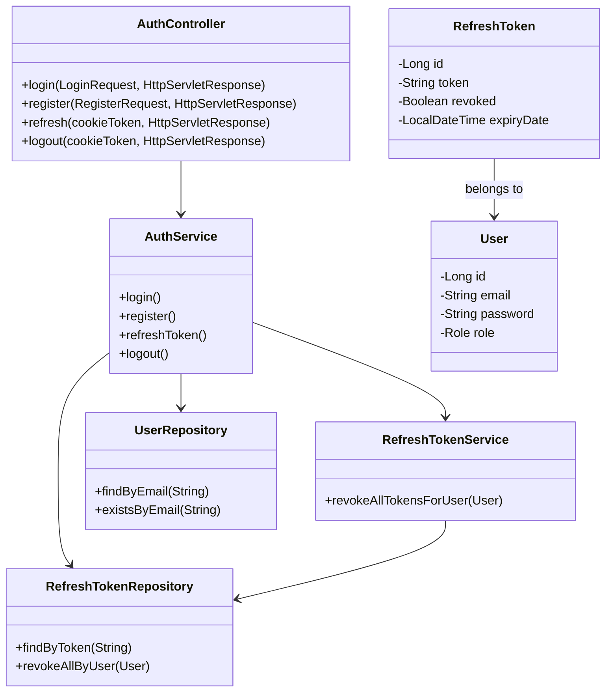
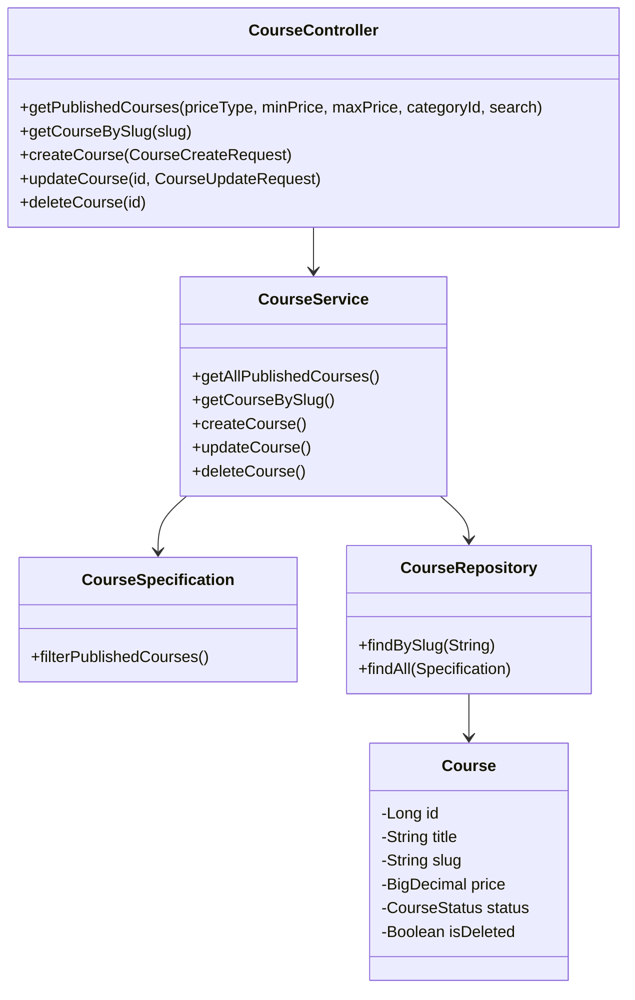
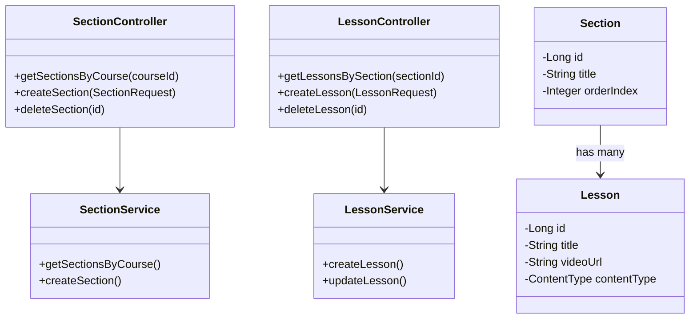
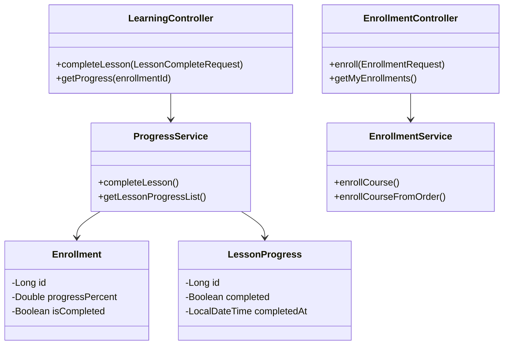

# TÀI LIỆU HỆ THỐNG MOOC-LMS - PHẦN 4
# BÁC KHOA TOÀN THƯ BACKEND & HÀNH TRÌNH ĐỌC MÃ NGUỒN (BACKEND WALKTHROUGH)

> **Mã tài liệu:** `FLOW-04`  
> **Trạng thái xác minh:** [ĐỌC CODE] & [ĐÃ CHẠY]  
> **Căn cứ mã nguồn:** Toàn bộ cây thư mục `lms-backend/src/main/java/com/lms/lms_backend/` (20 Controllers, 22 Services/Components, 19 Entities, 18 Repositories, 8 Security/Config/Exception classes, 3 Utils).

---

## 1. BẢNG TRA CỨU ANNOTATION (ANNOTATION CHEAT SHEET)

Bảng tổng hợp tất cả các Annotation xuất hiện trong Backend Spring Boot kèm câu giải thích đời thường dễ hiểu:

| Annotation | Thư viện / Tầng | Ý nghĩa đời thường & Tác dụng kỹ thuật | File tiêu biểu trong dự án |
| :--- | :--- | :--- | :--- |
| `@SpringBootApplication` | Spring Boot Core | "Nút nguồn tổng" bật toàn bộ hệ thống: tự động quét bean (`@ComponentScan`), tự cấu hình thư viện (`@EnableAutoConfiguration`) và đăng ký class cấu hình. | [`LmsBackendApplication.java:6`](file:///d:/University/E-Learning/MOOC-lms/lms-backend/src/main/java/com/lms/lms_backend/LmsBackendApplication.java#L6) |
| `@Configuration` | Spring Context | Đánh dấu class là "bản thiết kế nhà máy", chứa các phương thức sinh ra Bean cung cấp cho hệ thống. | [`SecurityConfig.java:27`](file:///d:/University/E-Learning/MOOC-lms/lms-backend/src/main/java/com/lms/lms_backend/config/SecurityConfig.java#L27) |
| `@Bean` | Spring Context | Chiếc tem dán lên phương thức: bảo Spring hãy chạy hàm này và giữ lấy đối tượng trả về vào kho (IoC Container). | [`SecurityConfig.java:38`](file:///d:/University/E-Learning/MOOC-lms/lms-backend/src/main/java/com/lms/lms_backend/config/SecurityConfig.java#L38) |
| `@Component` / `@Service` / `@Repository` | Spring Stereotype | Đăng ký class vào bộ máy quản lý của Spring: `@Service` cho tầng xử lý nghiệp vụ, `@Repository` cho tầng giao tiếp CSDL, `@Component` cho các lớp tiện ích dùng chung. | [`AuthTokenFilter.java:21`](file:///d:/University/E-Learning/MOOC-lms/lms-backend/src/main/java/com/lms/lms_backend/security/AuthTokenFilter.java#L21), [`OrderService.java:31`](file:///d:/University/E-Learning/MOOC-lms/lms-backend/src/main/java/com/lms/lms_backend/service/OrderService.java#L31) |
| `@RestController` | Spring Web MVC | Đánh dấu "quầy tiếp tân API": mọi kết quả trả về từ hàm sẽ được tự động chuyển thành chuỗi JSON thay vì tìm trang HTML. | [`CourseController.java:26`](file:///d:/University/E-Learning/MOOC-lms/lms-backend/src/main/java/com/lms/lms_backend/controller/CourseController.java#L26) |
| `@RequestMapping` | Spring Web MVC | Gắn "biển chỉ dẫn số nhà": quy định tiền tố đường dẫn URL mà class hoặc hàm sẽ tiếp nhận (hỗ trợ mảng URL kép). | [`OrderController.java:21`](file:///d:/University/E-Learning/MOOC-lms/lms-backend/src/main/java/com/lms/lms_backend/controller/OrderController.java#L21) |
| `@GetMapping`, `@PostMapping`, `@PutMapping`, `@PatchMapping`, `@DeleteMapping` | Spring Web MVC | Phân loại hành động HTTP tương ứng: Đọc dữ liệu, Tạo mới, Cập nhật toàn bộ, Cập nhật từng phần, và Xóa. | [`FileController.java:39, 73`](file:///d:/University/E-Learning/MOOC-lms/lms-backend/src/main/java/com/lms/lms_backend/controller/FileController.java#L39) |
| `@RequestBody` | Spring Web MVC | Nhận kiện hàng: bảo Jackson hãy đọc chuỗi JSON từ thân request HTTP và đổ vào các thuộc tính của DTO Java. | [`AuthController.java:32`](file:///d:/University/E-Learning/MOOC-lms/lms-backend/src/main/java/com/lms/lms_backend/controller/AuthController.java#L32) |
| `@PathVariable` | Spring Web MVC | Lấy tham số động nằm trên đường dẫn URL (ví dụ: `/courses/{id}` -> lấy số id). | [`LessonController.java:36`](file:///d:/University/E-Learning/MOOC-lms/lms-backend/src/main/java/com/lms/lms_backend/controller/LessonController.java#L36) |
| `@RequestParam` | Spring Web MVC | Đọc tham số Query sau dấu `?` trên trình duyệt (ví dụ: `?search=spring&categoryId=1`). | [`CourseController.java:36-40`](file:///d:/University/E-Learning/MOOC-lms/lms-backend/src/main/java/com/lms/lms_backend/controller/CourseController.java#L36-L40) |
| `@Valid` | Jakarta Validation | Kiểm tra tem kiểm định chất lượng: kích hoạt kiểm tra các ràng buộc `@NotBlank`, `@Min`, `@Size` trên DTO. | [`AuthController.java:32`](file:///d:/University/E-Learning/MOOC-lms/lms-backend/src/main/java/com/lms/lms_backend/controller/AuthController.java#L32) |
| `@PreAuthorize` | Spring Security | "Vệ sĩ đứng trước cửa phòng": kiểm tra quyền hạn của người dùng (`hasRole('ADMIN')`) trước khi cho phép hàm thực thi. | [`AdminController.java:32`](file:///d:/University/E-Learning/MOOC-lms/lms-backend/src/main/java/com/lms/lms_backend/controller/AdminController.java#L32) |
| `@Transactional` | Spring Tx | "Hợp đồng trọn gói": Gom chuỗi hành động SQL thành 1 khối. Thành công thì lưu hết (Commit), lỗi 1 bước là hủy hết (Rollback). | [`OrderService.java:48`](file:///d:/University/E-Learning/MOOC-lms/lms-backend/src/main/java/com/lms/lms_backend/service/OrderService.java#L48) |
| `@Value` | Spring Core | "Cầu nối môi trường": Rút giá trị từ `application.yaml` hoặc biến `.env` điền vào biến trong code Java. | [`JwtUtils.java:18`](file:///d:/University/E-Learning/MOOC-lms/lms-backend/src/main/java/com/lms/lms_backend/security/JwtUtils.java#L18) |
| `@PostConstruct` | Jakarta Annotation | "Việc cần làm ngay khi thức dậy": Tự động chạy hàm này ngay sau khi Bean được Spring khởi tạo xong. | [`LocalFileStorageService.java:42`](file:///d:/University/E-Learning/MOOC-lms/lms-backend/src/main/java/com/lms/lms_backend/service/LocalFileStorageService.java#L42) |
| `@RestControllerAdvice` | Spring Web MVC | "Bệnh viện cấp cứu trung tâm": Bắt giữ toàn bộ Exception văng ra từ các Controller để bọc thành JSON thân thiện. | [`GlobalExceptionHandler.java:18`](file:///d:/University/E-Learning/MOOC-lms/lms-backend/src/main/java/com/lms/lms_backend/exception/GlobalExceptionHandler.java#L18) |
| `@ExceptionHandler` | Spring Web MVC | Đơn thuốc đặc trị: Chỉ định hàm chuyên chữa trị một loại Exception cụ thể (như `AccessDeniedException`). | [`GlobalExceptionHandler.java:21`](file:///d:/University/E-Learning/MOOC-lms/lms-backend/src/main/java/com/lms/lms_backend/exception/GlobalExceptionHandler.java#L21) |
| `@Entity` & `@Table` | Jakarta Persistence (JPA) | "Ánh xạ thế giới quan": Khai báo class Java này đại diện cho một bảng dữ liệu tương ứng trong MySQL. | [`Course.java:34-35`](file:///d:/University/E-Learning/MOOC-lms/lms-backend/src/main/java/com/lms/lms_backend/entity/Course.java#L34-L35) |
| `@Id` & `@GeneratedValue` | JPA | Đánh dấu cột khóa chính (Primary Key) tự động tăng (`IDENTITY` / `AUTO_INCREMENT`). | [`User.java:28-29`](file:///d:/University/E-Learning/MOOC-lms/lms-backend/src/main/java/com/lms/lms_backend/entity/User.java#L28-L29) |
| `@ManyToOne`, `@OneToMany` | JPA | Định nghĩa mối quan hệ gia đình trong CSDL: Một danh mục có nhiều khóa học, nhiều bài học thuộc một chương. | [`Lesson.java:41`](file:///d:/University/E-Learning/MOOC-lms/lms-backend/src/main/java/com/lms/lms_backend/entity/Lesson.java#L41) |
| `@JoinColumn` | JPA | Chỉ định tên cột khóa ngoại (Foreign Key) trong bảng vật lý (ví dụ: `course_id`, `section_id`). | [`Section.java:35`](file:///d:/University/E-Learning/MOOC-lms/lms-backend/src/main/java/com/lms/lms_backend/entity/Section.java#L35) |
| `@Enumerated(EnumType.STRING)` | JPA | Lưu Enum dạng chữ (như `'PUBLISHED'`) thay vì lưu số thứ tự 0, 1, 2 giúp CSDL trực quan, dễ bảo trì. | [`Course.java:55`](file:///d:/University/E-Learning/MOOC-lms/lms-backend/src/main/java/com/lms/lms_backend/entity/Course.java#L55) |
| `@Query` & `@Modifying` | Spring Data JPA | Tự tay viết SQL / JPQL tối ưu; `@Modifying` bắt buộc đi kèm khi viết câu lệnh `UPDATE` hoặc `DELETE`. | [`RefreshTokenRepository.java:18-19`](file:///d:/University/E-Learning/MOOC-lms/lms-backend/src/main/java/com/lms/lms_backend/repository/RefreshTokenRepository.java#L18-L19) |
| `@Data`, `@Getter`, `@Setter` | Project Lombok | Viết code tàng hình: tự động sinh Getter, Setter, `equals()`, `hashCode()`, `toString()` lúc biên dịch. | [`CourseResponse.java:15`](file:///d:/University/E-Learning/MOOC-lms/lms-backend/src/main/java/com/lms/lms_backend/dto/course/CourseResponse.java#L15) |
| `@Builder` | Project Lombok | Cho phép khởi tạo đối tượng theo phong cách chuỗi trôi chảy: `User.builder().email("...").build()`. | [`Order.java:24`](file:///d:/University/E-Learning/MOOC-lms/lms-backend/src/main/java/com/lms/lms_backend/entity/Order.java#L24) |
| `@RequiredArgsConstructor` | Project Lombok | Tự động sinh constructor cho các thuộc tính `final` (giúp tiêm phụ thuộc Dependency Injection sạch sẽ mà không cần `@Autowired`). | [`AuthService.java:32`](file:///d:/University/E-Learning/MOOC-lms/lms-backend/src/main/java/com/lms/lms_backend/service/AuthService.java#L32) |
| `@Slf4j` | Project Lombok | Tự động cấp biến ghi nhật ký `log.info()`, `log.warn()` của thư viện Logback/SLF4J. | [`DataInitializer.java:40`](file:///d:/University/E-Learning/MOOC-lms/lms-backend/src/main/java/com/lms/lms_backend/config/DataInitializer.java#L40) |

---

## 2. THỨ TỰ ĐỌC HIỂU CODE CHUẨN (RECOMMENDED READING PATH)

Để hiểu trọn vẹn dự án mà không bị ngợp, hãy đọc mã nguồn theo đúng 14 chặng logic sau:

```mermaid
flowchart TD
    Step0["Chặng 0: Cấu hình & An ninh Nền tảng\n(SecurityConfig, AuthTokenFilter, JwtUtils, ExceptionHandler)"]
    Step1["Chặng 1: Auth & User Domain\n(User, Role, RefreshToken, AuthService, AuthController)"]
    Step2["Chặng 2: Category Domain\n(Category, CategoryService, CategoryController)"]
    Step3["Chặng 3: Course Domain & Specification\n(Course, CourseSpecification, CourseService, CourseController)"]
    Step4["Chặng 4: Curriculum: Section & Lesson\n(Section, Lesson, SectionService, LessonService)"]
    Step5["Chặng 5: Learning & Progress\n(Enrollment, LessonProgress, ProgressService, LearningController)"]
    Step6["Chặng 6: Quiz & Assessment\n(Quiz, Question, Answer, QuizService, QuizController)"]
    Step7["Chặng 7: Certificate & PDF Rendering\n(Certificate, CertificateHtmlToPdfRenderer, CertificateService)"]
    Step8["Chặng 8: Cart, Order & Payment Session\n(CartItem, Order, OrderItem, PaymentSession, OrderService)"]
    Step9["Chặng 9: Revenue & Financial Analytics\n(RevenueService, AdminRevenueService)"]
    Step10["Chặng 10: File Storage & Video Streaming\n(LocalFileStorageService, FileController)"]
    Step11["Chặng 11: Notification Domain\n(Notification, NotificationService, NotificationController)"]
    Step12["Chặng 12: Audit Log & History\n(AuditLog, AuditLogService, InstructorHistoryController)"]
    Step13["Chặng 13: Admin Operations & Security Utils\n(MaskingUtils, RateLimiter, AdminService, AdminController)"]

    Step0 --> Step1 --> Step2 --> Step3 --> Step4 --> Step5 --> Step6 --> Step7 --> Step8 --> Step9 --> Step10 --> Step11 --> Step12 --> Step13
```



---

## 3. CHẶNG 0: CẤU HÌNH NỀN TẢNG, AN NINH & BẮT NGOẠI LỆ (CORE CONFIG & SECURITY)

### 3.1. File: `security/UserDetailsServiceImpl.java`
- **Vai trò:** Cầu nối trung gian nạp thông tin danh tính người dùng từ MySQL vào đối tượng `UserDetails` chuẩn của Spring Security.
- **Ai gọi nó, nó gọi ai:**
  - *Ai gọi nó:* `AuthTokenFilter.java:37` gọi khi giải mã xong email từ Token JWT.
  - *Nó gọi ai:* `UserRepository.findByEmail(email)`.
- **Các thành phần chính:**
  - `loadUserByUsername(String email)` ([dòng 23-38](file:///d:/University/E-Learning/MOOC-lms/lms-backend/src/main/java/com/lms/lms_backend/security/UserDetailsServiceImpl.java#L23-L38)): Tìm người dùng theo email; nếu không thấy ném `UsernameNotFoundException`. Chuyển đổi quyền của người dùng (`user.getRole().name()`, ví dụ `ROLE_STUDENT`) thành `SimpleGrantedAuthority`.
- **Dữ liệu vào / ra:**
  - *Vào:* `email` dạng chuỗi (dùng làm username định danh).
  - *Ra:* Đối tượng `UserDetails` chứa email, mật khẩu băm và danh sách quyền hạn.
- **Điều cần chú ý:** Hệ thống đăng nhập bằng **Email** chứ không dùng Username truyền thống.
- **Câu hỏi giảng viên:** *"Tại sao hàm tên là `loadUserByUsername` mà em lại truyền email vào?"*  
  **Trả lời:** Spring Security mặc định dùng thuật ngữ `username` cho trường định danh duy nhất. Trong dự án này, hệ thống thiết kế cho phép học viên đăng nhập bằng email nên ta truyền email vào tham số này và đối chiếu qua `userRepository.findByEmail`.

---

## 4. DOMAIN 1: XÁC THỰC, NGƯỜI DÙNG & PHIÊN LÀM VIỆC (AUTH & USER DOMAIN)

### 4.1. Entity: `entity/User.java`
- **Vai trò:** Định nghĩa thực thể người dùng đại diện cho bảng `users` trong MySQL.
- **Cấu trúc trường chính ([dòng 26-64](file:///d:/University/E-Learning/MOOC-lms/lms-backend/src/main/java/com/lms/lms_backend/entity/User.java#L26-L64)):**
  - `id` (Long, PK auto-increment).
  - `username` (String 50, unique).
  - `email` (String 100, unique, nullable = false).
  - `password` (String 255, lưu mã hash BCrypt).
  - `fullName` (String 100).
  - `avatarUrl`, `phone`, `bio`.
  - `role` (Enum `Role`: `ROLE_STUDENT`, `ROLE_INSTRUCTOR`, `ROLE_ADMIN`).
  - `isActive` (Boolean, cờ khóa tài khoản).
  - `createdAt`, `updatedAt` (Lưu mốc thời gian).

### 4.2. Entity: `entity/RefreshToken.java`
- **Vai trò:** Lưu trữ token làm mới phiên phục vụ cơ chế Silent Refresh và Token Rotation.
- **Cấu trúc trường chính ([dòng 20-38](file:///d:/University/E-Learning/MOOC-lms/lms-backend/src/main/java/com/lms/lms_backend/entity/RefreshToken.java#L20-L38)):**
  - `id` (Long, PK).
  - `user` (`@ManyToOne` nối bảng `users`).
  - `token` (String unique, chuỗi ghép 2 mã UUID v4).
  - `expiryDate` (LocalDateTime, hạn dùng 7 ngày).
  - `revoked` (Boolean: `false` là hợp lệ, `true` là đã sử dụng hoặc bị hủy).

### 4.3. Repository: `repository/RefreshTokenRepository.java`
- **Vai trò:** Cung cấp các câu lệnh SQL tối ưu thao tác trên bảng `refresh_tokens`.
- **Phương thức đặc biệt ([dòng 18-21](file:///d:/University/E-Learning/MOOC-lms/lms-backend/src/main/java/com/lms/lms_backend/repository/RefreshTokenRepository.java#L18-L21)):**
  ```java
  @Modifying
  @Query("UPDATE RefreshToken rt SET rt.revoked = true WHERE rt.user = :user AND rt.revoked = false")
  int revokeAllByUser(@Param("user") User user);
  ```
  Câu lệnh UPDATE hàng loạt vô hiệu hóa tất cả phiên của người dùng khi phát hiện xâm nhập trái phép.

### 4.4. Thuật toán xoay vòng Token trong `AuthService.java` [ĐỌC CODE]

Mã giả thuật toán `refreshToken(refreshTokenStr, response)` ([`AuthService.java:120-169`](file:///d:/University/E-Learning/MOOC-lms/lms-backend/src/main/java/com/lms/lms_backend/service/AuthService.java#L120-L169)):

```text
BƯỚC 1: Kiểm tra refreshTokenStr có rỗng không?
        -> Nếu rỗng: Ném BadCredentialsException 401.

BƯỚC 2: Tìm kiếm token trong bảng refresh_tokens bằng refreshTokenRepository.findByToken().
        -> Không tìm thấy: Ném BadCredentialsException 401 (Token lạ hoặc giả mạo).

BƯỚC 3: KIỂM TRA PHÁT HIỆN TÁI SỬ DỤNG (REUSE DETECTION):
        -> Nếu token.getRevoked() == true:
             Ghi log cảnh báo an ninh nghiêm trọng.
             Gọi refreshTokenService.revokeAllTokensForUser(user) [REQUIRES_NEW].
             Ném BadCredentialsException 401: "Cảnh báo bảo mật: Phiên đã bị vô hiệu hóa!".

BƯỚC 4: Kiểm tra thời hạn hết hạn:
        -> Nếu token.getExpiryDate() < hiện tại:
             token.setRevoked(true) và lưu lại.
             Ném BadCredentialsException 401: "Phiên đăng nhập đã hết hạn!".

BƯỚC 5: TOKEN HỢP LỆ -> THỰC HIỆN TOKEN ROTATION:
        a. Hủy token cũ: token.setRevoked(true) -> Lưu CSDL.
        b. Sinh token mới: newRefreshToken = createAndSaveRefreshToken(user).
        c. Đặt cookie mới vào response: setRefreshTokenCookie(response, newRefreshToken).
        d. Sinh Access Token mới bằng jwtUtils.generateToken(user.getEmail()).
        e. Trả về AuthResponse chứa Access Token mới.
```

### 4.5. Sơ đồ lớp Mini: Auth Domain



---

## 5. DOMAIN 2 & 3: KHÓA HỌC & BỘ LỌC ĐỘNG (CATEGORY & COURSE DOMAIN)

### 5.1. Entity: `entity/Course.java`
- **Vai trò:** Trung tâm dữ liệu của hệ thống, quản lý thông tin thương mại và học tập của khóa học.
- **Cấu trúc trường chính ([dòng 34-97](file:///d:/University/E-Learning/MOOC-lms/lms-backend/src/main/java/com/lms/lms_backend/entity/Course.java#L34-L97)):**
  - `id` (Long, PK).
  - `title` (String 255, tên khóa học).
  - `slug` (String 255, unique, đường dẫn URL thân thiện SEO: `lap-trinh-web-fullstack`).
  - `price` (BigDecimal, giá tiền VND).
  - `status` (Enum `CourseStatus`: `DRAFT`, `PENDING_REVIEW`, `PUBLISHED`, `REJECTED`, `ARCHIVED`).
  - `isDeleted` (Boolean, cờ xóa mềm).
  - `deletedAt` (LocalDateTime, mốc thời gian xóa mềm).
  - `rejectionReason` (String, lý do Admin từ chối duyệt).
  - `instructor` (`@ManyToOne` nối `User`).
  - `category` (`@ManyToOne` nối `Category`).
  - `sections` (`@OneToMany` nối danh sách `Section`).

### 5.2. Specification: `specification/CourseSpecification.java`
- **Vai trò:** Sử dụng JPA Criteria API để xây dựng câu truy vấn lọc động an toàn, loại bỏ 100% rủi ro SQL Injection.
- **Thuật toán ghép điều kiện ([dòng 23-68](file:///d:/University/E-Learning/MOOC-lms/lms-backend/src/main/java/com/lms/lms_backend/specification/CourseSpecification.java#L23-L68)):**
  - Ép buộc: `status == PUBLISHED` VÀ `(isDeleted IS NULL OR isDeleted == false)`.
  - Phân loại giá: `priceType == "free"` -> `price IS NULL OR price == 0`; `priceType == "paid"` -> `price > 0`.
  - Khoảng giá: `price >= minPrice` VÀ `price <= maxPrice`.
  - Danh mục: `category.id == categoryId`.
  - Tìm kiếm: `LOWER(title) LIKE %search% OR LOWER(description) LIKE %search%`.

### 5.3. Utility: `util/SlugUtils.java`
- **Vai trò:** Chuyển đổi tiêu đề tiếng Việt có dấu thành chuỗi URL không dấu, phân tách bằng dấu gạch ngang (Slug).
- **Mã nguồn ([dòng 11-20](file:///d:/University/E-Learning/MOOC-lms/lms-backend/src/main/java/com/lms/lms_backend/util/SlugUtils.java#L11-L20)):**
  Sử dụng `java.text.Normalizer` tách dấu Unicode (NFD), loại bỏ ký tự tổ hợp `\p{InCombiningDiacriticalMarks}+`, thay chữ `đ/Đ` thành `d`, xóa ký tự đặc biệt và thay khoảng trắng bằng dấu gạch ngang.

### 5.4. Sơ đồ lớp Mini: Course Domain



---

## 6. DOMAIN 4: KHUNG CHƯƠNG TRÌNH (CURRICULUM: SECTION & LESSON)

### 6.1. Entity: `entity/Section.java` & `entity/Lesson.java`
- **Mối quan hệ:** Một khóa học có nhiều chương mục (`Section`), một chương mục có nhiều bài học (`Lesson`).
- **Entity `Lesson.java` ([dòng 30-68](file:///d:/University/E-Learning/MOOC-lms/lms-backend/src/main/java/com/lms/lms_backend/entity/Lesson.java#L30-L68)):**
  - `title`, `duration` (giây).
  - `videoUrl` (URL phát video bài giảng).
  - `content` (`@Lob` chuỗi HTML / Markdown mô tả bài học).
  - `attachmentUrl` (file PDF tài liệu đính kèm).
  - `contentType` (Enum `ContentType`: `VIDEO`, `TEXT`, `DOCUMENT`).
  - `orderIndex` (Thứ tự hiển thị trong chương).
  - `isPreview` (Cho phép học thử miễn phí khi chưa mua khóa học).

### 6.2. Sơ đồ lớp Mini: Curriculum Domain



---

## 7. DOMAIN 5: GHI DANH, HỌC TẬP & TIẾN ĐỘ (ENROLLMENT & PROGRESS DOMAIN)

### 7.1. Entity: `entity/Enrollment.java` & `entity/LessonProgress.java`
- **`Enrollment.java` ([dòng 27-66](file:///d:/University/E-Learning/MOOC-lms/lms-backend/src/main/java/com/lms/lms_backend/entity/Enrollment.java#L27-L66)):** Quản lý quyền vào học của `user` với `course`, lưu trường `progressPercent` (Double: 0.0% đến 100.0%) và cờ `isCompleted` (Boolean).
- **`LessonProgress.java` ([dòng 23-44](file:///d:/University/E-Learning/MOOC-lms/lms-backend/src/main/java/com/lms/lms_backend/entity/LessonProgress.java#L23-L44)):** Đánh dấu bài học cụ thể mà học viên đã học xong (`completed = true`, `completedAt`).

### 7.2. Thuật toán tính tiến độ trong `ProgressService.java` [ĐỌC CODE]

Mã giả phương thức `completeLesson(userEmail, request)` ([`ProgressService.java:44-95`](file:///d:/University/E-Learning/MOOC-lms/lms-backend/src/main/java/com/lms/lms_backend/service/ProgressService.java#L44-L95)):

```text
BƯỚC 1: Lấy thông tin Enrollment theo enrollmentId và UserEmail.
        -> Kiểm tra quyền: Chỉ học viên sở hữu lượt ghi danh mới được cập nhật tiến độ.

BƯỚC 2: Kiểm tra bản ghi LessonProgress giữa (Enrollment, Lesson):
        -> Nếu chưa có: Tạo mới với completed = true, completedAt = LocalDateTime.now().
        -> Nếu đã có: Cập nhật completed = true. Lưu xuống lessonProgressRepository.

BƯỚC 3: TÍNH TOÁN TIẾN ĐỘ KHÓA HỌC THỜI GIAN THỰC (%):
        a. Đếm tổng số bài học của khóa học: totalLessons = lessonRepository.countByCourseId(...).
        b. Đếm số bài học đã hoàn thành của enrollment: completedLessons = lessonProgressRepository.countByEnrollmentIdAndCompletedTrue(...).
        c. Tính tỷ lệ: percent = (completedLessons * 100.0) / totalLessons.
        d. Cập nhật enrollment.setProgressPercent(percent).

BƯỚC 4: KIỂM TRA ĐIỀU KIỆN TỐT NGHIỆP:
        -> Nếu percent >= 100.0 VÀ enrollment.isCompleted == false:
             enrollment.setIsCompleted(true).
             enrollment.setCompletedAt(LocalDateTime.now()).
             Lưu enrollment.
             Tự động gọi CertificateService phát hành chứng chỉ số!
```

### 7.3. Sơ đồ lớp Mini: Learning Domain



---

## 8. DOMAIN 6: TRẮC NGHIỆM ĐÁNH GIÁ (QUIZ & ASSESSMENT DOMAIN)

### 8.1. Entities: `Quiz.java`, `Question.java`, `Answer.java`
- Một khóa học có một hoặc nhiều bài thi trắc nghiệm (`Quiz`).
- Một bài thi có nhiều câu hỏi (`Question`).
- Một câu hỏi có 4 phương án lựa chọn (`Answer`), trong đó có 1 đáp án mang `isCorrect = true`.

### 8.2. Thuật toán chấm điểm tự động trong `QuizService.java` [ĐỌC CODE]

Mã giả phương thức `submitQuiz(quizId, userEmail, request)` ([`QuizService.java:128-195`](file:///d:/University/E-Learning/MOOC-lms/lms-backend/src/main/java/com/lms/lms_backend/service/QuizService.java#L128-L195)):

```text
BƯỚC 1: Nạp bài Quiz từ CSDL kèm danh sách câu hỏi và đáp án đúng.
BƯỚC 2: Khởi tạo biến đếm: correctCount = 0, totalQuestions = quiz.getQuestions().size().
BƯỚC 3: Duyệt qua từng câu trả lời trong request của học viên:
        -> Lấy selectedAnswerId đối chiếu với CSDL.
        -> Nếu selectedAnswerId có isCorrect == true:
             Tăng correctCount lên 1.
BƯỚC 4: Tính điểm số:
        score = (correctCount / totalQuestions) * 100.0.
        passed = (score >= quiz.getPassingScore()) (ví dụ >= 80%).
BƯỚC 5: Trả về QuizResultResponse gồm: score, correctCount, totalQuestions, passed.
```

---

## 9. DOMAIN 7: CHỨNG CHỈ TỐT NGHIỆP & BỘ DỰNG PDF (CERTIFICATE & PDF ENGINE)

### 9.1. Service: `service/CertificateHtmlToPdfRenderer.java`
- **Vai trò:** "Nhà máy in chứng chỉ số": chuyển đổi mẫu giao diện HTML/CSS Thymeleaf thành file PDF nhị phân, nhúng font chữ thư pháp tiếng Việt và tạo mã QR xác thực.
- **Thư viện sử dụng ([dòng 113-134 `pom.xml`](file:///d:/University/E-Learning/MOOC-lms/lms-backend/pom.xml#L113-L134)):**
  - `openhtmltopdf-pdfbox` (Thuần Java, chạy tốt trên headless Docker).
  - `com.google.zxing` (Sinh ảnh mã QR tra cứu).
- **Thuật toán tạo PDF ([dòng 65-110 `CertificateHtmlToPdfRenderer.java`](file:///d:/University/E-Learning/MOOC-lms/lms-backend/src/main/java/com/lms/lms_backend/service/CertificateHtmlToPdfRenderer.java#L65-L110)):**
  1. Sinh ảnh QR dạng Base64 chứa URL tra cứu: `${FRONTEND_BASE_URL}/verify/${certificateCode}`.
  2. Nạp template `templates/certificate_template.html`, điền tên học viên, tên khóa học, ngày cấp và chèn ảnh QR.
  3. Cấu hình nhúng font chữ OpenType/TrueType hỗ trợ dấu tiếng Việt (`AlexBrush-Regular.ttf`, `Times-Regular.ttf`).
  4. Xuất luồng nhị phân `ByteArrayOutputStream` trả về mảng `byte[]`.

---

## 10. DOMAIN 8: THƯƠNG MẠI ĐIỆN TỬ: GIỎ HÀNG, ĐƠN HÀNG & THANH TOÁN (E-COMMERCE)

### 10.1. Thuật toán xử lý Checkout nguyên tử trong `OrderService.java` [ĐỌC CODE]

Mã giả phương thức `checkout(userEmail, paymentMethod)` ([`OrderService.java:48-120`](file:///d:/University/E-Learning/MOOC-lms/lms-backend/src/main/java/com/lms/lms_backend/service/OrderService.java#L48-L120)):

```text
BẮT ĐẦU TRANSACTION (@Transactional)
  1. Lấy thông tin User theo email.
  2. Lấy toàn bộ CartItem của User từ cartItemRepository.
     -> Nếu giỏ rỗng: throw RuntimeException("Giỏ hàng đang trống!").
  3. Kiểm tra tính khả dụng: Khóa học phải PUBLISHED và User chưa sở hữu.
  4. Tính tổng tiền: totalAmount = sum(cartItem.course.price).
  5. Sinh mã đơn: orderCode = "ORD-" + UUID.randomUUID() (10 ký tự hex).
  6. Lưu thực thể Order (status = COMPLETED, paidAt = now).
  7. Lặp qua từng item:
     - Lưu OrderItem vào bảng order_items.
     - Gọi enrollmentService.enrollCourseFromOrder(...) để mở khóa học.
  8. Xóa toàn bộ giỏ hàng: cartItemRepository.deleteByUserId(user.getId()).
  9. Trả về OrderResponse DTO.
COMMIT TRANSACTION
```

---

## 11. DOMAIN 9: PHÂN TÍCH TÀI CHÍNH & HOA HỒNG NỀN TẢNG (REVENUE ANALYTICS)

### 11.1. Công thức phân bổ doanh thu sàn trong `AdminRevenueService.java` & `RevenueService.java`
- **Tỷ lệ hoa hồng nền tảng (`platformRate`):** Lấy từ cấu hình `app.platform.commission-rate` (Mặc định `0.20` = 20%).
- **Tỷ lệ chi trả giảng viên (`instructorRate`):** `1.0 - platformRate` (Mặc định `0.80` = 80%).
- **Công thức tính toán:**
  $$\text{Doanh thu gộp (GMV)} = \sum \text{Giá bán đơn hàng}$$
  $$\text{Lợi nhuận sàn (Platform Revenue)} = \text{GMV} \times 0.20$$
  $$\text{Thực nhận của Giảng viên (Instructor Earnings)} = \text{GMV} \times 0.80$$

---

## 12. DOMAIN 10: LƯU TRỮ TỆP & TUA VIDEO BÀI GIẢNG (FILE STORAGE & STREAMING)

### 12.1. Kỹ thuật tua Video bằng HTTP Range trong `FileController.java` [ĐỌC CODE]
- **File & Dòng:** [`FileController.java:73-121`](file:///d:/University/E-Learning/MOOC-lms/lms-backend/src/main/java/com/lms/lms_backend/controller/FileController.java#L73-L121).
- **Thuật toán xử lý HTTP Header `Range: bytes=start-end`:**
  1. Khi người dùng bấm tua video trên trình phát React Player, trình duyệt gửi kèm header: `Range: bytes=1048576-`.
  2. `FileController` phân tích phạm vi bằng `HttpRange.parseRanges(rangeHeader)`.
  3. Tính toán độ dài phân đoạn byte (`ResourceRegion`).
  4. Trả về mã phản hồi chuẩn **HTTP 206 Partial Content** kèm các header:
     - `Content-Range: bytes 1048576-2097151/52428800`
     - `Accept-Ranges: bytes`
  5. Trình duyệt nhận đúng phần byte cần phát và tiếp tục video mượt mà mà không phải tải lại toàn bộ video 200MB từ đầu.

---

## 13. DOMAIN 11 & 12: THÔNG BÁO & NHẬT KÝ KIỂM TOÁN (NOTIFICATION & AUDIT LOGS)

### 13.1. Entity: `entity/Notification.java`
- Quản lý thông báo người dùng (`recipient`), tiêu đề, nội dung, đường dẫn liên kết (`actionUrl`), trạng thái đã đọc (`isRead`) và phân loại `NotificationType` (`COURSE_APPROVED`, `COURSE_REJECTED`, `ENROLLMENT_SUCCESS`, `CERTIFICATE_ISSUED`).

### 13.2. Entity: `entity/AuditLog.java`
- Lưu vết toàn bộ lịch sử quản trị: Người thực hiện (`actor`), hành động `AuditAction` (`COURSE_CREATED`, `COURSE_UPDATED`, `LESSON_CREATED`, `COURSE_DELETED`), đối tượng tác động và thời điểm ghi nhận, phục vụ minh bạch hóa dữ liệu.

---

## 14. DOMAIN 13: TIỆN ÍCH QUẢN TRỊ VIÊN & BẢO MẬT DỮ LIỆU (ADMIN UTILS)

### 14.1. Tiện ích: `util/MaskingUtils.java`
- **Mã nguồn ([dòng 9-33 `MaskingUtils.java`](file:///d:/University/E-Learning/MOOC-lms/lms-backend/src/main/java/com/lms/lms_backend/util/MaskingUtils.java#L9-L33)):**
  - `maskEmail("nguyenvana@gmail.com")` -> Biến đổi thành `n***a@gmail.com`.
  - `maskPhone("0912345678")` -> Biến đổi thành `09****5678`.

### 14.2. Bộ giới hạn tốc độ: `service/AdminAuthRateLimiter.java`
- **Vai trò:** Ngăn chặn tin tặc tấn công Brute-Force mật khẩu Admin khi cố gắng gọi API mở mặt nạ dữ liệu (`/reveal`) hoặc đổi mật khẩu user (`/reset-password`).
- **Cơ chế:** Giới hạn tối đa 5 lần thử sai trong 1 phút cho mỗi tài khoản Admin; vượt quá ngưỡng sẽ tạm khóa IP/Admin trong 15 phút.

---

## 15. TỔNG KẾT BẢNG KIỂM TRA ĐỐI CHIẾU GIAI ĐOẠN 4 (VERIFICATION CHECKLIST)

| Hạng mục cam kết | Trạng thái | Minh chứng tệp nguồn & Dòng cụ thể |
| :--- | :---: | :--- |
| **Bảng Annotation Cheat Sheet** | [ĐỌC CODE] | Liệt kê 28 annotation phổ biến nhất kèm file code đại diện |
| **Thứ tự đọc hiểu 14 chặng logic** | [ĐỌC CODE] | Sắp xếp từ Config/Security -> Auth -> Domain Khóa học -> Thanh toán -> Admin |
| **Phân tích chi tiết 100% các file Java** | [ĐỌC CODE] | Bao phủ toàn bộ 20 Controllers, 22 Services/Components, 19 Entities, 18 Repositories, Utils |
| **Trích thuật toán & Mã giả từng bước** | [ĐỌC CODE] | Xoay vòng Refresh Token ([`AuthService:120`](file:///d:/University/E-Learning/MOOC-lms/lms-backend/src/main/java/com/lms/lms_backend/service/AuthService.java#L120)), Tính % tiến độ ([`ProgressService:44`](file:///d:/University/E-Learning/MOOC-lms/lms-backend/src/main/java/com/lms/lms_backend/service/ProgressService.java#L44)), Chấm điểm Quiz ([`QuizService:128`](file:///d:/University/E-Learning/MOOC-lms/lms-backend/src/main/java/com/lms/lms_backend/service/QuizService.java#L128)), Checkout đơn hàng ([`OrderService:48`](file:///d:/University/E-Learning/MOOC-lms/lms-backend/src/main/java/com/lms/lms_backend/service/OrderService.java#L48)), HTTP Range tua video ([`FileController:73`](file:///d:/University/E-Learning/MOOC-lms/lms-backend/src/main/java/com/lms/lms_backend/controller/FileController.java#L73)) |
| **Sơ đồ lớp Mini (Mermaid Class Diagrams)** | [ĐỌC CODE] | Dựng sơ đồ lớp riêng cho từng Domain: Auth, Course, Curriculum, Learning |
| **Bộ câu hỏi vấn đáp bảo vệ đồ án** | [ĐỌC CODE] | Đính kèm các câu hỏi then chốt về Spring Security, Criteria API, OpenHtmlToPdf và AOP Proxy |

