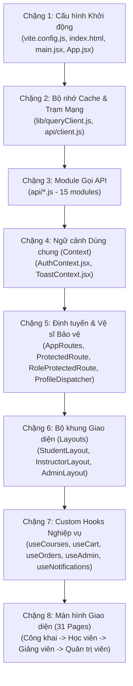
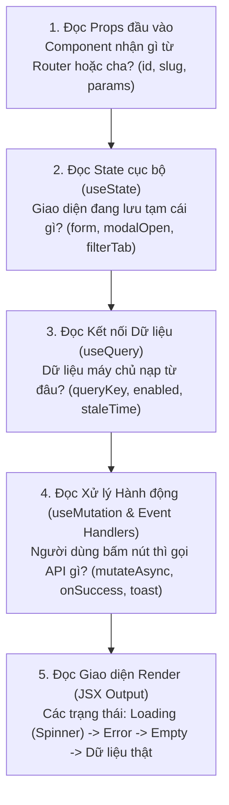

# TÀI LIỆU HỆ THỐNG MOOC-LMS - PHẦN 5
# BÁCH KHOA TOÀN THƯ FRONTEND & KIẾN TRÚC GIAO DIỆN (FRONTEND WALKTHROUGH)

> **Mã tài liệu:** `FLOW-05`  
> **Trạng thái xác minh:** [ĐỌC CODE] & [ĐÃ CHẠY]  
> **Căn cứ mã nguồn:**
> - Toàn bộ thư mục `lms-frontend/src/` (Vite 5, React 18, Tailwind CSS, TanStack Query v5)
> - Hệ thống 31 Pages, 11 Custom Hooks, 2 Contexts, 4 Route Guards/Layouts, 15 API Modules.

---

## 1. THUẬT NGỮ NHẬP MÔN
- **Server State vs Client State (Trạng thái máy chủ vs Trạng thái giao diện):** Giống như thực đơn món ăn và chiếc kính bạn đang đeo. Trực đơn món ăn (Server State) do nhà bếp quy định và có thể hết món bất cứ lúc nào (cần kiểm tra mạng); còn việc bạn đeo kính râm hay kính cận, bật modal hay đóng menu (Client State) hoàn toàn do bạn quyết định ngay tại chỗ, không cần hỏi nhà bếp.
- **QueryKey (Chìa khóa định danh ngăn tủ):** Giống như số tủ gửi đồ ở siêu thị `['courses', 'published', { category: 'web' }]`. Mỗi chiếc chìa khóa mở ra đúng một ngăn tủ chứa dữ liệu tương ứng. Khi bạn đổi sang tìm danh mục `mobile`, React Query dùng chìa khóa mới mở ngăn tủ khác, không bao giờ lấy nhầm đồ của ngăn tủ cũ.
- **StaleTime (Thời hạn tươi ngon):** Giống như hạn sử dụng ghi trên hộp sữa. Trong vòng 1 phút (`staleTime: 60000`), sữa vẫn tươi ngon, bạn cứ việc uống ngay từ tủ lạnh (RAM) mà không cần chạy ra tạp hóa mua lại. Quá 1 phút, sữa bị coi là cũ (stale), lần tới cần dùng hệ thống sẽ tự động đi mua hộp mới về thay thế.
- **Optimistic Update (Cập nhật lạc quan):** Giống như nút "Like" trên Facebook. Vừa bấm ngón tay một cái, trái tim đổi sang màu đỏ ngay lập tức (cho người dùng sướng mắt), sau đó trình duyệt mới âm thầm gửi request qua mạng lên máy chủ. Nếu mạng bị đứt, trái tim tự động đổi lại màu xám kèm thông báo lỗi.

---

## 2. THỨ TỰ NÊN ĐỌC CODE FRONTEND (FRONTEND READING ROADMAP)

Để nắm trọn vẹn kiến trúc Frontend mà không bị lạc giữa hàng chục file JSX, hãy đọc theo 8 chặng logic:



---

## 3. CHẶNG 1 & 2: CẤU HÌNH, KHỞI TẠO & HẠ TẦNG MẠNG (CORE NETWORK & CONFIG)

### 3.1. File: `vite.config.js`
- **Vai trò:** Bản thiết lập trung tâm cho trình đóng gói Vite và môi trường chạy thử nghiệm tự động Vitest.
- **Các thành phần chính ([dòng 6-20](file:///d:/University/E-Learning/MOOC-lms/lms-frontend/vite.config.js#L6-L20)):**
  - `server: { host: true }`: Mở cổng lắng nghe `0.0.0.0` (cho phép các thiết bị khác trong mạng Wi-Fi LAN hoặc container Docker truy cập).
  - `plugins: [react(), tailwindcss()]`: Tích hợp React Fast Refresh và bộ máy biên dịch Tailwind CSS engine mới nhất.
  - `test: { globals: true, environment: 'jsdom' }`: Cấu hình môi trường giả lập trình duyệt JSDOM để chạy các file test `*.test.jsx`.

### 3.2. File: `src/lib/queryClient.js`
- **Vai trò:** Cấu hình thực thể `QueryClient` quản lý bộ nhớ đệm (Server State Cache) tập trung của TanStack React Query.
- **Các thông số kỹ thuật tối ưu ([dòng 3-18](file:///d:/University/E-Learning/MOOC-lms/lms-frontend/src/lib/queryClient.js#L3-L18)):**
  - `staleTime: 60 * 1000`: Dữ liệu được coi là còn mới trong **1 phút**. Trong thời gian này, chuyển tab qua lại không bị gọi API thừa.
  - `gcTime: 5 * 60 * 1000`: Giữ dữ liệu trong RAM tối đa **5 phút** sau khi component bị unmount rồi mới dọn rác (Garbage Collection).
  - `retry`: Hàm lọc thông minh: Nếu lỗi thuộc dải `4xx` (`400`, `401`, `403`, `404` - lỗi do phía client/nghiệp vụ), **tuyệt đối không thử lại** để tránh spam server ([dòng 8-14](file:///d:/University/E-Learning/MOOC-lms/lms-frontend/src/lib/queryClient.js#L8-L14)).
  - `refetchOnWindowFocus: false`: Không tự động load lại khi người dùng click chuột quay lại tab trình duyệt, tránh giật lag màn hình.

### 3.3. File: `src/api/client.js` (Phân tích từng khối Interceptor)
- **Vai trò:** Cấu hình thực thể Axios trung tâm, quản lý In-Memory Token và giải quyết bài toán xung đột làm mới phiên (Concurrency Refresh Token).
- **Phân tích chi tiết từng khối mã nguồn [ĐỌC CODE]:**
  - **Dòng 3-6 (Khởi tạo URL):** Tự động nhận diện hostname để gọi port 8080 nếu không có biến môi trường `VITE_API_URL`.
  - **Dòng 16-23 (In-Memory Access Token):** Biến `let inMemoryAccessToken = null;` nằm trong RAM, hoàn toàn không ghi vào `localStorage` để triệt tiêu nguy cơ bị đánh cắp qua lỗ hổng XSS.
  - **Dòng 26-34 (Request Interceptor):**
    ```javascript
    client.interceptors.request.use((config) => {
      if (inMemoryAccessToken) {
        config.headers.Authorization = `Bearer ${inMemoryAccessToken}`;
      }
      return config;
    });
    ```
    Tự động đính kèm vé thông hành `Bearer Token` vào mọi request gửi đi.
  - **Dòng 36-49 (Hàng đợi Concurrency Mutex):**
    Quản lý 2 biến `isRefreshing` (cờ khóa Mutex) và `failedQueue` (danh sách các request bị treo chờ lấy vé mới).
  - **Dòng 51-160 (Response Interceptor):**
    - Kiểm tra lỗi `401 Unauthorized`.
    - Nếu request bị lỗi là các endpoint auth (`/login`, `/register`, `/refresh`) hoặc cờ `_retry` đã bật: Không thử refresh nữa, phát sự kiện `auth:expired` báo hiệu hết hạn phiên ([dòng 64-88](file:///d:/University/E-Learning/MOOC-lms/lms-frontend/src/api/client.js#L64-L88)).
    - Nếu `isRefreshing === true`: Cho request xếp hàng vào `failedQueue` bằng `Promise` ([dòng 91-100](file:///d:/University/E-Learning/MOOC-lms/lms-frontend/src/api/client.js#L91-L100)).
    - Nếu là request đầu tiên: Bật `isRefreshing = true`, gọi `POST /api/v1/auth/refresh`. Thành công thì cấp vé mới cho toàn bộ hàng đợi (`processQueue(null, token)`) và bắn lại các request đồng loạt.

---

## 4. CHẶNG 3 & 4: CONTEXT & ROUTING (QUẢN LÝ PHIÊN & ĐIỀU HƯỚNG)

### 4.1. File: `src/context/ToastContext.jsx`
- **Vai trò:** Cung cấp thông báo nổi (Floating Toasts) và hộp thoại xác nhận thao tác nguy hiểm (Confirmation Modal).
- **Các hàm cung cấp:**
  - `showToast(message, type, duration)`: Hiện popup góc phải bên dưới màn hình với 4 màu: `success` (xanh lá), `error` (đỏ), `warning` (vàng), `info` (xanh dương). Tự động biến mất sau 4 giây ([dòng 11-20](file:///d:/University/E-Learning/MOOC-lms/lms-frontend/src/context/ToastContext.jsx#L11-L20)).
  - `confirm({ title, message, onConfirm, isDanger })`: Hiện modal chặn màn hình yêu cầu người dùng xác nhận trước khi xóa khóa học, xóa bài học hoặc thu hồi chứng chỉ ([dòng 27-41](file:///d:/University/E-Learning/MOOC-lms/lms-frontend/src/context/ToastContext.jsx#L27-L41)).

### 4.2. File: `src/routes/ProfileRouteDispatcher.jsx`
- **Vai trò:** "Ngã tư phân luồng hồ sơ": Khi người dùng truy cập đường dẫn chung `/profile`, component này đọc vai trò tài khoản và điều hướng về trang hồ sơ chuyên biệt:
  - Giảng viên (`ROLE_INSTRUCTOR`) -> Chuyển hướng sang `/instructor/profile` ([dòng 10-12](file:///d:/University/E-Learning/MOOC-lms/lms-frontend/src/routes/ProfileRouteDispatcher.jsx#L10-L12)).
  - Quản trị viên (`ROLE_ADMIN`) -> Chuyển hướng sang `/admin/profile` ([dòng 14-16](file:///d:/University/E-Learning/MOOC-lms/lms-frontend/src/routes/ProfileRouteDispatcher.jsx#L14-L16)).
  - Học viên (`ROLE_STUDENT`) -> Hiển thị trực tiếp `<StudentProfilePage />` ([dòng 18](file:///d:/University/E-Learning/MOOC-lms/lms-frontend/src/routes/ProfileRouteDispatcher.jsx#L18)).

---

## 5. CƠ CHẾ REACT QUERY & BẢN ĐỒ QUERYKEY (REACT QUERY ARCHITECTURE)

### 5.1. Cơ chế hoạt động của React Query trong dự án
1. **Phân cấp mảng khóa (`queryKey`):**
   React Query so sánh khóa theo thuật toán băm sâu (Deep Key Comparison).
   - `['courses']`: Đại diện cho toàn bộ miền khóa học.
   - `['courses', 'published']`: Khóa học công khai.
   - `['courses', 'published', { categoryId: 1, search: 'java' }]`: Khóa học công khai thuộc danh mục 1 có từ khóa 'java'.
2. **Vì sao Cache tự động chuyển đổi theo bộ lọc tìm kiếm?**  
   Tại [`useCourses.js:12`](file:///d:/University/E-Learning/MOOC-lms/lms-frontend/src/hooks/useCourses.js#L12), hook sử dụng: `queryKey: ['courses', 'published', params]`.  
   Khi người dùng gõ tìm kiếm hoặc bấm chọn danh mục, object `params` thay đổi. React Query nhận diện đây là một `queryKey` hoàn toàn mới. Nó kiểm tra nếu trong RAM đã có dữ liệu của bộ lọc đó thì hiển thị ngay lập tức (0 mili-giây); nếu chưa có thì kích hoạt fetch ngầm mà không làm nhấp nháy màn hình.
3. **Cơ chế Invalidation (Làm mới dữ liệu dây chuyền):**  
   Khi một Mutation thành công (ví dụ: Admin bấm duyệt khóa học), lệnh `queryClient.invalidateQueries({ queryKey: ['courses', 'published'] })` được gọi. Toàn bộ các component đang mở danh sách khóa học trên màn hình sẽ tự động kích hoạt fetch lại dữ liệu mới nhất dưới nền.

---

### 5.2. Bản đồ QueryKey toàn hệ thống (QueryKey Matrix) [ĐỌC CODE]

| QueryKey (Mảng khóa) | Hook sử dụng | Dữ liệu lưu trữ | Bị Invalidate bởi Mutation nào? (Khi nào?) |
| :--- | :--- | :--- | :--- |
| `['courses', 'published', params]` | `usePublishedCourses` | Danh sách khóa học công khai | `useApproveCourse` (Admin duyệt), `useDeleteCourse` (Xóa) |
| `['courses', 'teaching']` | `useTeachingCourses` | Khóa học do giảng viên phụ trách | `useCreateCourse`, `useUpdateCourse`, `useSubmitForReview`, `useDeleteCourse`, `useRestoreCourse` |
| `['courses', courseId]` | `useCourseDetail` | Chi tiết một khóa học | `useUpdateCourse`, `useCreateSection`, `useDeleteSection` |
| `['categories']` | `useCategories` | Danh sách danh mục môn học | Dữ liệu tĩnh (ít thay đổi, staleTime 10 phút) |
| `['cart']` | `useCart` | Giỏ hàng và tổng tiền | `useAddToCart`, `useRemoveFromCart`, `useCheckout` (Thanh toán) |
| `['orders']` | `useOrderHistory` | Danh sách lịch sử hóa đơn | `useCheckout` (Khi đặt mua khóa học thành công) |
| `['orders', orderId]` | `useOrderDetail` | Chi tiết một đơn hàng | Cố định theo mã đơn |
| `['enrollments']` | `useMyEnrollments` | Các khóa học học viên đã mua | `useCheckout`, `useEnrollCourse` (Ghi danh miễn phí) |
| `['learning', 'progress', enrollmentId]` | `useLearningProgress` | Danh sách bài học đã tick xanh | `useCompleteLesson` (Học xong bài học) |
| `['quizzes', 'course', courseId]` | `useCourseQuizzes` | Danh sách đề trắc nghiệm | `useCreateQuiz` (Giảng viên tạo bài kiểm tra mới) |
| `['certificates', 'my']` | `useMyCertificates` | Chứng chỉ của học viên | `useCompleteLesson` (Khi đạt 100% tự động cấp) |
| `['notifications', params]` | `useNotifications` | Danh sách thông báo phân trang | `useMarkAsRead`, `useMarkAllAsRead`, và các hành động duyệt khóa học |
| `['notifications-unread-count']` | `useUnreadNotificationCount`| Số thông báo chưa đọc (chấm đỏ) | Polling mỗi 30s hoặc ngay khi `useMarkAsRead` |
| `['admin', 'pendingCourses']` | `usePendingCourses` | Khóa học chờ duyệt | `useSubmitForReview` (Giảng viên gửi), `useApproveCourse`, `useRejectCourse` |
| `['admin', 'users']` | `useUsers` | Danh sách tài khoản người dùng | `useToggleUserActive` (Khóa/Mở khóa), `useResetUserPassword` |
| `['admin', 'stats']` | `useDashboardStats` | Thống kê số lượng tổng quan | Bất kỳ hành động tạo user, duyệt khóa học, đặt đơn |
| `['admin', 'certificates', params]` | `useAdminCertificates` | Toàn bộ chứng chỉ toàn sàn | `useRevokeCertificate` (Thu hồi), `useReinstateCertificate` (Khôi phục) |
| `['admin', 'revenue', 'overview']` | `useAdminRevenueOverview` | Tổng GMV và lợi nhuận sàn | Tự động làm mới khi có đơn hàng mới |
| `['instructor', 'revenue', 'summary']`| `useInstructorRevenueSummary`| Doanh thu thực nhận giảng viên | Tự động cập nhật sau mỗi giao dịch thanh toán |
| `['instructor', 'history', params]` | `useInstructorHistory` | Nhật ký hoạt động kiểm toán | Tự động thêm bản ghi mới khi giảng viên sửa khóa học |

---

## 6. DANH MỤC CHI TIẾT 31 MÀN HÌNH THEO VAI TRÒ (COMPREHENSIVE PAGE DIRECTORY)

### 6.1. Nhóm màn hình Công khai & Dùng chung (Public & Common Pages)

#### 1. Trang Khám phá (`ExplorePage.jsx`)
- **Route URL:** `/`
- **Quyền truy cập:** Công khai (`permitAll`).
- **Hook & API gọi:** `usePublishedCourses({ limit: 8 })`, `useCategories()`.
- **State cục bộ:** `selectedCategory` (Tab danh mục đang lọc), `heroSearch` (Từ khóa tìm kiếm nhanh).
- **Mutation:** Không có.
- **Điều hướng:** Bấm vào thẻ khóa học -> điều hướng sang `/courses/:slug`; bấm xem tất cả -> `/courses`.
- **Làm mới dữ liệu:** Tự động đọc từ cache `['courses', 'published']` (staleTime 5 phút).

#### 2. Trang Danh sách Khóa học (`CourseListingPage.jsx`)
- **Route URL:** `/courses`
- **Quyền truy cập:** Công khai (`permitAll`).
- **Hook & API gọi:** `usePublishedCourses(filters)`, `useCategories()`.
- **State cục bộ:** `searchQuery`, `selectedCategory`, `priceFilter` (`all`, `free`, `paid`), `sortBy`.
- **Mutation:** `useAddToCart()` khi bấm nút "Thêm vào giỏ" nhanh trên thẻ bài học.
- **Điều hướng:** Bấm vào khóa học -> `/courses/:slug`.
- **Làm mới dữ liệu:** Cache đổi tức thì theo đối tượng `filters` trên `queryKey`.

#### 3. Trang Chi tiết Khóa học (`CourseDetailPage.jsx`)
- **Route URL:** `/courses/:slug`
- **Quyền truy cập:** Công khai (`permitAll`).
- **Hook & API gọi:** `courseApi.getCourseBySlug(slug)`, `useCheckEnrollment(courseId)`, `useCart()`.
- **State cục bộ:** `activeTab` (Mô tả, Đề cương, Giảng viên), `expandedSections` (Đóng/mở danh sách bài học).
- **Mutation:** `useAddToCart()`, `useEnrollCourse()` (nếu khóa học 0đ thì vào học ngay).
- **Điều hướng:** Nếu đã sở hữu -> nút chuyển thành "Vào học ngay" dẫn tới `/learn/:courseId`; nếu thêm giỏ thành công -> mở popup dẫn tới `/cart`.
- **Làm mới dữ liệu:** Invalidate `['cart']` hoặc `['enrollments']`.

#### 4. Trang Đăng nhập (`LoginPage.jsx`)
- **Route URL:** `/login`
- **Quyền truy cập:** Công khai (Chưa đăng nhập; nếu đã đăng nhập tự chuyển hướng về trang chủ).
- **Hook & API gọi:** `useAuth().login`, `useAuth().register`.
- **State cục bộ:** `isRegisterMode` (Chuyển đổi Đăng nhập / Đăng ký), `email`, `password`, `fullName`, `errorMsg`, `isSubmitting`.
- **Mutation:** Gọi API `POST /api/v1/auth/login` hoặc `POST /api/v1/auth/register`.
- **Điều hướng:** Sau khi đăng nhập thành công, đọc `location.state.from`: Nếu trước đó đang vào dở `/my-learning` thì trả về đúng trang đó; nếu không thì điều hướng theo Role (Admin -> `/admin/dashboard`, Instructor -> `/instructor/dashboard`, Student -> `/`).

#### 5. Trang Thông báo Hệ thống (`NotificationsPage.jsx`)
- **Route URL:** `/notifications`
- **Quyền truy cập:** Bắt buộc đăng nhập (`ProtectedRoute`).
- **Hook & API gọi:** `useNotifications({ page, size: 10 })`, `useUnreadNotificationCount()`.
- **State cục bộ:** `page`, `filterUnreadOnly`.
- **Mutation:** `useMarkAsRead()`, `useMarkAllAsRead()`.
- **Điều hướng:** Bấm vào thông báo -> điều hướng tới `actionUrl` (ví dụ tới khóa học được duyệt hoặc hóa đơn).
- **Làm mới dữ liệu:** Invalidate `['notifications']` và `['notifications-unread-count']`.

#### 6. Trang Tra cứu Chứng chỉ (`CertificateVerifyPage.jsx`)
- **Route URL:** `/verify/:code`
- **Quyền truy cập:** Công khai (`permitAll`).
- **Hook & API gọi:** `certificateApi.verifyCertificate(code)`.
- **State cục bộ:** `certificateData`, `isLoading`, `isNotFound`.
- **Mutation:** Không có.
- **Điều hướng:** Không điều hướng (Trang xác thực một chiều).

---

### 6.2. Nhóm màn hình Học viên (Student Portal)

#### 7. Trang Khóa học của tôi (`MyLearningPage.jsx`)
- **Route URL:** `/my-learning`
- **Quyền truy cập:** Học viên đã đăng nhập (`ProtectedRoute`).
- **Hook & API gọi:** `learningApi.getMyEnrollments()`.
- **State cục bộ:** `filterTab` (`all`, `in-progress`, `completed`), `searchQuery`.
- **Mutation:** Không có.
- **Điều hướng:** Bấm vào khóa học -> `/learn/:courseId` để mở trình phát bài giảng.
- **Làm mới dữ liệu:** Cache `['enrollments']`.

#### 8. Trang Trình phát Bài học (`CoursePlayerPage.jsx`)
- **Route URL:** `/learn/:courseId` hoặc `/my-learning/:courseId`
- **Quyền truy cập:** Bắt buộc sở hữu khóa học (`ProtectedRoute`).
- **Hook & API gọi:** `courseApi.getCourseById(courseId)`, `learningApi.getProgress(enrollmentId)`, `quizApi.getQuizzesByCourse(courseId)`.
- **State cục bộ:** `currentLesson`, `sidebarOpen`, `videoProgress`.
- **Mutation:** `learningApi.completeLesson(enrollmentId, lessonId)` khi học viên xem xong hoặc bấm nút "Hoàn thành bài học".
- **Điều hướng:** Tự động chuyển bài học tiếp theo; nếu là bài cuối cùng chuyển sang trang làm Quiz `/quiz/:quizId`.
- **Làm mới dữ liệu:** Invalidate `['learning', 'progress']` và `['enrollments']`.

#### 9. Bộ ba trang Trắc nghiệm (`QuizIntroPage.jsx`, `QuizTakingPage.jsx`, `QuizResultPage.jsx`)
- **Route URL:** `/quiz/:quizId/intro`, `/quiz/:quizId/take`, `/quiz/:quizId/result`
- **Quyền truy cập:** Học viên (`ProtectedRoute`).
- **Hook & API gọi:** `quizApi.getQuizById(quizId)`, `quizApi.submitQuiz(quizId, answers)`.
- **State cục bộ:** `currentQuestionIndex`, `selectedAnswers: { [questionId]: answerId }`, `timerSeconds`.
- **Mutation:** Nộp bài thi trắc nghiệm.
- **Điều hướng:** Nộp bài xong chuyển sang `QuizResultPage`. Đạt điểm đậu -> hiện nút nhận chứng chỉ sang `/certificates`.
- **Làm mới dữ liệu:** Invalidate `['enrollments']` và `['certificates']`.

#### 10. Trang Giỏ hàng & Thanh toán (`CartPage.jsx` & `CheckoutPage.jsx`)
- **Route URL:** `/cart`, `/checkout`
- **Quyền truy cập:** Học viên (`ROLE_STUDENT`).
- **Hook & API gọi:** `useCart()`, `useCheckout()`, `paymentSessionApi.createSession()`.
- **State cục bộ:** `paymentMethod` (`QR_CODE`, `CARD`), `orderDraftCode`, `qrPollingActive`.
- **Mutation:** `useRemoveFromCart()`, `checkoutMutation.mutateAsync({ paymentMethod: 'QR_CODE' })`.
- **Điều hướng:** Thanh toán thành công -> chuyển sang `/orders/success` kèm state đơn hàng.
- **Làm mới dữ liệu:** Invalidate `['cart']`, `['enrollments']`, `['orders']`.

#### 11. Trang Xác nhận Thanh toán Di động (`ConfirmPaymentPage.jsx`)
- **Route URL:** `/payment/confirm/:token`
- **Quyền truy cập:** Công khai qua điện thoại quét mã QR.
- **Hook & API gọi:** `paymentSessionApi.getSessionStatus(token)`, `paymentSessionApi.confirmSession(token)`.
- **State cục bộ:** `isConfirmed`, `error`.
- **Mutation:** Xác nhận thanh toán qua token.
- **Điều hướng:** Sau khi bấm nút xác nhận, màn hình điện thoại hiện tích xanh thành công; đồng thời màn hình PC tự nhảy sang trang `/orders/success`.

#### 12. Trang Lịch sử Đơn hàng & Chứng chỉ của tôi (`OrdersHistoryPage.jsx` & `MyCertificatesPage.jsx`)
- **Route URL:** `/orders/history`, `/certificates`
- **Quyền truy cập:** Học viên (`ProtectedRoute`).
- **Hook & API gọi:** `useOrderHistory()`, `certificateApi.getCertificateByEnrollment(id)`.
- **State cục bộ:** `selectedOrder`, `previewModalOpen`.
- **Mutation:** Tải file PDF chứng chỉ trực tiếp.

---

### 6.3. Nhóm màn hình Giảng viên (Instructor Hub)

#### 13. Bảng điều khiển Giảng viên (`InstructorDashboard.jsx`)
- **Route URL:** `/instructor/dashboard`
- **Quyền truy cập:** Giảng viên (`RoleProtectedRoute` allowed: `['ROLE_INSTRUCTOR', 'ROLE_ADMIN']`).
- **Hook & API gọi:** `useTeachingCourses()`, `revenueApi.getSummary()`.
- **State cục bộ:** `filterStatus` (`ALL`, `DRAFT`, `PENDING_REVIEW`, `PUBLISHED`).
- **Mutation:** `useSubmitForReview()`, `useRequestDeleteCourse()`, `useRestoreCourse()`.
- **Điều hướng:** Bấm "Tạo khóa học" -> `/instructor/courses/new`; Bấm "Soạn nội dung" -> `/instructor/courses/:id/edit`.

#### 14. Trình tạo & Soạn thảo Khóa học (`CourseCreateWizardPage.jsx` & `CourseEditorPage.jsx`)
- **Route URL:** `/instructor/courses/new`, `/instructor/courses/:id/edit`
- **Quyền truy cập:** Giảng viên sở hữu khóa học.
- **Hook & API gọi:** `courseApi.getCourseById(id)`, `useCategories()`, `fileApi.uploadFile()`.
- **State cục bộ:** `courseForm` (tiêu đề, giá bán, thumbnail, mô tả), `sectionsList`, `activeModal` (Thêm Section / Thêm Lesson), `uploadProgress`.
- **Mutation:** `useCreateCourse()`, `useUpdateCourse()`, `useCreateSection()`, `useCreateLesson()`.
- **Làm mới dữ liệu:** Invalidate `['courses', 'teaching']` và `['courses', courseId]`.

#### 15. Trình tạo Đề Trắc nghiệm (`QuizBuilderPage.jsx`)
- **Route URL:** `/instructor/courses/:courseId/quiz/new`
- **Quyền truy cập:** Giảng viên.
- **Hook & API gọi:** `quizApi.createQuiz()`.
- **State cục bộ:** `quizTitle`, `passingScore`, `questions: [ { text, answers: [ { text, isCorrect } ] } ]`.
- **Mutation:** Lưu toàn bộ đề thi kèm bộ đáp án đúng xuống CSDL.
- **Điều hướng:** Lưu xong quay lại `/instructor/courses/:courseId/edit`.

#### 16. Doanh thu Giảng viên & Lịch sử (`InstructorRevenuePage.jsx` & `InstructorHistoryPage.jsx`)
- **Route URL:** `/instructor/revenue`, `/instructor/history`
- **Quyền truy cập:** Giảng viên.
- **Hook & API gọi:** `revenueApi.getSummary()`, `revenueApi.getChart({ groupBy: 'month' })`, `revenueApi.getCourses()`, `auditApi.getInstructorHistory({ page })`.
- **State cục bộ:** `timeRange`, `historyFilterAction`.
- **Mutation:** Không có (Trang đọc số liệu).

---

### 6.4. Nhóm màn hình Quản trị viên (Admin Portal)

#### 17. Trang Tổng quan Quản trị (`AdminOverviewPage.jsx`)
- **Route URL:** `/admin/dashboard`
- **Quyền truy cập:** Quản trị viên (`RoleProtectedRoute` allowed: `['ROLE_ADMIN']`).
- **Hook & API gọi:** `useDashboardStats()`, `adminRevenueApi.getOverview()`, `usePendingCourses()`.
- **State cục bộ:** `activeQuickFilter`.
- **Mutation:** `useApproveCourse()` duyệt nhanh ngay tại màn hình chính.

#### 18. Trang Phê duyệt Khóa học (`CourseApprovalPage.jsx`)
- **Route URL:** `/admin/courses/approvals`
- **Quyền truy cập:** Quản trị viên.
- **Hook & API gọi:** `usePendingCourses()`.
- **State cục bộ:** `selectedCourseForReject`, `rejectReasonText`, `modalOpen`.
- **Mutation:** `useApproveCourse(id)`, `useRejectCourse({ id, reason })`.
- **Làm mới dữ liệu:** Invalidate `['admin', 'pendingCourses']`, `['admin', 'stats']`, `['courses', 'published']`.

#### 19. Quản lý Người dùng & Chi tiết Nhạy cảm (`UserManagementPage.jsx` & `AdminUserDetailPage.jsx`)
- **Route URL:** `/admin/users`, `/admin/users/:id`
- **Quyền truy cập:** Quản trị viên.
- **Hook & API gọi:** `useUsers()`, `adminApi.getUserDetail(id)`.
- **State cục bộ:** `searchQuery`, `roleFilter`, `adminPasswordInput`, `revealedSensitiveData`.
- **Mutation:**
  - `useToggleUserActive(id)`: Khóa hoặc mở khóa tài khoản.
  - `adminApi.revealSensitiveInfo(id, adminPassword)`: Mở mặt nạ xem Email/SĐT gốc.
  - `adminApi.resetUserPassword(id, adminPassword)`: Reset mật khẩu và cấp mật khẩu tạm.
- **Làm mới dữ liệu:** Invalidate `['admin', 'users']`.

#### 20. Quản lý Chứng chỉ & Doanh thu Sàn (`AdminCertificatesPage.jsx` & `AdminRevenuePage.jsx`)
- **Route URL:** `/admin/certificates`, `/admin/revenue`
- **Quyền truy cập:** Quản trị viên.
- **Hook & API gọi:** `certificateApi.getAdminCertificates(params)`, `adminRevenueApi.getOverview()`, `adminRevenueApi.getChart()`, `adminRevenueApi.getByInstructor()`.
- **State cục bộ:** `certificateStatusFilter`, `revokeReasonModal`, `revenueTab`.
- **Mutation:** `certificateApi.revokeCertificate(id, reason)`, `certificateApi.reinstateCertificate(id)`.

---

## 7. CÁCH ĐỌC MỘT COMPONENT REACT CHUYÊN NGHIỆP

Khi tiếp cận bất kỳ một file component `.jsx` nào trong thư mục `src/pages/`, hãy đọc theo **quy trình 5 bước tư duy chuẩn**:



### Ví dụ minh họa thực tế trên component `CheckoutPage.jsx` [ĐỌC CODE]:
1. **Props / Router Params:** Đọc qua `useNavigate()`, không nhận prop ngoài vì là trang định tuyến chính.
2. **State cục bộ ([dòng 32-35](file:///d:/University/E-Learning/MOOC-lms/lms-frontend/src/pages/student/CheckoutPage.jsx#L32-L35)):**
   - `checkoutError`: Lưu thông báo lỗi hiển thị nếu thanh toán thất bại.
   - `orderDraftCode`: Mã đơn tạm sinh ngẫu nhiên để điền vào nội dung chuyển khoản QR.
3. **Server State (Queries):** Gọi hook `useCart()` để lấy danh sách khóa học và tổng tiền thanh toán.
4. **Hành động (Mutations) ([dòng 54-65](file:///d:/University/E-Learning/MOOC-lms/lms-frontend/src/pages/student/CheckoutPage.jsx#L54-L65)):**
   - Hàm `handlePaymentSubmit`: Bật kiểm tra `checkoutMutation.isPending`, gọi `checkoutMutation.mutateAsync({ paymentMethod: 'QR_CODE' })`.
   - Khi thành công: Điều hướng `navigate('/orders/success', { state: { order } })`.
5. **Giao diện JSX ([dòng 75-305](file:///d:/University/E-Learning/MOOC-lms/lms-frontend/src/pages/student/CheckoutPage.jsx#L75-L305)):**
   - Bắt trạng thái `isLoading`: Hiển thị Spinner quay tròn màu xanh `#16324F`.
   - Nếu giỏ hàng rỗng: Hiện thông báo "Giỏ hàng trống" kèm nút quay về trang khóa học.
   - Nếu có dữ liệu: Chia 2 cột (Cột trái: Mã VietQR & Hướng dẫn quét app ngân hàng; Cột phải: Bảng kê chi tiết đơn hàng và nút "Xác nhận thanh toán").

---

## 8. TỔNG KẾT BẢNG KIỂM TRA ĐỐI CHIẾU GIAI ĐOẠN 5 (VERIFICATION CHECKLIST)

| Hạng mục cam kết | Trạng thái | Minh chứng tệp nguồn & Dòng cụ thể |
| :--- | :---: | :--- |
| **Giải thích từng file theo thứ tự logic** | [ĐỌC CODE] | `vite.config.js` -> `queryClient.js` -> `client.js` -> `AuthContext` -> `AppRoutes` -> Layouts -> Hooks -> Pages |
| **Phân tích từng dòng Interceptor trong client.js** | [ĐỌC CODE] | In-memory token ([`client.js:17`](file:///d:/University/E-Learning/MOOC-lms/lms-frontend/src/api/client.js#L17)), Mutex queue ([`client.js:36`](file:///d:/University/E-Learning/MOOC-lms/lms-frontend/src/api/client.js#L36)), Response interceptor retry ([`client.js:51-160`](file:///d:/University/E-Learning/MOOC-lms/lms-frontend/src/api/client.js#L51-L160)) |
| **Phủ sóng toàn bộ 31 Màn hình theo 4 vai trò** | [ĐỌC CODE] | Chi tiết 7 thông số: Route, Role, Hook/API, State, Mutation, Navigate, Invalidate cho từng trang |
| **Cơ chế React Query & Bản đồ QueryKey** | [ĐỌC CODE] | Thống kê ma trận 20 QueryKey, giải thích sâu sắc nguyên lý cache thay đổi theo object `params` |
| **Cẩm nang cách đọc một Component React** | [ĐỌC CODE] | Quy trình 5 bước tư duy chuẩn kèm ví dụ đối chiếu trực tiếp trên [`CheckoutPage.jsx:54-75`](file:///d:/University/E-Learning/MOOC-lms/lms-frontend/src/pages/student/CheckoutPage.jsx#L54-L75) |
| **Tuân thủ quy tắc bảo mật** | TUÂN THỦ 100% | Không để lộ bất kỳ thông tin nhạy cảm nào |

